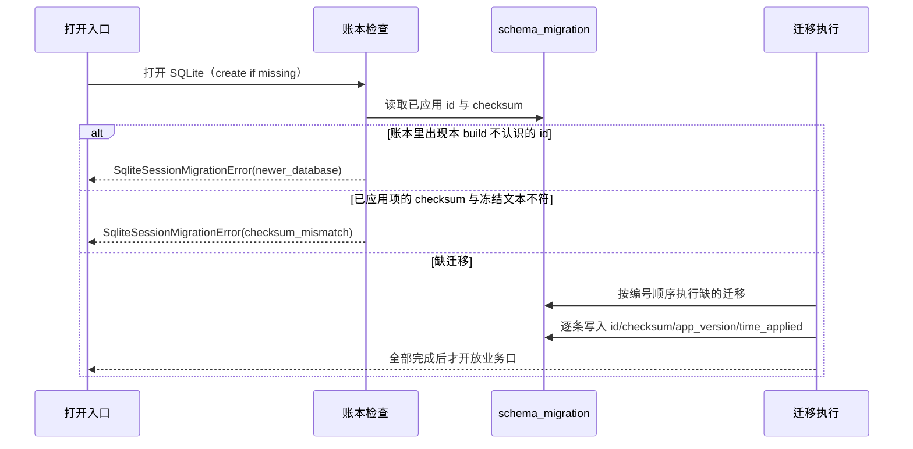

# apps-cli-packages-01 重写设计（design.md）

配套合同：`README.md`、`behavior.md`（B1–B134）、`interface.md`、`callers.md`、`known-differences.md`、
`acceptance.md`、`gate-old.json`。本合同 PR（#120）未合并时，替换分支基于合同分支；合并后 rebase 到 `main`。

## 一、重写原则

1. **按行为重写，不按旧文件一一对应**：`interface.md` 列出的 55 个模块路径与导出签名保持不变
   （外壳），内部实现重新切分；每个新文件第一行 `// SPDX-License-Identifier: Apache-2.0`，
   且每个文件 ≤ 400 行（AGENTS.md；旧文件里 `migrations.ts` 821 行 / `schema.ts` 439 行 /
   `config/index.ts` 407 行是包级 lint 的既有失败项，重写不得延续）。
2. **数据与协议零变化**：`KNORVIA_*` 键名、`.knorvia-studio` 目录、SQLite 迁移 id / SQL 文本 /
   checksum 记账、schema 字段名、逐字错误消息、诊断 code、日志事件名全部保持。
3. **门禁**：行相似度（规范化行包含率 < 0.2 且最长连续段 < 8 行）与结构相似度同时过；
   纯声明/桶文件用 `--declaration --interface interface.md` 计分。改动按
   `GATE-PLAYBOOK.md`：换模块切法、换控制流形态、换内部数据形状，注释/日志/错误文案全部重写。
4. **状态唯一所有者**（下表），没有第二份状态、没有隐藏全局状态，不用超时掩盖时序。

## 二、状态所有者

| 域           | 状态所有者                                          | 说明                                                              |
| ------------ | --------------------------------------------------- | ----------------------------------------------------------------- |
| 配置         | `ConfigPortImpl` 持有的 `ConfigStore` 实例          | 键值表 + 观察者集合；`mergeConfigs`/`parseEnv`/文件读取都是纯函数 |
| 配置来源追踪 | `createConfig()` 的返回值快照                       | 每次调用重建，不缓存                                              |
| 进程探测     | `createProcessProbe` 返回的实例                     | 「连续失败计数」；单次采样各自持有截止                            |
| 设备标识     | 模块级 `Map<statePath, Promise<string>>` + 状态文件 | 单飞 + 文件锁                                                     |
| 文件系统     | 每次调用                                            | 无跨调用状态；原子写用同目录临时文件 + `rename`                   |
| 文本窗口     | `TextLineWindow` 实例（单次 range 读）              | 行缓冲与行尾计数                                                  |
| 图片         | 每次调用                                            | 无状态；压缩阶梯是常量表                                          |
| 日志         | 工厂实例（`level`、`cleanupAdmitted`）+ 日志文件    | 写入同步追加，无内存队列                                          |
| 邮箱         | `rootDir/<sessionId>/{unread,read}` 目录            | `rename` 即已读                                                   |
| 会话存储     | SQLite 文件（`schema_migration` 账本 + 业务表）     | 迁移执行器按账本推进                                              |
| 工作流       | `rootDir/index.json` + `runs/<sanitized>/*`         | 无内存状态                                                        |

## 三、模块划分（新）

```text
adapters/src/
├── index.ts                        # 根 barrel（18 条 export *，不含 mailbox）
├── config/
│   ├── index.ts                    # 兼容外壳：ConfigPortImpl / createConfigPort + re-export
│   ├── port.ts                     # ConfigPortImpl + 内部 ConfigStore（键值+通知）
│   ├── merge.ts                    # 优先级表 + 分区合并策略表
│   ├── env.ts                      # KNORVIA_* 映射表
│   ├── project-config.adapter.ts   # 项目发现（外壳）
│   ├── project/                    # 发现 → 归一化 → patch 三步
│   ├── file-config.adapter.ts      # 原子 JSON 编辑器（外壳）
│   ├── file/                       # 路径解析、读写原语、8 个 patch 操作
│   ├── config-factory.ts           # 装配（外壳）
│   ├── factory/                    # 装配步骤 + 来源快照 + 诊断告警
│   └── schema.ts + schema/         # 分区 schema 表（外壳 + 每分区一文件）
├── context/{index.ts,git-snapshot.ts,git/,instructions/,project.ts}
├── commands/{index.ts,roots.ts,scan/,frontmatter.ts}
├── device/{process-probe.ts,process-probe-{shared,linux,darwin,windows}.ts,cli-device-mid.ts,probe/}
├── fs/{index.ts,node-file-io.ts,node-file-policy.ts,node-search.ts,ripgrep-plan.ts,
│       ripgrep-worker.ts,text-{metadata,line-window,range-reader,search-lines,search-results}.ts}
├── image/{index.ts,image-budget.ts,jimp-compression.ts,jimp-media.ts,webp-passthrough.ts}
├── logging/{index.ts,entry.ts,file-sink.ts,retention.ts,serialize.ts}
├── mailbox/index.ts
├── pdf/index.ts
├── provider/index.ts               # 空模块（导出集合为空）
├── skills/{index.ts,roots.ts,scan.ts}
├── storage/session-store.ts + storage/session-store/{migrations.ts,options.ts,rows.ts,migrations/00*.ts,ledger/}
└── workflow/index.ts
```

- 兼容外壳只做「签名 + 转发」，不含业务逻辑；业务逻辑放同目录的内部模块。
- `commands/` 与 `skills/` 共享同形状的「根发现」与「frontmatter 解析」内部实现，但各自导出
  `interface.md` 要求的名字；两者语义差异（命令按名去重、技能按路径去重；技能支持块标量、
  插件来源限定名）在各自模块里表达。
- **纯声明/桶文件**（`provider/index.ts`、`index.ts`、`session-store.ts`、`options.ts`、`rows.ts`、
  `*-roots.ts` 之外的桶）按 `--declaration` 模式计分：先剔除 `interface.md` 的兼容名再算两道门槛。

## 四、会话存储迁移的事件顺序（用户数据兼容的关键）

账本是**数据**：`0001`–`0022` 的 `id`、`appVersion`、`sql` 文本逐字不变（`sql.trim()` 的 sha256 是
记账值），只允许追加**新的最大编号**。打开数据库的顺序：



- `0041`示例：本项目只到 `0022`；新增迁移必须是 `0023_*` 且只能追加。
- 业务表只做加法（旧列与旧行必须仍可读），`tests/session-store.test.ts` 的
  `B17/B124` 往返用例锁定这一点。

## 五、B 条目落点

| 条目              | 落点模块                                                                                     |
| ----------------- | -------------------------------------------------------------------------------------------- |
| B1–B17、B122–B124 | `storage/session-store/migrations.ts`（冻结账本）+ `ledger/`（结构与校验辅助）+ 合同测试组织 |
| B18–B19           | `config/env.ts`                                                                              |
| B20–B21           | `config/merge.ts`                                                                            |
| B22–B25           | `config/port.ts` + `config/index.ts`（外壳）                                                 |
| B26               | `config/project-config.adapter.ts` + `config/project/`                                       |
| B27               | `config/index.ts` 导出面                                                                     |
| B28–B36           | `config/schema.ts` + `config/schema/`                                                        |
| B37–B47           | `config/config-factory.ts` + `config/factory/`                                               |
| B48               | 合同测试对 `owners.test.mjs` 的替换覆盖（该文件在替换阶段删除）                              |
| B49–B59           | `config/file-config.adapter.ts` + `config/file/`                                             |
| B60–B63、B70      | `context/git-snapshot.ts` + `context/git/`                                                   |
| B64–B69           | `context/index.ts` + `context/instructions.ts` + `context/project.ts`                        |
| B71–B78           | `commands/index.ts` + `commands/roots.ts` + `commands/scan/`                                 |
| B79–B86           | `device/process-probe*.ts` + `device/probe/`                                                 |
| B87               | `device/cli-device-mid.ts`                                                                   |
| B88–B94           | `image/*`                                                                                    |
| B95–B113          | `fs/*`（错误表、IO、文本、搜索）                                                             |
| B114–B121         | `logging/*`                                                                                  |
| B125              | `mailbox/index.ts`                                                                           |
| B126–B128         | `skills/roots.ts`、`skills/scan.ts`、`skills/index.ts`                                       |
| B129              | `pdf/index.ts`                                                                               |
| B130–B131         | `workflow/index.ts`                                                                          |
| B132              | `provider/index.ts`（空模块）                                                                |
| B133              | `index.ts` 根 barrel                                                                         |
| B134              | `storage/session-store.ts` barrel                                                            |
