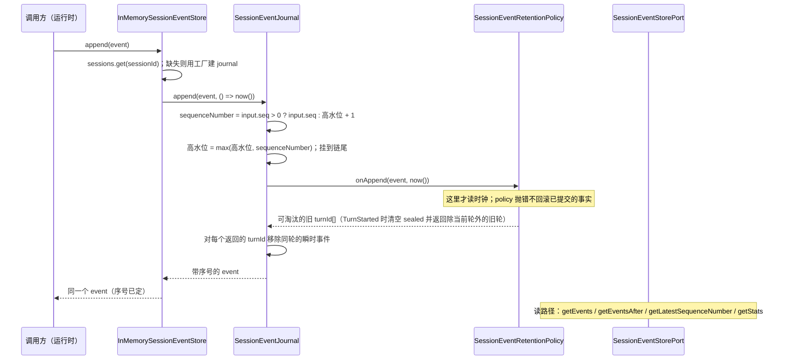
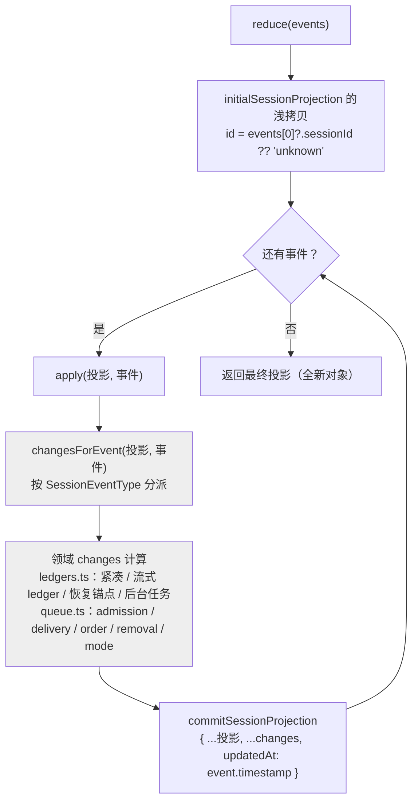

# contracts-01 替换设计（design.md）

本文件说明独立实现**怎么组织**：状态所有者、模块划分与依赖方向、事件顺序，以及 `behavior.md` 里 B1–B26 各条的落点。
它是替换实现的设计依据；行为规格以 `behavior.md` 为准，兼容面以 `interface.md` 为准。

## 1. 这个包负责什么

`@knorvia/contracts` 是 Knorvia Studio 的**契约层**：它不碰进程、文件、网络，只回答三件事——

1. 跨模块共享的**类型与取值词表**（事件、投影、端口、模型、会话存储）；
2. 一批**纯函数与 schema**（命令展开、紧凑 payload 校验、投影 changes、保留策略、媒体与路径谓词）；
3. 一个**内存事件存储**（`InMemorySessionEventStore`），它是运行时持久化实现的对照实现与测试替身。

由此得到两条边界：

- 本包**不产生外部副作用**：没有 `fs`、`http`、`child_process`、`process.env` 调用；唯一的时间来源是注入的 `now()`。
- 本包**不拥有会话业务状态**：会话事件由存储实现落盘，投影由调用方持有；本包只提供「事件 → 新投影」的纯变换。

## 2. 状态所有者

| 状态                           | 所有者                                               | 说明                                                                            |
| ------------------------------ | ---------------------------------------------------- | ------------------------------------------------------------------------------- |
| 会话事件的**持久化事实**       | 存储适配器（本包只给端口 `SessionEventStorePort`）   | `sequenceNumber` 由存储分配，从 1 单调递增                                      |
| 单会话的**驻留事件链**         | `SessionEventJournal`（每 session 一个实例）         | 序号高水位、驻留条目、被淘汰计数都只在这里；对外只交出数组投影                  |
| **保留策略**的 sealed 集合     | `SessionEventRetentionPolicy`（每 session 一个）     | `turn-window` 模式下的 sealed turn 链与首次 sealed 时间                         |
| session → journal 的**注册表** | `InMemorySessionEventStore`                          | 只做创建与删除；不缓存事件、不自己分配序号                                      |
| **投影**                       | 调用方（`EventReducer` 不持有）                      | `reduce`/`apply` 每次返回新对象；模块级只有一份 `initialSessionProjection` 模板 |
| **数据目录与默认配置**         | `config/index.ts` 的模块常量                         | 调用方不得原地修改 `DefaultRuntimeConfig`                                       |
| **模型调用上下文**             | `AsyncLocalStorage`（`model/invocation-context.ts`） | `runWithModelInvocationContext` 之外读不到上下文                                |

约束：**没有隐藏的全局可变状态**。三个类（`EventReducer`、`SessionEventJournal`、`InMemorySessionEventStore`）与两个工厂
（`createSessionEventRetentionPolicy`、`createInMemorySessionEventStore`）之外，模块级导出都是常量、纯函数或类型。

## 3. 模块划分与依赖方向

```text
                        interfaces/shared.ts        logging/logger.ts
                        （ID 品牌类型与工厂）          （级别常量与日志端口）
                                 |                          |
   capabilities/  （空占位）      |                          |
                                 v                          v
   interfaces/*.port.ts  ────────────────►  model/  compact/  config/  plugins/  hooks/
   （28 个端口：会话、存储、           │        （模型与媒体、  （紧凑边界、 （配置键与  （hook 配置与
     执行、文件、MCP、工作流…）        │          用量与上下文）    schema）    默认值）    信任状态机）
                                 v
                              events/  ◄── 事件顺序的唯一入口
        ┌────────────────────────────┼───────────────────────────────┐
        │                            │                               │
  session.events.ts            event-reducer.ts              session-event-retention.ts
  （事件枚举与 payload、          （EventReducer/reduce/apply）    （unbounded / turn-window）
    createSessionEvent）                 │                               │
        │                                v                               v
        │                     session-projection-transition.ts    session-event-journal.ts
        │                       （事件 → changes 分派）            （单 session 驻留链）
        │                          │            │                       │
        │                          v            v                       v
        │            session-projection-       session-projection-  in-memory-session-event-store.ts
        │                ledgers.ts               queue.ts            （session 注册表）
        │            （领域 changes）           （队列 changes）
        │                          │            │
        └──────────────────────────┴────────────┘
                                   v
                       interfaces/session.port.ts（SessionProjection）
```

依赖方向铁律：**`events/` 只能向下依赖 `interfaces/`、`compact/`、`model/`、`rewind/`、`tools/`、`hooks/`**，
反向依赖为零（`interfaces/` 里的端口不认识 `events/`）。`events/index.ts` 是唯一聚合出口。

包内实际依赖（替换后）：

- `commands/index.ts`、`plugins/index.ts`、`config/index.ts`、`logging/logger.ts`、`path/*`、`network/*`：只依赖类型，无跨模块运行时依赖。
- `model/index.ts` → `model/media-policy.ts`、`model/image-media.ts`、`model/model.ts`、`model/invocation-context.ts`（聚合并再导出）。
- `events/*` → `session.events.ts` / `stream-recovery.events.ts` / `compact/index.ts` / `interfaces/*` / `model/index.ts`。
- `hooks/*` → `interfaces/index.ts`；`workspace-hook-trust.ts` 与 `workspace-hook-trust-store.ts` 之间只经 schema 常量耦合。

拆包实现（相对旧文件结构的变化，属「换模块切法」，公开模块路径不变）：

| 旧结构                         | 新结构                                                                                                                                                                  | 理由                                                                                                                                                                  |
| ------------------------------ | ----------------------------------------------------------------------------------------------------------------------------------------------------------------------- | --------------------------------------------------------------------------------------------------------------------------------------------------------------------- |
| `config/index.ts`（410 行）    | 保持单文件（不拆）                                                                                                                                                      | 复核后判定：`ConfigKey` 改元组表、`DefaultRuntimeConfig` 改点分默认值表 + 归约、`ConfigScope` 改清单推导后该文件已 0.037 过线；拆文件只会把命中搬到新文件、不减少重合 |
| `hooks/index.ts`（433 行）     | 保持单文件（不拆）                                                                                                                                                      | 复核后判定：schema 去重与链式改写已把该文件压到门槛内，拆文件只会把命中搬到新文件、不减少重合；`workspace-hook-trust*` 与 `index.ts` 之间本来就是单向再导出           |
| `model/index.ts`（1061 行）    | `model/index.ts` + `ids_core` / `message-text_core` / `usage_core` / `json-schema_core` / `runtime-tables_core` / `protocol-error_core`                                 | 入口只留类型声明与再导出；运行时实现按职责拆到 `*_core.ts`，实现与兼容面分开计分                                                                                      |
| `events/*`（分派、账本、队列） | 各原路径 + `projection-event-dispatch` / `projection-ledger-changes` / `projection-queue-changes` / `session-event-journal-core` / `in-memory-session-event-store-core` | 原路径只声明名字并再导出（薄壳），真实逻辑进内部模块                                                                                                                  |

## 4. 事件顺序（events/）

### 4.1 追加一个事件



要点（对应 B16、B17）：

- **序号分配与淘汰都发生在 journal 内部**，store 只是注册表；读操作返回数组投影，不暴露链节点。
- `TurnStarted` 是「上一轮已完成」的边界：它消费掉所有 sealed 条目并返回**除当前轮以外**的旧 turnId。
- `TurnComplete` / `TurnError` 只记**首次** sealed 时间（同一 turn 重复上报不刷新），所以超时淘汰是单调的。
- 只有**瞬时事件**（`model.streaming`、`tool.call.progress`、`streaming.tool.ledger.updated`、`model.network.status`）会被淘汰；
  余下的历史事件永久驻留。`SEALED_TURN_TRANSIENT_GRACE_MS = 120000` 是淘汰宽限期，`now - sealedAt >= grace` 即到期。

### 4.2 归约一个事件（投影）



要点（对应 B14、B15、B18、B19）：

- **入参永不被改写**：`reduce` 不改写事件数组，`apply` 不改写输入投影，所有 changes 都是新对象/新数组。
- `reduce` 与 `apply` 是同一条路径（`apply` 就是单事件版 `reduce`），空数组得到 `id === "unknown"` 的初值。
- 未知事件类型返回空 changes，但**仍然 commit 一次**（推进 `updatedAt`）——冷重建与增量归约走同一条路。
- 紧凑边界：`truePostCompactTokenCount ?? postCompactTokenCount ?? contextUsed`，并写入 `lastCompact`。
- 流式 ledger：命中 `(attemptId, toolCallId)` 覆盖（**显式 `undefined` 也覆盖**），未命中追加。
- 后台任务：`started` 用字段白名单整行替换，`updated` 只覆盖**已定义**字段，`completed` 命中则覆盖、未命中追加。

## 5. B1–B26 落点

| 条目 | 落点（模块 · 导出）                                                                                                                                                     |
| ---- | ----------------------------------------------------------------------------------------------------------------------------------------------------------------------- |
| B1   | 全部 `index.ts` 的导出面（`capabilities` 允许零导出；`events`/`model`/`compact`/`config`/`hooks`/`plugins` 子入口）                                                     |
| B2   | `interfaces/shared.ts` · `createSessionId` 等 11 个工厂（前缀 + 单次调用内唯一片段；`createTraceId` 为裸 UUID）                                                         |
| B3   | `logging/logger.ts` · `LogLevel`、`LogLevelName`                                                                                                                        |
| B4   | `commands/index.ts` · `splitCustomCommandArguments`（状态表驱动分词）                                                                                                   |
| B5   | `commands/index.ts` · `expandCustomCommandTemplate`                                                                                                                     |
| B6   | `commands/index.ts` · `formatCustomCommandPrompt`                                                                                                                       |
| B7   | `commands/index.ts` · `detectUnsupportedDynamicSyntax` / `expandCustomCommandPrompt`                                                                                    |
| B8   | `commands/index.ts` · `CustomCommandScope` / `CustomCommandSource` / 诊断码类型                                                                                         |
| B9   | `compact/index.ts` · `CompactTrigger` 等 9 个常量对象                                                                                                                   |
| B10  | `compact/index.ts` · `compactBoundaryPayloadSchema` / `parseCompactBoundaryPayload`                                                                                     |
| B11  | `compact/index.ts` · `compactTimelinePayloadSchema` / `parseCompactTimelinePayload`（transform 丢 `text`）                                                              |
| B12  | `compact/index.ts` · `microcompactBoundaryPayloadSchema` / `parseMicrocompactBoundaryPayload`                                                                           |
| B13  | `compact/index.ts` · `isCompactBoundaryItem`、`buildPostCompactItems`、`getItemsAfterLastCompactBoundary`、`annotateBoundaryWithPreservedSegment`                       |
| B14  | `events/event-reducer-helpers.ts` · `initialSessionProjection`（模块求值一次，调用方不得原地修改）                                                                      |
| B15  | `events/event-reducer.ts` · `EventReducer` / `reduce` / `apply`                                                                                                         |
| B16  | `events/session-event-retention.ts` · `TRANSIENT_SESSION_EVENT_TYPES`、`SEALED_TURN_TRANSIENT_GRACE_MS`、`isTransientSessionEvent`、`createSessionEventRetentionPolicy` |
| B17  | `events/in-memory-session-event-store.ts` + `events/session-event-journal.ts`                                                                                           |
| B18  | `events/session-projection-ledgers.ts` · `commitSessionProjection` 与各领域 changes                                                                                     |
| B19  | `events/session-projection-queue.ts` · `queueAdmissionChanges` 等 5 个 changes 函数                                                                                     |
| B20  | `model/media-policy.ts` · `isProviderVisibleModelInputMediaBlock`、`getUnsupportedModelInputMediaKind`、`createUnsupportedModelInputMediaText`                          |
| B21  | `network/public-egress-ip.ts` · `normalizeIpAddressLiteral`、`getIpAddressVersion`、`getPublicEgressIpBlockReason`（网段表驱动）                                        |
| B22  | `path/git-bash.ts` · `windowsPathToGitBashPath`、`gitBashPathToWindowsPath`（规则表驱动）；`path/index.ts` 转发                                                         |
| B23  | `plugins/index.ts` + `config/index.ts` 的导出面（逐 schema 行为见 B25/B26）                                                                                             |
| B24  | `hooks/index.ts`（+ `hooks/hook-config.ts`）的导出面；逐条判定归 `specs/contracts/core-hooks`                                                                           |
| B25  | `config/index.ts` · `ConfigKey`、`ConfigScope`、`ConfigScopePriority`、`DEFAULT_MODEL_STREAM_IDLE_TIMEOUT_MS`、`DefaultRuntimeConfig`                                   |
| B26  | `plugins/index.ts` · 4 个 `KNORVIA_*` 常量与 `isOfficialMarketplaceId`                                                                                                  |

## 6. 与「内部逻辑写自己的单元测试」的对应

契约测试只走公开入口，覆盖 B1–B26。补在包内 `test/` 的单元测试瞄准**契约测试看不到的内部结构**：

- 保留策略内部链的淘汰顺序与幂等（重复 sealed、重开同一轮）；
- 事件 journal 的序号高水位（外部带入序号时的取大语义）与 `readAfter` 边界；
- 投影领域 changes 的「不改入参」逐函数复核（紧凑、ledger、后台任务、队列五类）；
- 官方 marketplace 判定矩阵、Git Bash 路径规则表、网段表与阻断 reason 的完整枚举；
- 规范声明模式下会被整块剔除的运行时部分（ID 工厂、错误工厂与 `is*PortError` 谓词、zod schema refinement）在这里兜底。

契约测试与单元测试都通过 `apps/cli/packages/contracts/test/` 被 `pnpm test:studio` 收录。
