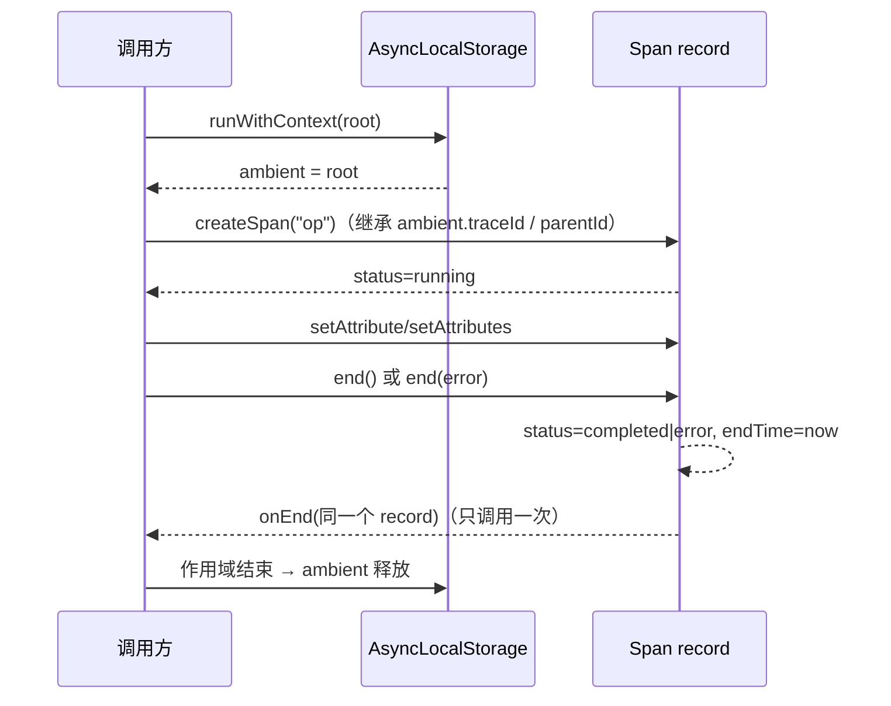
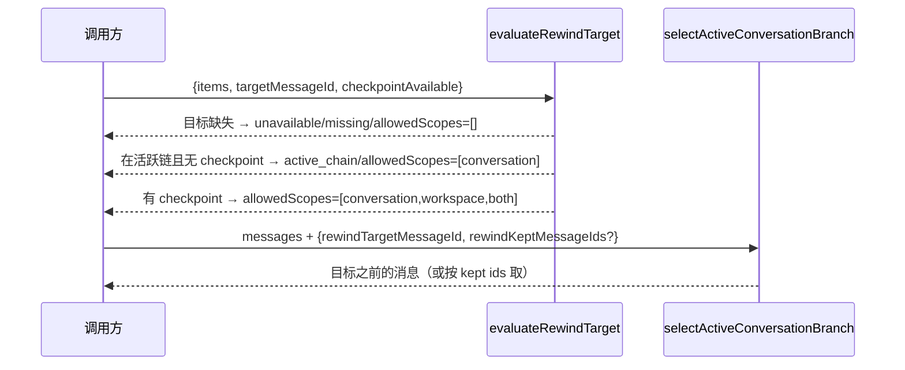

# contracts-02 设计（design.md）

替换实现的设计说明。合同（`interface.md` / `behavior.md`）是不可变部分；本文件描述**内部怎么组织**，替换阶段可以继续调整，但公开导出名与签名必须与 `interface.md` 一致。

## 1. 状态所有者

本包**不持有可变业务状态**：它是类型、schema、常量与纯函数的集合。唯一的进程内状态是追踪的 ambient 上下文。

| 状态                                              | 所有者                                           | 生命周期                                                                       |
| ------------------------------------------------- | ------------------------------------------------ | ------------------------------------------------------------------------------ |
| ambient 追踪上下文（`TraceContext`）              | `tracing/tracer.ts` 的模块级 `AsyncLocalStorage` | 由 `runWithContext`/`runWithContextAsync` 的作用域持有，作用域结束即释放（B2） |
| span 记录（`Span`）                               | span 对象自身；`onEnd` 回调只经 `WeakMap` 关联   | 创建到结算（`end()` 一次），不缓存第二份 status/attributes（B3）               |
| 其余（工具 schema、workflow schema、rewind 判定） | 无状态                                           | 纯函数/常量                                                                    |

设计约束：不给 span 增加 exporter 或事件集合（旧契约没有），`addEvent` 保持无副作用；不引入定时器、sleep 或固定超时（计划书红线）。

## 2. 模块划分

按合同的行为域拆文件，不与旧文件结构一一对应；`interface.md` 列出的模块路径必须存在并导出同名同签名的成员。

```
src/tracing/
  trace-context.ts    // TraceContext/Span/Tracer 类型 + createSpanIdentifier（B2/B3 的类型面）
  tracer.ts           // ambient AsyncLocalStorage + createTracer/runWithContext/createSpan（B2/B3）
  span-record.ts      // span 记录的创建与结算（状态机：running → completed | error）（B3）
  span-operations.ts  // setAttribute/setAttributes/end/addEvent 的实现（B3）
src/tools/
  <每个工具一个文件>   // 常量表 + zod schema + JSON schema 投影（B4–B6、B8）
  tool-registry.ts    // 工具名与 step kind 等枚举表（B8）
src/workflow/
  strategy.ts         // 策略 schema（canonical + Expert 同一对象）（B9）
  run-snapshot.ts     // 运行快照 schema（canonical + Expert 同一对象）（B9）
  <其余按合同签名>
src/rewind/
  payloads.ts         // checkpoint/rewind/artifact 三个 payload schema 与 parse*（B7）
  target-evaluation.ts// evaluateRewindTarget 判定（B7）
  active-branch.ts    // selectActiveConversationBranch 裁剪（B7）
```

组织方式与旧实现的差别（这是替换的核心，不是改名）：旧实现把常量、schema、文案、函数混在同一文件里按「工具」堆叠；新实现按**职责**分层——常量表与枚举集中、schema 与 JSON schema 投影成对出现、纯判定函数独立成模块，使每个文件只承担一种职责。

## 3. 关键数据结构

- `TraceContext`：`traceId` + `spanId` + 可选 `parentSpanId`/`parentId`/`queryId`/`sessionId`/`turnId` + `attributes` 平铺表。child 上下文的 `parentSpanId` 与 `parentId` 必须同时指向父 `spanId`（B2 断言两者）。
- `Span`：单条 record 保存 `traceId/spanId/parentId/name/startTime/endTime/attributes/status/error`；状态机只允许 `running → completed` 或 `running → error`，重复 `end()` 不改变状态（B3）。
- 工具 schema：常量表（上限/超时/描述文案）+ zod schema + `toToolJsonSchema` 投影；strict 语义必须保留（未知键被拒）。
- rewind 判定结果：`{allowedScopes, strategy, targetStatus, reason, compactBoundary?, compactBoundaryId?}`，三个枚举的取值固定（B7）。

## 4. 事件顺序（追踪与 rewind）





## 5. 每条 B 的落点

| 条目                         | 实现落点                                                               | 测试                               |
| ---------------------------- | ---------------------------------------------------------------------- | ---------------------------------- |
| B1 导出面                    | 各模块的导出（`interface.md` 驱动）                                    | `tests/api-surface.test.mjs`       |
| B2 追踪上下文                | `src/tracing/tracer.ts`（ambient + root/child 构造 + log 映射）        | `tests/behavior.test.mjs` B2 / B2b |
| B3 span 驻留                 | `src/tracing/span-record.ts` + `span-operations.ts`                    | B3                                 |
| B4 Read PDF                  | `src/tools/read-pdf.ts`（常量表 + 区间解析 + 校验）                    | B4                                 |
| B5 Read 常量/错误码          | `src/tools/read.ts`（常量表 + 错误码枚举）                             | B5                                 |
| B6 goal/target schema        | `src/tools/target.ts`（枚举 + schema + 文案函数）                      | B6                                 |
| B7 rewind                    | `src/rewind/payloads.ts` + `target-evaluation.ts` + `active-branch.ts` | B7                                 |
| B8 CreateWorkflow            | `src/tools/create-workflow.ts`（上限常量表 + schema）                  | B8                                 |
| B9 workflow canonical/Expert | `src/workflow/strategy.ts` + `run-snapshot.ts`                         | B9                                 |

## 6. 未覆盖项的实现口径

`acceptance.md` §5 列出的未覆盖项（各工具文件逐键 schema、投影函数、`workflow/script.ts` 与 `scheduler-state.ts` 常量、`evaluateRewindTarget` 其余分支）在实现时按「与旧实现接受/拒绝集合等价」自查：新实现用同一 schema 语义重写，并在替换 PR 的验收文档中逐项列出对照结果。

## 7. 桩与回退

替换过程中 `stubs/src/**` 只用于验证契约测试有效（已记录：6 个模块路径替换后 11/11 全失败）。实现完成后删除全部桩与旧文件，不留回退路径（计划书「五、接入与登记」第 1 条）。
