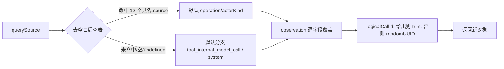

# contracts-03 设计（design.md）

替换阶段的设计记录：状态所有者、模块划分、关键数据结构、事件顺序、每条 B 的落点，以及实现约束。

## 1. 状态所有者

本包没有运行时状态：5 个文件全是**纯函数、常量表与类型**。所有权划分如下。

| 关注点                                    | 所有者                                                     | 说明                                          |
| ----------------------------------------- | ---------------------------------------------------------- | --------------------------------------------- |
| 模型 API 操作/actor/failure 取值          | `telemetry/`（常量表）                                     | 冻结面，调用方只读；不由任何调用点改写        |
| querySource → (operation, actorKind) 判定 | `resolveModelApiCallObservation`（纯函数）                 | 每次调用自行计算，不缓存、不共享可变状态      |
| `logicalCallId` 生成                      | 调用时由 `crypto.randomUUID()` 产生                        | 未给出时每次新生成；契约不承诺可重复          |
| telemetry schema 版本                     | `TELEMETRY_SCHEMA_VERSION` 常量                            | 与 `apps/cli/packages/telemetry` 的导出器共用 |
| 本地日历日                                | `formatLocalIsoDate`（纯函数）                             | 依赖进程本地时区；不读环境变量、不写全局      |
| 媒体预算取值                              | `@knorvia/shared`（`packages/shared/src/media-policy.ts`） | 本包包根只转发，不复制常量                    |
| 类型面                                    | 各模块声明                                                 | 纯编译期，无运行时所有者                      |

## 2. 模块划分（薄壳 + 内部实现）

| 公开路径（合同冻结）               | 替换后的角色                                                                                 | 内部实现                                                                                                    |
| ---------------------------------- | -------------------------------------------------------------------------------------------- | ----------------------------------------------------------------------------------------------------------- |
| `src/index.ts`                     | 包根纯再导出桶（54 个相对路径 + 5 个 `@knorvia/shared` 名字）                                | 无（只有再导出）                                                                                            |
| `src/skills/index.ts`              | 技能域的公开类型面（16 个类型）                                                              | 无（纯声明；不新增运行时值，避免改变入口命名空间）                                                          |
| `src/telemetry/agent-execution.ts` | 公开的 trace 端口与取值表：`TELEMETRY_SCHEMA_VERSION`、`AgentTelemetryOperation` + 38 个类型 | `telemetry/agent-execution_core.ts`（取值表常量）与类型分组文件                                             |
| `src/telemetry/index.ts`           | 公开面：3 张取值表 + 2 个函数 + 类型再导出                                                   | `telemetry/model-api-operations_core.ts`（表与映射）、`telemetry/model-api-observation_core.ts`（归一逻辑） |
| `src/time/local-date.ts`           | 公开面：`formatLocalIsoDate`                                                                 | `time/local-date_core.ts`（本地日历日计算）                                                                 |

约定：

- 每个新文件第一行 `// SPDX-License-Identifier: Apache-2.0`。
- 公开面文件的**导出名与类型形状**与 `interface.md` 完全一致；实现细节放在内部模块，内部模块不进 `package.json` 的 `exports`。
- 桶文件保持"只有再导出"的形态：调用方与 `dep:refs`/文本搜索看到的入口不变。
- 内部模块名带 `_core` 后缀，避免与既有 `interfaces/*.port.ts` 等命名风格冲突。

## 3. 关键数据结构

1. **取值表**（三张，对外形状是 `as const` 对象）：
   - `ModelApiOperation`：13 个语义键 → 字符串值；
   - `AgentTelemetryOperation`：13 个（键名不同）→ 相同字符串值；
   - `ModelApiActorKind`（5）、`ModelFailureExceptionKind`（7）。
     实现上改为"值列表 + 派生"或"显式元组表"，但**对外键名与取值必须逐字一致**（B2/B4 断言）。
2. **querySource 判定表**：`Map<string, {operation, actorKind}>` 形式的查找表 + 默认项；对照 `fixtures/query-source-mapping.json`（12 个具名 source + 默认分支）。
3. **observation 归一**：输入 `querySource` 与可选 `observation` → 输出 `Required<Pick<…>> & ModelApiCallObservation`；覆盖顺序为"默认判定 → observation 逐字段覆盖 → 补 `logicalCallId`"。
4. **本地日期**：从 `Date` 取本地 `getFullYear/getMonth/getDate`，月日各补零到 2 位；不使用 UTC 字段、不做时间运算。

## 4. 事件顺序

本包**没有异步、时序、并发或事件**：全部是同步纯函数与常量。因此没有事件顺序图；唯一的"顺序"是归一函数的覆盖顺序：

替换阶段不引入 sleep、超时或重试：没有 I/O，也没有跨进程边界。

## 5. 每条 B 的落点

| 条目                      | 实现位置                                                                                                            | 契约测试                                              |
| ------------------------- | ------------------------------------------------------------------------------------------------------------------- | ----------------------------------------------------- |
| B1 公开入口导出面         | `src/index.ts`（再导出结构）+ 各公开面文件                                                                          | `test/api-surface.test.mjs`                           |
| B2 取值表与恒等映射       | `telemetry/model-api-operations_core.ts`（表）、`telemetry/index.ts`（`mapModelApiOperationToAgentOperation` 薄壳） | `test/behavior.test.mjs`                              |
| B3 querySource 映射与归一 | `telemetry/model-api-observation_core.ts`、`telemetry/index.ts`                                                     | `test/behavior.test.mjs`                              |
| B4 schema 版本与 agent 表 | `telemetry/agent-execution_core.ts`、`telemetry/agent-execution.ts`                                                 | `test/behavior.test.mjs`                              |
| B5 本地 ISO 日期          | `time/local-date_core.ts`、`time/local-date.ts`                                                                     | `test/behavior.test.mjs`                              |
| B6 类型面                 | `skills/index.ts` 与 telemetry 类型分组文件                                                                         | `test/types.test.mjs`（编译期用例）                   |
| B7 `@knorvia/shared` 转发 | `src/index.ts` 的命名再导出                                                                                         | `test/behavior.test.mjs`、`test/api-surface.test.mjs` |

内部实现的单元测试放 `apps/cli/packages/contracts/test/`（如 `telemetry-internals.test.mjs`），覆盖表驱动判定与边界（空白、大小写、未命中、`logicalCallId` 空白）。

## 6. 实现约束（替换阶段自查用）

1. **相似度两道门槛**（行包含率 < 0.2、最长同段 < 8 行、结构相似度 < 0.4）对"被替换的旧文件"与"上游固定提交 `872ad960`"两侧取最大值；常量不得调整。
2. **计分模式**：`src/index.ts`、`skills/index.ts`、`telemetry/agent-execution.ts`、`telemetry/index.ts` 的声明主体与 `time/local-date.ts` 的签名行走 `--declaration --interface specs/contracts/contracts-03/interface.md`；兼容面占比与算式记入 `acceptance.md`。运行时函数体在任何模式下都不被剔除，必须真正改写（换切分、换数据结构、换注释）。
3. **`interface.md` 的导出面不得增删**：`dep:refs --list-exports` 与 `interface.md` 的交叉核对脚本要在替换后复跑，确认 5 个文件的导出名集合不变。
4. **core 的 frozen artifact receipt**：`apps/cli/packages/core/test/current-message-buffer-artifact-receipt-20261003.json` 固定了 `apps/cli/packages/contracts/src/index.ts` 的源字节与 `dist/index.{js,d.ts}` 的产物摘要。本包会改写 `src/index.ts` → **必然**改变这些摘要；按 PR #129 已获批准并在仓库有先例（commit `4bf32a33`）的做法处理：用真实构建产物重固定对应摘要 + 同步测试里的 JSON 自校验摘要，并在 PR 正文、`acceptance.md`、`known-differences.md`、`licensing/reviews.json` 的 basis/evidence 留痕，不做静默改动。
5. **不改用户数据格式、协议字段、`KNORVIA_` 环境变量、`.knorvia-studio` 数据目录**；本包本来也不碰这些。
6. **日志**：本包没有日志调用（纯函数与常量），新增实现不得引入日志或 `console`。
