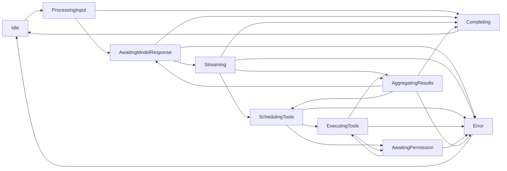

# core-01 设计（design.md）

替换阶段的设计记录：状态所有者、模块划分、关键数据结构、事件顺序、每条行为条目的落点，以及实现约束。

## 1. 状态所有者

| 关注点                       | 所有者                                                                             | 说明                                                                                   |
| ---------------------------- | ---------------------------------------------------------------------------------- | -------------------------------------------------------------------------------------- |
| 回合阶段与回合内子状态       | `TurnMachineImpl` / `TurnState`（`agent/turn-state.ts` + `agent/turn-machine.ts`） | 调用方持有 `TurnState`；machine 是状态的载体，所有方法**返回新状态、不改接收者**       |
| 消息历史与缓存统计           | `MessageHistoryImpl`（`agent/message-history.ts`）                                 | 条目数组 + `cacheStats`；`borrowReadOnlyRuntimeEntries` 返回**共享视图**（约定式只读） |
| 读文件状态快照               | 调用方传入的 `readFileState`（Map，`agent/read-file-state-hydrator.ts` 只写入）    | 水合先 `clear()`，只从持久化事实投影，不重读磁盘                                       |
| 上下文装配                   | `ContextBuilder`（`context/builder.ts`）                                           | 段列表有序；`addSection` 追加不去重；`setEnvInfo` 替换环境段                           |
| 压缩策略判定                 | 纯函数（`compact/policy.ts`）                                                      | 无状态；阈值由配置推导                                                                 |
| MCP 工具注册与结果投影       | 调用方的 registry / artifact store（`mcp/*`）                                      | 本包只做判定、投影与上限校验，不持有连接                                               |
| 遥测（telemetry 区不在本包） | —                                                                                  | 本包无遥测状态                                                                         |

## 2. 模块划分（保持 38 个公开路径不变）

替换实现**必须保留** `interface.md` 列出的模块路径与导出名；内部实现可在同文件内重组或拆到内部模块（内部模块不进 `package.json` 的 `exports`）：

| 子区域            | 文件数 | 替换策略                                                                                                                                                                                                                                                                                   |
| ----------------- | ------ | ------------------------------------------------------------------------------------------------------------------------------------------------------------------------------------------------------------------------------------------------------------------------------------------ |
| `agent`           | 11     | `turn-state`/`turn-machine` 保持"状态 + 纯推进"；`message-history` 保持实现类与工厂；`session-history-hydrator`/`read-file-state-hydrator`/`file-part-hydration`/`compact-session`/`tool-part-order`/`runtime-input-presentation`/`message-history-usage` 保持现有导出面（部分为内部可达） |
| `compact`         | 6      | `policy` 的阈值与五分支决策是兼容面；`prompt`/`manual`/`microcompact` 的文案与阈值逐字冻结；`rounds` 只被 `manual` 使用                                                                                                                                                                    |
| `context`         | 14     | `builder` 的**装配顺序**与 meta_user 组装是兼容面；`sections/*` 的标题、顺序与文案逐字冻结；`utils` 的 token 权重与除数冻结                                                                                                                                                                |
| `embedded-search` | 2      | 判定与 dialect 白名单冻结；不经公开入口（间接覆盖）                                                                                                                                                                                                                                        |
| `mcp`             | 5      | 名称 sanitize、结果投影文案、图像/帧阈值、受信与借用策略冻结                                                                                                                                                                                                                               |

## 3. 关键数据结构

1. **`TurnState`**：`phase`（10 个取值）、`streamingContent`、`toolCalls[]`（`scheduled`/`waiting_permission`/`permission_denied`/`running`/`completed`/`failed`）、`toolResults[]`、`scheduledTools{items,parallelGroups,executionOrder}`、`pendingInputs[]`、`pendingPermissions[]`/`resolvedPermissions[]`、`resultType`、`error`、`startedAt`/`completedAt`。
2. **转移表**（`canTransitionTo`）：10×10 全组合已由 A1 冻结（含原地自转与跨阶段跳转为 false）。
3. **`RuntimeMessageEntry`**：`{message, metadata?}`——**每条条目都带 `metadata` 键**（缺省 `undefined`）。
4. **`cacheStats`**：`{totalMessages, cachedMessages, lastCacheHit}`；`cacheReadTokens` **只在设置过之后才存在**（设置后清除时保留键、值为 `undefined`）。
5. **`ContextSection`**：`{name, source, injectionTarget, cacheHint, chars, tokens, content, preview}`；builder 最小配置下的顺序为 CLI Prefix → Agent Identity → Dynamic Behavior → Environment Info → Context Management。
6. **MCP 阈值**：`MCP_IMAGE_INLINE_BASE64_BYTES = 204800`、`MCP_IMAGE_INLINE_RAW_BYTES = 153600`、`HOST_NODE_REPL_IMAGE_MAX_DIMENSION = 2048`、`WINDOWS_COMPUTER_USE_MAX_IMAGE_BYTES = 8388608`、`WINDOWS_COMPUTER_USE_MAX_TEXT_BYTES = 65536`、压缩 `maxDimension = 2000`。
7. **compact 阈值**：`DEFAULT_COMPACT_CONTEXT_WINDOW = 200000`、输出预留上限 **21000**、有效窗口 **179000**、阈值 **166000**、`AUTOCOMPACT_BUFFER_TOKENS = 13000`、`MAX_CONSECUTIVE_AUTOCOMPACT_FAILURES = 3`；microcompact 保留最近 **5**、最小节省 **256**、比率 **0.9**、缓冲 **2000**、九个可清理工具名。

## 4. 事件顺序

回合推进是**同步状态机**（无 I/O、无计时器），事件顺序即"方法调用 → 返回的新状态"：

两条必须保留的 quirk（`known-differences.md` §6）：① **没有 streaming 自环**（一次模型响应只允许一次内容写入，多次到达由调用方在状态外累积）；② `startToolExecution` 把**所有非等待调用重标为 `running`**（必须在完成工具之前调用），且 `resolvePermission("allow")` 不改调用状态。

## 5. 每条行为条目的落点

| 条目   | 实现位置                                                                                                                                                                                                                                                                                                                                |
| ------ | --------------------------------------------------------------------------------------------------------------------------------------------------------------------------------------------------------------------------------------------------------------------------------------------------------------------------------------- |
| M1–M5  | `mcp/name.ts`、`mcp/result-format.ts`、`mcp/image-normalization.ts`、`mcp/index.ts`、`mcp/windows-computer-use.ts`                                                                                                                                                                                                                      |
| E1–E2  | `embedded-search/capability.ts`、`embedded-search/shell.ts`                                                                                                                                                                                                                                                                             |
| C1–C6  | `compact/policy.ts`、`compact/manual.ts`、`compact/prompt.ts`、`compact/microcompact.ts`、`compact/rounds.ts`、`compact/index.ts`                                                                                                                                                                                                       |
| X1–X13 | `context/utils.ts`、`context/sections/*`、`context/builder.ts`、`context/dynamic-sections.ts`、`context/types.ts`、`context/index.ts`                                                                                                                                                                                                   |
| A1–A15 | `agent/turn-state.ts`、`agent/turn-machine.ts`、`agent/tool-part-order.ts`、`agent/runtime-input-presentation.ts`、`agent/message-history.ts`、`agent/message-history-usage.ts`、`agent/compact-session.ts`、`agent/session-history-hydrator.ts`、`agent/file-part-hydration.ts`、`agent/read-file-state-hydrator.ts`、`agent/index.ts` |

## 6. 实现约束

1. **桩复验已通过**：`scripts/contract-gate.mjs` 在 `replace/core-01` 上复跑——源码 42/42、dist 42/42、桩替换（38 个文件）**42/42 全失败**。
2. **两道相似度门槛**（常量 0.2 / 8 / 0.4 不得调整）：实现型文件用**普通模式**；纯声明/桶文件用 `--declaration --interface specs/contracts/core-01/interface.md`（含兼容面占比算式，记入 acceptance）。比较对象为 `--old-rev origin/main` 与 `--upstream-dir cache/zcode-872ad960`，取最大值；每个新内部模块也要跑。
3. **差分探针**：对替换前后的公开导出与关键纯函数做行为差分（同一输入 → 同一输出/同一错误），差异必须为 0 或登记进 `known-differences.md`。
4. **接口面不得增删**：`dep:refs --list-exports` 与 `interface.md` 的交叉核对要在替换后复跑，确认 38 个文件的导出名集合不变。
5. **不改用户数据格式、协议字段、`KNORVIA_` 环境变量、`.knorvia-studio` 数据目录**；本包本来也不碰这些。
6. **日志**：本包没有日志调用（纯函数与状态机），替换实现不得引入日志或 `console`。
7. **每子区域一批 commit + #133 记一行**（agent → compact → context → embedded-search → mcp，或按依赖顺序）。
