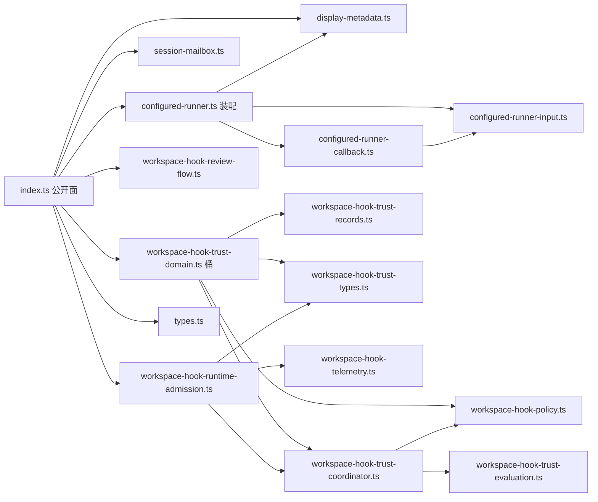
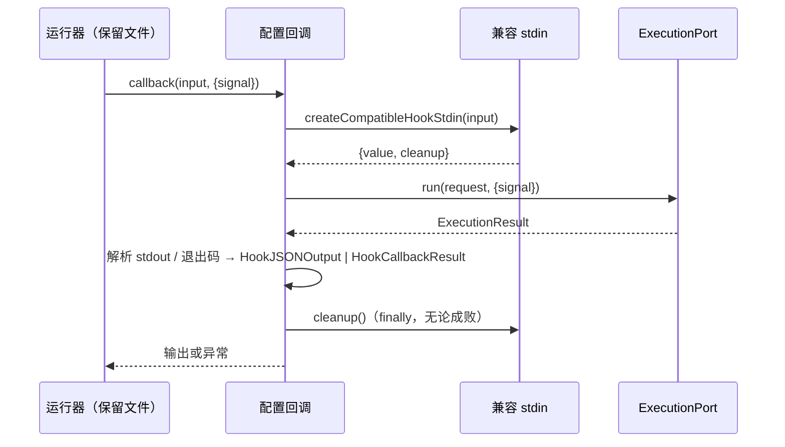
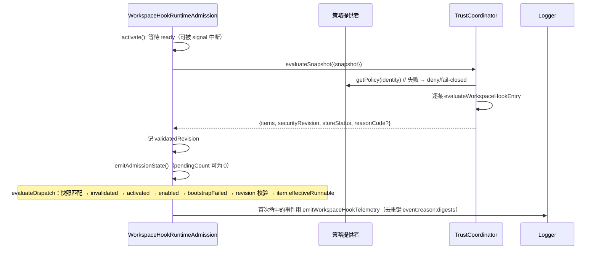

// SPDX-License-Identifier: Apache-2.0
# core-hooks 设计（替换实现，合同 v1）

本文件说明替换实现的状态所有者、模块划分、关键数据结构与事件顺序，并给出每条 B 的落点。
实现依据 `behavior.md` 的 B1..B19；`behavior.md` 附录 A 的行为由保留的已独立候选文件提供，本设计不重写。

## 1. 状态所有者

| 状态 | 所有者 | 生命周期 |
| ---- | ------ | -------- |
| 登记项列表与单次运行结果 | `InMemoryHookRunner`（保留的 `runner.ts`） | 运行器实例 / 单次 `run` |
| 配置快照（`HooksRuntimeConfig`） | 调用方（bootstrap） | 传入即只读；本包不缓存 |
| workspace 快照与准入判定 | `WorkspaceHookRuntimeAdmission` | 实例；`replaceSnapshot` 换一份 |
| 持久信任记录（内存镜像） | `WorkspaceHookTrustCoordinator` | 实例；真实文件由 adapters 的 Trust store 拥有 |
| 安全修订计数（`coordinatorEpoch` + counter） | `WorkspaceHookTrustCoordinator` | 实例；不持久化 |
| 撤销集合 | `WorkspaceHookTrustCoordinator` | 实例；重新授权时清除 |
| 策略（默认 + 按 workspace） | 策略提供者实现（`InMemoryWorkspaceHookPolicyProvider`） | 提供者实例 |
| 审核流程的当前代 | `WorkspaceHookReviewFlowRegistry` | 实例；每个 session 一份 |
| 临时 stdin 目录 | 每次回调（`createCompatibleHookStdin` 的 `cleanup`） | 单次调用 |
| telemetry 去重键 | `WorkspaceHookRuntimeAdmission` | 实例 |

本包不新增进程级单例、全局可变状态或跨运行缓存；所有状态都挂在调用方传入并在构造函数中保存的依赖上。

## 2. 模块划分（16 个被替换文件 → 8 个职责）

保留原模块路径（调用方与保留文件按这些路径导入），内部按职责重新组织：



- `types.ts`、`display-metadata.ts` 是保留的已独立候选文件（`runner*`、`output*`）通过固定路径导入的两个模块，
  签名与 `interface.md` 完全一致，内部实现按合同重写。
- `configured-runner*.ts` 三件套按「装配 → 兼容 stdin/环境 → 执行与结果解析」分层：
  装配层只产登记项，不触碰 I/O；执行层只经 `ExecutionPort` 触碰外部世界。
- 信任域四件套按「策略 → 求值（纯函数）→ 记录（纯函数）→ 协调者（状态机）」分层，
  纯函数不持有状态，协调者是唯一可变点。
- `workspace-hook-runtime-admission.ts` 是准入状态机与 telemetry 去重的所有者。
- `workspace-hook-review-flow.ts` 是审核代的唯一所有者；不持久化、不渲染。

## 3. 关键数据结构

### 3.1 信任键与修订

```ts
type TrustKey = `${string}\u0000${string}`;        // workspaceIdentity + hookDeclarationDigest
interface SecurityRevision { coordinatorEpoch: string; counter: number }
```

- `coordinatorEpoch` 构造时固定；`counter` 每发生一次影响准入的变化 +1（策略变更、记录替换、撤销）。
- `validateSecurityRevision` 只做「epoch 相等 && counter 相等」的常量时间比较，不查询外部。

### 3.2 单条求值结果

```ts
type TrustState =
  | "blocked_policy" | "blocked_untrusted" | "trusted_persistent" | "revoked" | "stale_digest" | "pending_trust";
```

判定顺序严格按 `behavior.md` B12 的表格；`admissionClass` 与 `reasonCode` 直接取
`@knorvia/contracts` 的 `WORKSPACE_HOOK_STATE_ADMISSION_MAP`，不复制判定表。
`effectiveRunnable = admissionClass === "admitted" && configuredEnabled && policy.mode !== "deny"`。

### 3.3 审核代

```ts
interface ReviewFlow {
  request: WorkspaceHookReviewRequestPayload;   // 一次性快照，不再变
  state: WorkspaceHookReviewFlowState;          // pending → resolved/superseded/timed_out/cancelled
  result: Promise<WorkspaceHookReviewOutcome>;  // 只结算一次
  timer?: NodeJS.Timeout;                        // unref
}
```

`open`/`supersede` 是仅有的两个「创建代」的入口；`validate`/`resolve`/`fail`/`closeWithoutDecision`
都先做「代匹配 → 快照匹配 → 状态 pending」三重检查，再做状态迁移。

### 3.4 配置登记项

配置到登记项的映射在装配阶段一次完成：`event`、`matcher`、`source`、`sourceKind`、`timeoutMs`、
`async`、`descriptor`、`admission`（仅 workspace 项）。执行阶段只看登记项，不再回读配置。

## 4. 事件顺序

### 4.1 配置 Hook 回调（B1/B2/B7/B8/B9）



- 先建 stdin，再执行，最后在 `finally` 清理临时目录（B19.1）。
- 退出码 2 的阻断输出、schema 校验失败的错误语义按 B9。

### 4.2 运行时准入（B14）



## 5. 每条 B 的落点

| 条目 | 实现位置 |
| ---- | -------- |
| B1 兼容 stdin | `configured-runner-input.ts`：`createCompatibleHookStdin` + transcript 写入 |
| B2 环境/变量 | `configured-runner-input.ts`：`createPluginEnvOverlay`、`expandPluginVariables`、`resolveHookTimeoutMs` |
| B3 描述元数据 | `display-metadata.ts`：`createHookExecutionDescriptor` + 引号规则 |
| B4 脱敏 | `display-metadata.ts`：`sanitizeHookDisplayText`（按顺序应用遮蔽规则） |
| B5 配置登记 | `configured-runner.ts`：`createConfiguredHookRunner` + 目录遍历 |
| B6 workspace 项与顺序 | `configured-runner.ts`：`createWorkspaceHookRegistrations` + `insertWorkspaceHooks` |
| B7 执行映射 | `configured-runner-callback.ts`：两种 `hook.type` 的 `ExecutionPort.run` 入参 |
| B8 结果解析 | `configured-runner-callback.ts`：`processHookExecutionResult` |
| B9 stdout / exit 2 | `configured-runner-callback.ts`：`parseHookStdout`、`createExitCodeBlockOutput` |
| B10 策略提供者 | `workspace-hook-policy.ts` |
| B11 协调者 | `workspace-hook-trust-coordinator.ts` |
| B12 单条求值 | `workspace-hook-trust-evaluation.ts` |
| B13 审核流程 | `workspace-hook-review-flow.ts` |
| B14 运行时准入 | `workspace-hook-runtime-admission.ts` |
| B15 telemetry | `workspace-hook-telemetry.ts` |
| B16 信任记录 | `workspace-hook-trust-records.ts` |
| B17 session mailbox | `session-mailbox.ts` |
| B18 公开面 | `index.ts`、`types.ts`、`workspace-hook-trust-domain.ts` |
| B19 平台/资源 | `configured-runner-input.ts`（临时目录）、全部模块（`node:os`/`node:path`、无 stdout 写入） |

## 6. 错误与日志语义

- 执行失败 → `CoreError(type=ToolExecutionFailed, recoverable=true)`，`context` 带 exitCode/status/预览（B8.3）。
- 变量展开缺 skill 上下文 → `CoreError(type=ConfigurationError, recoverable=true)`（B2.4）。
- 准入解析失败 → 不抛错，降级为 deny/fail-closed 策略 + `reasonCode`（B11.8）；`evaluateSnapshot` 的
  schema 失败由调用方（admission 的 `safeRefreshEvaluation`）捕获并置 `bootstrapFailed`（B14.2）。
- 日志：准入 fail-closed、Hook 失败用 `warn`；trust telemetry 用 `info`，只记摘要与 reasonCode（B15）。

## 7. 与附录 A 的边界

保留文件（`runner*`、`output*`）拥有批次计划、准入两次求值、生命周期事件、超时/取消、结果合并与 JSON 投影。
本实现只提供它们依赖的两件事：`types.ts` 的类型面与 `display-metadata.ts` 的脱敏函数，
以及被它们调用的登记项/回调。修改本实现不得改变这些调用方期望的签名。
