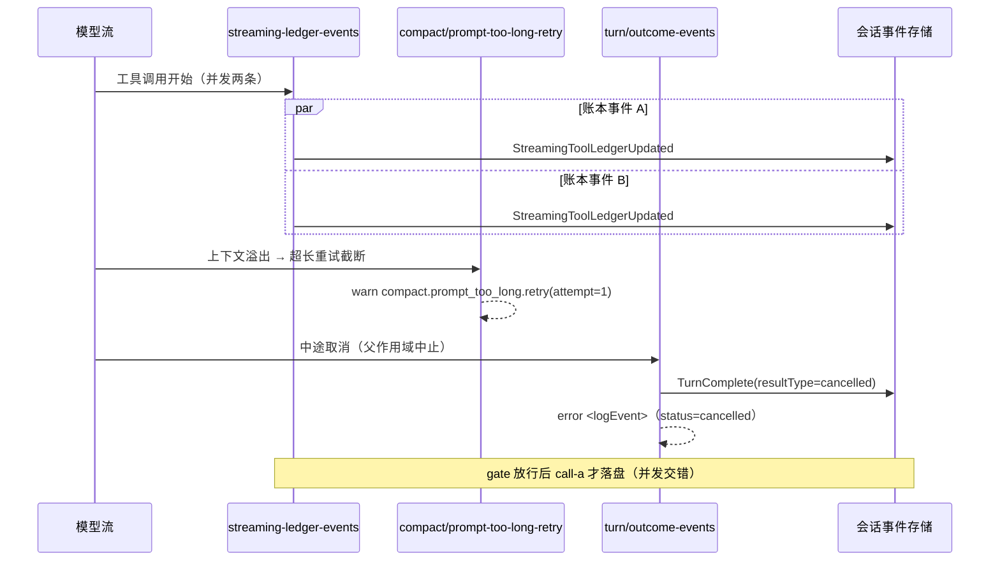

# core-runtime-helpers-01 替换设计（design.md 草稿）

## 一、约束

- **模块路径与导出面不可变**：`interface.md` 冻结了 60 个模块路径 × 316 个导出。因此每个旧路径保留为
  **薄转发模块**（只做具名 re-export / 单一构造函数转发），实现全部搬进下面的新模块并**真正改写**
  （换切法、换控制流形态、注释与日志全部自写）。
- 无共享可变状态；一切外部副作用经注入端口（文件系统、附件产物库、会话存储、执行端口、日志器）。
- 时序敏感编排内联；共享状态只读一次并向下传；不用 sleep / 固定超时。

## 二、模块划分（新切法）

| 新模块（`runtime/helpers/<新路径>`）                                                                           | 承接的行为 | 旧文件                                                             |
| -------------------------------------------------------------------------------------------------------------- | ---------- | ------------------------------------------------------------------ |
| `attachments/turn-attachment-resolver.ts`                                                                      | B1         | attachments.ts                                                     |
| `attachments/turn-attachment-summary.ts`                                                                       | B2         | attachments.ts                                                     |
| `attachments/data-url-codec.ts`                                                                                | B3         | attachment-data-url.ts                                             |
| `attachments/image-preparation.ts`                                                                             | B4         | attachment-image.ts                                                |
| `attachments/document-codecs.ts`                                                                               | B5         | attachment-pdf.ts、attachment-video.ts                             |
| `attachments/fallback-blocks.ts`                                                                               | B6         | attachment-placeholder.ts、attachment-path-reference.ts            |
| `attachments/artifact-content.ts`                                                                              | B6         | attachment-artifacts.ts                                            |
| `attachments/media-dispatch.ts` + `attachments/local-media-readers.ts` + `attachments/inline-media-readers.ts` | B7         | attachment-media-resolver.ts、attachment-media-resolver/\*         |
| `media/model-media-policy.ts`                                                                                  | B8、B9     | media-capability.ts、media-budget.ts、official-cua-media.ts        |
| `media/compact-request-placeholders.ts`                                                                        | B10        | compact-media.ts                                                   |
| `media/source-materializer.ts`                                                                                 | B11        | media-attachment-path.ts                                           |
| `media/tool-result-persistence.ts`                                                                             | B12        | tool-result-media-persistence.ts                                   |
| `media/observability.ts`                                                                                       | B13        | media-observability.ts                                             |
| `permission/capability-guards.ts`                                                                              | B14        | permission-broker.ts                                               |
| `permission/grant-marker-restore.ts`                                                                           | B15        | permission-grant-resume.ts                                         |
| `permission/subagent-request-routing.ts` + `permission/child-port-derivation.ts`                               | B16        | subagent-interaction-broker.ts、child-client-ports.ts              |
| `permission/subagent-model-resolution.ts`                                                                      | B17        | subagent-selection.ts                                              |
| `steering/input-measurement.ts`                                                                                | B18        | steering.ts                                                        |
| `steering/fork-clone.ts`                                                                                       | B19        | steering.ts                                                        |
| `runtime-reminders/prompt-builders.ts` + `runtime-reminders/read-state-replay.ts`                              | B20、B21   | runtime-reminders.ts、compact-post-reminders.ts                    |
| `session/approved-plan-file.ts`                                                                                | B22        | plan-file-continuity.ts                                            |
| `session/turn-file-diff.ts`                                                                                    | B23        | turn-file-changes.ts                                               |
| `compact/trigger-mapping.ts`                                                                                   | B24        | compact.ts                                                         |
| `compact/history-assembly.ts` + `compact/micro-compact-application.ts`                                         | B25        | compact.ts                                                         |
| `compact/entry-selection.ts` + `compact/prompt-too-long-retry.ts`                                              | B26        | compact-selection.ts                                               |
| `compact/preserved-tail.ts`                                                                                    | B27        | compact-preservation.ts                                            |
| `model/failure-classification.ts` + `model/suspicious-response.ts`                                             | B28        | model-errors.ts                                                    |
| `model/provider-business-failure.ts`                                                                           | B29        | provider-business-error.ts                                         |
| `turn/abort-scope.ts` + `turn/outcome-events.ts`                                                               | B30        | turn-errors.ts                                                     |
| `turn/model-anomaly-warnings.ts`                                                                               | B31        | model-anomaly.ts                                                   |
| `turn/tool-call-name-guard.ts`                                                                                 | B32        | model-tool-call-validation.ts                                      |
| `turn/streaming-ledger-events.ts`                                                                              | B33        | streaming-tool-ledger.ts                                           |
| `provider/request-message-pipeline.ts`                                                                         | B34        | provider-request-messages.ts、runtime-provider-request-messages.ts |
| `provider/input-presentation-projection.ts`                                                                    | B35        | provider-entry-origins.ts                                          |
| `provider/mid-conversation-system.ts`                                                                          | B36        | provider-mid-conversation-system.ts                                |
| `tooling/allowlist-rules.ts`                                                                                   | B37        | tool-allowlist.ts                                                  |
| `tooling/runtime-tooling-assembly.ts`                                                                          | B38        | runtime-tools.ts                                                   |
| `tooling/slash-command-parser.ts`                                                                              | B39        | commands.ts                                                        |
| `tooling/tool-result-formatting.ts`                                                                            | B40        | tool-result.ts、data.ts                                            |
| `session/identity-and-guards.ts`                                                                               | B41        | project.ts、data.ts                                                |
| `session/turn-input-admission.ts`                                                                              | B42        | conversation.ts                                                    |
| `session/rewind-support.ts`                                                                                    | B43        | rewind.ts                                                          |
| `session/remote-session-repair.ts`                                                                             | B44        | persisted-remote-session-path-repair.ts                            |
| `memory/project-memory-root.ts` + `memory/memory-agent-context.ts`                                             | B45        | project-memory.ts、project-memory-agent.ts                         |
| `memory/extraction-scheduling.ts`                                                                              | B46        | project-memory-extraction.ts                                       |
| `context/usage-contributors.ts`                                                                                | B47        | context-usage-breakdown.ts                                         |
| `index.ts`（桶）+ 60 个旧路径转发模块                                                                          | 接口面     | 全部旧文件                                                         |

## 三、状态所有者

| 状态                         | 唯一所有者                                 | 备注                          |
| ---------------------------- | ------------------------------------------ | ----------------------------- |
| 附件产物内容                 | `ToolArtifactStorePort`                    | 合同只依赖 URI 复用与物化回报 |
| 计划文件                     | 工作区磁盘 `<root>/.knorvia-studio/plans/` | 写入原子、读取带上限          |
| 会话记录 / 检查点 / 压缩边界 | `SessionStorePort` 与会话事件流            | 本包只读事件流做选择，不写    |
| 取消信号                     | 回合作用域（`createTurnAbortScope`）       | `dispose` 解除父监听          |
| 异常注入计数                 | 回合运行时（调用方持有）                   | 本包按引用原地更新            |
| 工具注册面                   | 运行时注册表                               | 本包只提交注册请求            |
| 记忆根                       | 配置 + 工作区（身份键）                    | 计算结果不缓存                |
| 远程路径                     | 会话存储（CAS 窄化修复）                   | 未命中只回调不覆盖            |

## 四、事件顺序

## 五、实现口径

1. 先用 `stubs/` 替换 60 个目标文件，跑契约测试**必须全失败**（证据记进 PR）。
2. 按上表逐模块实现；每个旧路径只留转发层，转发层与内部模块都必须自写（禁复制/改名/逐行改写）。
3. 每完成 1–3 个模块跑一次相似度工具（`wt/tool-m08` 的 `similarity.mjs`，`--old-rev origin/main`、
   `--upstream-dir cache/zcode-872ad960`），两道门槛同时过再继续。
4. 时序敏感处（账本事件、取消映射、压缩重试）内联，不做多余 await 边界；共享状态只读一次。
5. 每个新文件第一行 `// SPDX-License-Identifier: Apache-2.0`；为内部逻辑补自己的单元测试（黑盒契约测试不许改）。
