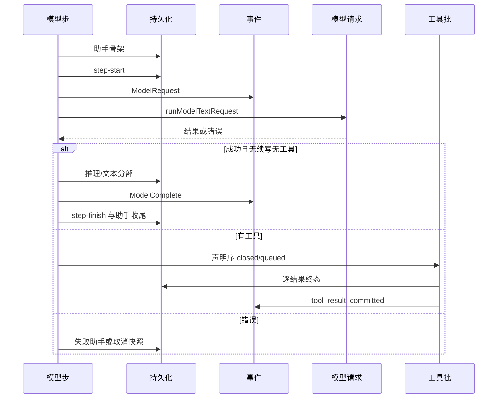

# core-runtime-methods-02 替换设计

> 目标：把 `apps/cli/packages/core/src/runtime/methods/` 的 24 个继承文件（回合模型步、工具批、
> 停止与 guide、输出续写、compact/context）换成独立实现。兼容面冻结为 interface.md 的 24 个模块
> 路径 × 98 个导出。行为以 B32–B52、S1–S5、两份金样和 KD-1/KD-2/KD-3 为准。

## 0. 不改的东西

- 24 个模块路径与导出名、参数与返回形状。
- 对象键序被测试钉死的构造（`buildTurnModelRequest` 的 17 个键、诊断日志的 `providerMetadataKeys`）。
- 错误文案、事件名、querySource 三值、续写提示词、rapid-refill 的 3/3、空工具名 `empty_tool_name`。
- `pendingStreamRecoveryRequest` 读后立即清空；`TurnMachineImpl` 接纳返回值后再写回 `state.turnMachine`。
- 相邻文件、`methods/index.ts`、methods-01 的 support 内核、契约测试与金样。

## 1. 模块划分

公开文件只做再导出。实现放在 `runtime/methods/support/m02-*.ts`，按流水线阶段而不是按旧文件切。

| 内核                  | 公开门面                                                                     | 条目                  |
| --------------------- | ---------------------------------------------------------------------------- | --------------------- |
| `m02-loop-state.ts`   | `turn-loop-state.ts`                                                         | B39                   |
| `m02-continuation.ts` | `turn-output-token-continuation.ts`                                          | B40                   |
| `m02-context.ts`      | `context-history-entries.ts`、`context-refresh.ts`、`compact-log-context.ts` | B52 侧件              |
| `m02-turn-model.ts`   | `turn-model.ts`                                                              | B38                   |
| `m02-step-usage.ts`   | `turn-model-step-usage.ts`                                                   | B36                   |
| `m02-step-records.ts` | `turn-model-step-records.ts`                                                 | B34                   |
| `m02-step-shapes.ts`  | `turn-model-step-fields.ts`                                                  | B35                   |
| `m02-step-recover.ts` | `turn-model-step-recovery.ts`                                                | B37、S5               |
| `m02-tool-parts.ts`   | 元数据、名称边界、分部三态、跟进、工具用量、告警、嵌套用量                   | B43–B48、B45–B47、B51 |
| `m02-guide.ts`        | `turn-guide-drain.ts`                                                        | B50                   |
| `m02-step-finish.ts`  | `turn-step-finish.ts`                                                        | B41                   |
| `m02-stop.ts`         | `turn-stop.ts`                                                               | B49、S4               |
| `m02-tool-batch.ts`   | `turn-tools.ts`                                                              | B42、S3               |
| `m02-step-run.ts`     | `turn-model-step.ts`、`turn-model-step-operation.ts`                         | B32、B33、S1、S2      |
| `m02-compact.ts`      | `compact.ts`                                                                 | B52、KD-3             |

`m02-record.ts` 只提供键序写入和日志出口，不出现在公开面。

## 2. 状态所有者

| 状态                                                                                      | 谁写                                                                 | 说明                         |
| ----------------------------------------------------------------------------------------- | -------------------------------------------------------------------- | ---------------------------- |
| `RegularTurnLoopState`                                                                    | 回合循环创建；本包按条目写指定字段                                   | 字段表在 `m02-loop-state.ts` |
| `modelResponse` / `modelStepCount` / `tokenCount` / `toolCallCount`                       | 模型步成功路                                                         | B33                          |
| `pendingStreamRecoveryRequest`                                                            | 模型步进入请求前清空                                                 | 一次性                       |
| `reactiveCompactAttemptedInCurrentModelStep` / `compactTracking` / 恢复后的 `turnMachine` | 反应式恢复                                                           | B37；工具批结束时 B39 清旗标 |
| `turnRequestState.entries` / `outputTokenContinuationCount`                               | 续写与 guide                                                         | B40、B50                     |
| `historyRoundCount`                                                                       | 模型史、compact 史各 +1                                              | 并行工具不按个数计           |
| `autoCompactConsecutiveFailures`                                                          | compact 成功归零、失败 +1                                            | B52                          |
| `queueAutoDrain` / `queueExternalDrainActive`                                             | 手动 compact 取消且未要求保留时关闭                                  | 与 Stop 一致                 |
| 会话模型选择                                                                              | `applySubmissionExecutionState`，且 `selectionScope !== "execution"` | B38                          |
| `stableProductStartMessageId` 与 `stableBoundaryAssistantMessageId`                       | 确定不再 continue 时成对写入                                         | B49                          |
| `automationCreateLimitReached`                                                            | 工具结果 `automation_create_limit`                                   | 之后本轮只出文本             |
| 用量账本                                                                                  | `UsageStorePort`；缺四方法则跳过；写入失败只 warn                    | B36、B45                     |

没有新增模块级可变全局。

## 3. 关键数据结构

- `StepBag`：一次模型步的锚点、trace、用量字段、协调器、快照、请求 id。阶段函数只改这个袋子和 `state`。
- `ToolBatchBoard`：声明序上的 call、part、流式结果索引。收口按声明序回放，不按完成序。
- `CompactPolicyView`：auto 与 reactive 共用的「投影消息 → token override → 调用 compactActiveConversation」骨架，两条路的事件名和跳过条件仍分开。
- 请求对象用键序表写入，避免字面量键序漂移。
- 续写判定三态：`toolCallCount > 0` 或非输出上限 → `none`；次数 `< 3` → `continue`；否则 `exhausted`。

## 4. 事件顺序

S1：steering 日志 → 助手骨架 → step-start → ModelRequest 创建与 append → 请求。
S2：诊断 → 推理分部（数组序）→ 文本 → ModelComplete → 用量 → machine 接纳 → drain → 三分支。
S3：声明循环 → schedule 两段 → queued → onBatchStart → 结果按声明序 → 嵌套用量 → completeTool → 逐结果（用量、媒体、终态、条目、checkpoint、anchor、follow-up）→ 批收尾。
S4：commit 判定 → 丢弃回滚或 step-finish → historyRound → automation / guide / stop hooks。stable 对只在 break 前写。
S5：本步已尝试过则直接 false；熔断抛错；compacted 才记成功并重建 machine。

同一次模型步内不插入额外的 await 边界去改变上述次序。Start Plan 退避的 `setTimeout(retryDelayMs)` 是 B33 规定的等待，测试不断言时长。

## 5. 条目落点

| 条目          | 实现                                                  |
| ------------- | ----------------------------------------------------- |
| B32           | `m02-step-run.ts` 的遥测包装                          |
| B33 / S1 / S2 | `m02-step-run.ts` 的准备、失败六路、成功收尾          |
| B34 / KD-2    | `m02-step-records.ts`                                 |
| B35           | `m02-step-shapes.ts`                                  |
| B36           | `m02-step-usage.ts`                                   |
| B37 / S5      | `m02-step-recover.ts`                                 |
| B38           | `m02-turn-model.ts`                                   |
| B39           | `m02-loop-state.ts`                                   |
| B40           | `m02-continuation.ts`                                 |
| B41           | `m02-step-finish.ts`                                  |
| B42 / S3      | `m02-tool-batch.ts`                                   |
| B43           | `m02-tool-parts.ts` 三态                              |
| B44           | `m02-tool-parts.ts` follow-up                         |
| B45           | `m02-tool-parts.ts` 工具用量                          |
| B46           | `m02-tool-parts.ts` 告警                              |
| B47           | `m02-tool-parts.ts` 元数据                            |
| B48           | `m02-tool-parts.ts` 名称边界与 pending                |
| B49 / S4      | `m02-stop.ts`                                         |
| B50           | `m02-guide.ts`                                        |
| B51           | `m02-tool-parts.ts` 嵌套用量                          |
| B52 / KD-3    | `m02-compact.ts` 与 `m02-context.ts`                  |
| KD-1          | 不在本包；rewind 成功载荷仍由既有 checkpoint 模块落账 |

## 6. 计分

公开门面是纯再导出，走普通模式（规范化后没有实现行）。内核走普通模式：包含率 < 0.2、最长相同行 < 8、结构 < 0.4。不使用声明模式，除非某个门面在普通模式下无法通过。
