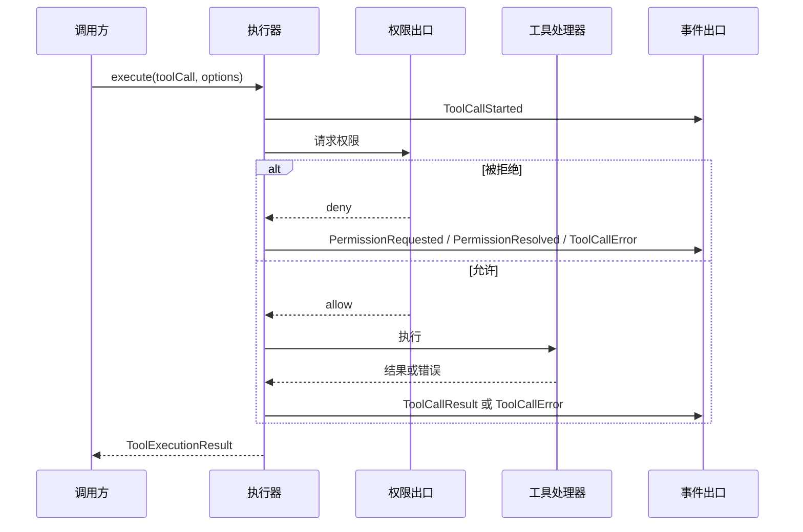
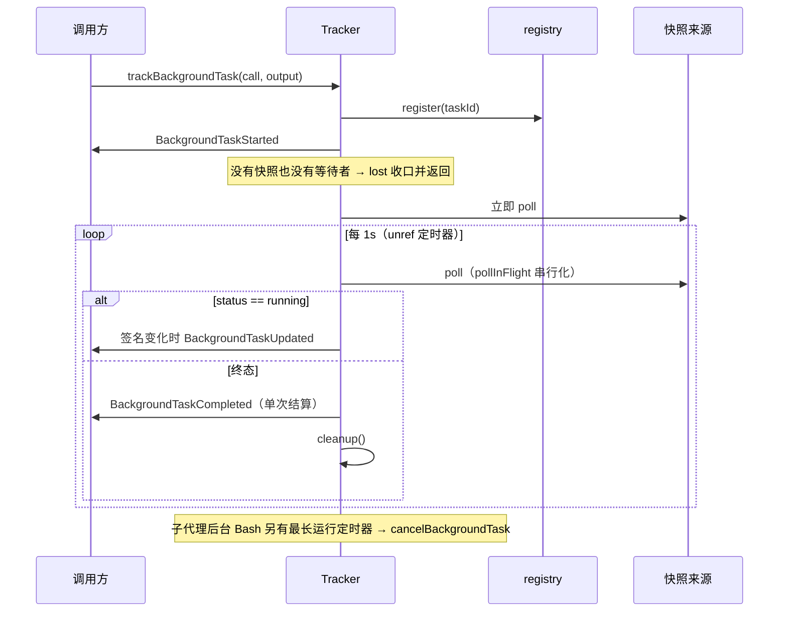

# core-tool-01 设计（design.md）

v1。替换阶段的设计说明：状态所有者、模块划分、事件顺序与每条行为（B1–B88）的落点。公开接口以 `interface.md` 为准，**模块路径与导出名不变**；内部怎么拆由本文件定。

## 1. 设计约束

- 兼容面：`interface.md` 列出的 32 个模块路径与 134 个导出声明必须继续可用，签名不变（`callers.md` 给出 228 个外部调用方）。
- 行为面：`behavior.md` B1–B88 是验收口径；`known-differences.md` K1–K3 必须保持现状。
- 相似度：两道门槛（行相似度 < 0.20 且最长连续段 < 8；结构相似度 < 0.40）对**被替换的旧文件与上游固定提交**都要过。因此**不沿用旧的函数切分与顺序**，按下面的模块划分重新组织，控制流与内部数据形状都换写法。
- 不动的部分：同目录 66 个已登记 `independent-replacement` 文件（含它们的既有缺陷）不碰。

## 2. 模块划分（新）

旧的 32 个路径保留为**兼容外壳**（导出与签名不变），实现搬到新的内部分层里；外壳只做转出，不含业务逻辑。

```text
tool/
  policy/            纯规则与取值（无 I/O、无状态）
    bash-timeout.ts          超时策略解析与夹取
    path-rules.ts            平台路径规范化、工作目录/工作区解析
    visibility.ts            工具名别名、白名单、禁用规则、webfetch 预授权
    edit/                    编辑匹配：距离、转义展开、引号、候选选择
  projection/        只做形状转换（纯函数）
    model-contract.ts        工具模型契约投影
    provider-order.ts        供应商可见顺序
    read-state.ts            读取状态键、元数据、最新条目选择
    background-view.ts       后台任务快照/负载/事件投影
    workflow-artifacts.ts    已发布产物的模型面投影
  executor/
    assembly.ts              执行器装配（deps 归一化、回退链）
    call-pipeline.ts         单次调用：权限 → 执行 → 结果/错误
    batch-pipeline.ts        批次与调度
    events/                  事件出口（按事件族拆分）
    telemetry.ts             遥测包装
    turn-control/            回合控制（自动化上限、计划退出、终止工具、工作流细化）
    background/              后台任务：注册、轮询、通知、收口
  types/             类型与常量（纯声明）
```

对应关系（旧路径 → 新实现位置）：

| 旧模块路径                                         | 新实现位置                                                 |
| -------------------------------------------------- | ---------------------------------------------------------- |
| `tool/bash-timeout-policy.ts`                      | `tool/policy/bash-timeout.ts`                              |
| `tool/compat.ts`                                   | `tool/policy/visibility.ts`（子代理派发名与 hook 别名表）  |
| `tool/diff.ts`                                     | `tool/policy/edit/patch.ts`                                |
| `tool/edit-match-distance.ts`                      | `tool/policy/edit/distance.ts`                             |
| `tool/edit-match-text.ts`                          | `tool/policy/edit/escaping.ts`                             |
| `tool/edit-matchers.ts`                            | `tool/policy/edit/matchers.ts`                             |
| `tool/model-contract.ts`                           | `tool/projection/model-contract.ts`                        |
| `tool/path-normalization.ts`                       | `tool/policy/path-rules.ts`                                |
| `tool/path-policy.ts`                              | `tool/policy/path-rules.ts`                                |
| `tool/provider-visible-order.ts`                   | `tool/projection/provider-order.ts`                        |
| `tool/read-file-state.ts`                          | `tool/projection/read-state.ts`                            |
| `tool/read-file-state-metadata.ts`                 | `tool/projection/read-state.ts`                            |
| `tool/tool-visibility.ts`                          | `tool/policy/visibility.ts`                                |
| `tool/webfetch-preapproved.ts`                     | `tool/policy/visibility.ts`                                |
| `tool/types.ts`                                    | `tool/types/`（按域拆分，导出名不变）                      |
| `tool/index.ts`、`tool/executor.ts`                | 兼容外壳（转出）                                           |
| `tool/executor/impl.ts`                            | `tool/executor/assembly.ts`                                |
| `tool/executor/types.ts`                           | `tool/types/executor.ts`                                   |
| `tool/executor/events.ts`                          | `tool/executor/events/`（按事件族拆分）                    |
| `tool/executor/telemetry.ts`                       | `tool/executor/telemetry.ts`                               |
| `tool/executor/turn-control.ts`                    | `tool/executor/turn-control/`                              |
| `tool/executor/model-status-sink.ts`               | `tool/executor/events/model-status.ts`                     |
| `tool/executor/memory-file-permission.ts`          | `tool/policy/memory-permission.ts`                         |
| `tool/executor/background-tasks.ts`                | `tool/executor/background/tracker.ts`                      |
| `tool/executor/background-task-registry.ts`        | `tool/executor/background/registry.ts`                     |
| `tool/executor/background-task-output.ts`          | `tool/executor/background/output.ts`                       |
| `tool/executor/background-tracker-notification.ts` | `tool/executor/background/notification.ts`                 |
| `tool/executor/background-tracker-projection.ts`   | `tool/projection/background-view.ts`                       |
| `tool/executor/utils.ts`                           | `tool/executor/events/` 与 `tool/projection/` 内的局部助手 |
| `tool/executor/workflow-artifact.ts`               | `tool/projection/workflow-artifacts.ts`                    |
| `tool/executor/workflow-published-artifacts.ts`    | `tool/projection/workflow-artifacts.ts`                    |

## 3. 状态所有者

| 状态                                                                                                | 所有者                                   | 生命周期                                | 说明                                                                                            |
| --------------------------------------------------------------------------------------------------- | ---------------------------------------- | --------------------------------------- | ----------------------------------------------------------------------------------------------- |
| `readFileState`（读取状态表）                                                                       | 执行器实例（`deps.readFileState`）       | 与执行器同寿                            | 缺省时每个执行器一个 `Map`，跨调用共享（B1）                                                    |
| 后台任务追踪（`stopped` / `pollInFlight` / `terminalPublishing` / `lastRunningSignature` / 定时器） | `BackgroundTaskTracker` 的单个追踪闭包   | 从 `trackBackgroundTask` 到 `cleanup()` | 每个 taskId 一份；`cleanup()` 清 interval 与最长运行定时器并从 `trackedTaskIds` 删除（B60–B67） |
| `trackedTaskIds`                                                                                    | `BackgroundTaskTracker` 实例             | 与 tracker 同寿                         | 只做去重；`lost` 路径与 `cleanup()` 都会移除（B60/B63）                                         |
| runtime task registry                                                                               | `deps.runtimeTaskRegistry`（调用方注入） | 调用方决定                              | tracker 只读改写，不拥有（B74–B78）                                                             |
| 通知认领（`notified`）                                                                              | registry 条目                            | 条目生命周期                            | 认领是「读改写」，释放是幂等复位（B78）                                                         |
| 回合控制信号（stop turn / follow-up）                                                               | 事件出口的返回值                         | 单次事件                                | 纯函数式判定，不落状态（B10–B13）                                                               |
| 模型状态 sink                                                                                       | 执行器 deps（缺省 sink 由事件出口提供）  | 与执行器同寿                            | 调用方给了 sink 就不覆盖（B15）                                                                 |

事件顺序（单次工具调用）：



后台任务追踪（轮询与收口）：



## 4. 每条行为的落点

| 行为    | 落点（新模块）                                                            |
| ------- | ------------------------------------------------------------------------- |
| B1–B4   | `executor/assembly.ts` + 兼容外壳 `tool/executor.ts`、`tool/index.ts`     |
| B5–B15  | `executor/events/**`、`executor/turn-control/**`、`executor/telemetry.ts` |
| B16–B18 | `projection/background-view.ts`、`policy/visibility.ts`                   |
| B19–B20 | `policy/memory-permission.ts`                                             |
| B21–B23 | `projection/workflow-artifacts.ts`、`projection/background-view.ts`       |
| B24–B29 | `policy/bash-timeout.ts`、`policy/visibility.ts`、`policy/edit/patch.ts`  |
| B30–B39 | `policy/edit/**`                                                          |
| B40–B41 | `projection/model-contract.ts`                                            |
| B42–B45 | `policy/path-rules.ts`                                                    |
| B46     | `projection/provider-order.ts`                                            |
| B47–B53 | `projection/read-state.ts`                                                |
| B54–B58 | `policy/visibility.ts`                                                    |
| B59     | 兼容外壳 `tool/index.ts`                                                  |
| B60–B67 | `executor/background/**`                                                  |
| B68–B72 | `projection/workflow-artifacts.ts`                                        |
| B73–B78 | `executor/background/registry.ts`                                         |
| B79–B84 | `projection/background-view.ts`                                           |
| B85–B86 | `executor/background/notification.ts`                                     |
| B87     | `projection/workflow-artifacts.ts`                                        |
| B88     | 兼容外壳的导出面（`interface.md` 对照）                                   |

## 5. 事件顺序与并发

- 单次调用的事件顺序见上面的时序图；`ToolCallStarted` 必须先于任何结果/错误事件，权限三件套（Requested/Resolved/Denied）在权限路径上按 B8/B9 的顺序与字段出现。
- 后台追踪：`pollInFlight` 保证同一时刻只有一个 poll 在飞；interval 与「立即 poll」共用这一把锁；`publishTerminal` 用 `terminalPublishing` 做单次结算，`stopped` 在事件之后才置真（事件失败不会静默停止追踪）。
- 取消/失败：等待者拒绝写 `warn` 且**有快照来源时不停追踪**；轮询读快照失败写 `warn` 且继续；子代理后台 Bash 超过最长运行时间写 `warn` 并调用 `cancelBackgroundTask`，取消失败再写 `warn`，都不向外抛。
- 实现里**不用 sleep 或固定超时凑时序**；契约测试用 `node:test` 假定时器驱动（`tests/deps-and-timers.test.ts`）。

## 6. 纯声明文件的处理

`tool/types.ts` 与 `tool/executor/types.ts` 是纯声明文件：相似度按 `interface.md` 先剔除兼容名字所在行，再算门槛。拆分时保持导出名与签名，只重排分组与内部组织，不引入实现逻辑。

## 7. 验收口径

见 `acceptance.md` 第 6 节：桩覆盖后契约测试 0/81 通过（已实测）→ 按合同实现 → 两入口 81/81 → 删桩 → 两道相似度门槛 → 接入门禁 → 登记与文档。
