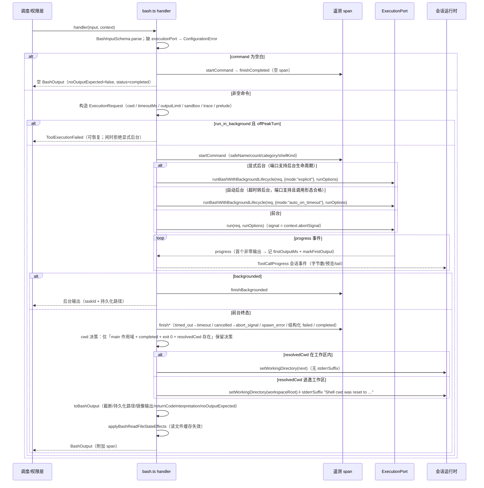

# core-tool-handlers-bash-01 替换设计（design.md v1）

对应合同 v1（`README.md`）。分支 `replace/core-tool-handlers-bash-01`，基线 origin/main `62c62f34`（含合同 PR #161）。本文件描述替换实现的模块重组、状态所有者、bash 执行事件顺序、行为条目落点与只读规则表重建方案（选择 9）；实现按簇推进，簇末与本文件保持一致。

## 1. 模块重组

**不变量**：`interface.md` 列出的 38 个模块路径与 209 个导出全部保留、签名不变（接口默认不可变）；`index.ts` 桶、workflow 簇、`-02` 簇、`generated/bash-command-registry.ts` 不在本包范围，不触碰。

**原则**：不沿用旧文件的函数切分与顺序。公开路径按兼容面保留，实现按「判定管线阶段 / 命令族」重新组织；旧路径里只留签名与转发，重型实现与数据表搬进两个新的内部目录（实施完成后的最终清单）：

```text
apps/cli/packages/core/src/tool/handlers/
  bash-rules/                  ← 新：只读规则表内部实现（按命令公开文档重组）
    policy-shapes.ts           策略形状（SafeFlagValue 语义说明；类型兼容声明块上移到公开壳）
    env-gates.ts               env 赋值/重定向/UNC 闸门
    wrapper-peeling.ts         command/builtin/noglob 包装剥离
    direct-shape-gates.ts      直接判定（find 写选项、printf 格式、定长参数命令、docker 前缀）
    git-subcommand-gates.ts    git 全局旗标消毒 + 子命令族最长前缀匹配
    main-chain.ts              判定主链（闸门 → 直接判定 → 多词 → 简单命令族）
    flag-walker.ts             safeFlags 画像的单遍历消费器
    flag-builder.ts            画像紧凑声明器（开关串 + 带值对）
    danger-checks.ts           非 git 命令族危险性复核（jq/sed/date/ps/man/lsof/tput/ss/test/xargs/gh/docker）
    git-danger-checks.ts       git 族危险性复核（format 签名/reflog/ls-remote/remote show/tag/branch）
    families/
      plain-commands.ts        简单命令族数据（git 全局旗标、观察类集合、单命令画像表）
      text-flags.ts            文本工具族画像（cat/grep/rg/sed/jq/file/tree/xargs/head-tail/wc）
      file-flags.ts            文件检查与系统信息族画像（fd/sort/base64/摘要和/date/hostname）
      git-flags.ts             git 展示预设 + log/diff/show/grep/status 专属画像
      process-flags.ts         进程/网络/容器/测试族画像（ps/pgrep/lsof/ss/netstat/man/tput/test/docker/gh 旗标组）
      git-subcommand-core.ts   git 只读子命令（查询与内容检视族）
      git-subcommand-history.ts git 只读子命令（历史与远端信息族）
      multiword.ts             docker 与 gh auth 多词前缀
      gh-multiword.ts          GitHub CLI 查询族多词前缀
      entry-builder.ts         子命令条目声明器（前缀 + 画像 + 可选复核）
  bash-exec/                   ← 新：执行簇内部实现（按管线阶段组织）
    command-analysis.ts        基于 unbash AST 的命令段分析（动态成分/重定向/操作符标注）
    rule-evaluation.ts         bash 权限规则求值
    permission-policy.ts       权限规则策略（授权计划派生 + 装配）
    action-folding.ts          稳定动作前缀折叠（包装剥离 + Fig 注册表下钻）
    background-lifecycle.ts    后台生命周期能力判定
    gh-reminder-text.ts        gh 限流识别信号与提醒文案
    handler-run.ts             执行编排（空命令短路/分派/cwd 跟随/投影串联）
    tool-profile.ts            工具画像（只读能力、超时预算、schema 定制、描述）
    command-span.ts            命令 span 遥测（开启/终态收尾/分类）
    request-build.ts           ExecutionRequest 构造 + ToolCallProgress 事件转发
    read-state-effects-util.ts read-state 效果辅助（trace/mtime/提示文案/记录组装）
```

**公开路径的三种角色**（替换后）：

| 角色       | 路径                                                                                                                                                                                              | 做法                                                     |
| ---------- | ------------------------------------------------------------------------------------------------------------------------------------------------------------------------------------------------- | -------------------------------------------------------- |
| 判定管线   | `bash-readonly-policy.ts`、`-argv.ts`、`-argv-flags.ts`、`-argv-direct.ts`、`-argv-git.ts`、`-argv-io.ts`                                                                                            | 重写实现（阶段顺序重排、表驱动），可调用 `bash-rules/`    |
| 数据转发   | `-commands.ts`、`-simple-commands.ts`、`-flags.ts`、`-flags-text.ts`、`-flags-file.ts`、`-flags-git.ts`、`-flags-process.ts`、`-git-subcommands-core.ts`、`-git-subcommands-history.ts`、`-multiword-core.ts`、`-multiword-gh.ts`、`-callbacks.ts`、`-git-callbacks.ts` | 导出名/类型保持，内容来自 `bash-rules/` 重建数据          |
| 类型声明   | `-types.ts`                                                                                                                                                                                        | 兼容声明块唯一集中点（M1 复盘硬要求②）                   |

执行簇（18 文件）按管线阶段重写：**解析**（`bash-command-parser.ts`，继续以 npm 依赖 `unbash` 的 AST 为语法事实来源，节点分类与提取逻辑重写）→ **判定/求值**（`bash-semantics.ts`、`bash-command-rule-evaluator.ts`、`bash-command-permission-policy.ts`）→ **投影/格式化**（`bash-output.ts`、`bash-model-content.ts`、`bash-metadata.ts`、`bash-prompt.ts`）→ **生命周期/IO**（`bash.ts`、`bash-background-*.ts`、`bash-cwd-policy.ts`、`bash-git-runtime-safety.ts`、`bash-gh-rate-limit.ts`、`bash-image-output.ts`、`bash-read-file-*.ts`）→ **遥测助手**（`tool-perf.ts`）。超过约 250 行的实现拆入 `bash-exec/` 内部模块，公开文件保留导出面（单文件 ≤400 行，AGENTS 规则）。

## 2. 状态所有者

| 状态                                   | 唯一所有者                        | 写点                                                                              | 备注                                   |
| -------------------------------------- | --------------------------------- | --------------------------------------------------------------------------------- | -------------------------------------- |
| gh 限流提示冷却时间戳                   | `bash-gh-rate-limit.ts` 模块级    | 仅命中（gh 命令 + 限流输出）的那一次调用写入；其后冷却期内直接返回 undefined        | 单进程语义；B-ex-21 事件序列断言        |
| 命令 span 遥测（start/finish*）        | `bash.ts`（经 `context.telemetry`）| handler 内唯一调用点；`tool-perf.ts` 只提供纯助手                                 | 不在投影层写 span                      |
| 进度计时 firstOutputMs                 | 每次执行的局部 `BashProgressTiming` | `onEvent` progress 首个非零输出事件一次写入                                     | 无跨执行共享                           |
| 读文件状态表失效                       | `bash-read-file-state.ts`         | 命令完成后单点调用（`applyBashReadFileStateEffects`），经状态端口失效缓存          | 端口替身单测覆盖                        |
| 工作目录                               | 会话运行时（`context.setWorkingDirectory`） | `bash.ts` 只在 cwd 决策给出 `nextWorkingDirectory` 时调用一次           | bash 侧不自持 cwd 状态                  |

除上表外全部为纯函数：无隐藏全局状态、无模块级可变缓存（multiword 前缀排序缓存属惰性纯派生数据，保持只读）。

## 3. bash 执行事件顺序



**退出码与终止语义**（`interpretBashReturnCode`，判定顺序即上表顺序）：`error.type==="output_limit"` → "Command stopped because output exceeded the configured limit"；`timed_out` → "Command timed out"；`cancelled` → "Command was cancelled"；`spawn_error` → "Command failed to start"；非零退出码 → 先查退出码 1 的语义化非错误读数（末段命令为 grep 族/git grep → "No matches found"，diff → "Files differ"，test/[ → "Condition is false"，find → "Some directories were inaccessible"），否则 "Command exited with code N"；退出码 0 且带信号 → "Command exited due to signal SIG"；否则 undefined。`isBashProviderErrorStatus` 仅在 `status==="failed"` 且退出码为非零数字且读数非语义化时报错。

**超时/取消的资源语义**：超时与取消都由执行端口按 `ExecutionRunOptions.signal` 与端口内部终止（kill）完成；bash 侧只负责传播终态与遥测收尾，不自建定时器、不用 sleep/固定超时凑时序（AGENTS 规则）。

## 4. 行为条目落点（B-ro / B-ex → 实现模块）

| 条目                | 实现模块                                                                                  |
| ------------------- | ----------------------------------------------------------------------------------------- |
| B-ro-1..9（简单/内建/glob/管道/链/重定向/子shell/sudo/xargs） | `bash-semantics.ts`（入口）+ `bash-rules/plain-gates.ts`、`bash-rules/families/shell.ts` |
| B-ro-10..14（git/就地/gh/docker 多词）          | `bash-rules/git-subcommands.ts`、`bash-rules/danger-checks.ts`、`bash-rules/families/{git,gh,docker}.ts`、`bash-rules/multiword-matcher.ts` |
| B-ro-15（进程/运行时/包/网络/文件系统/数据库）  | `bash-rules/families/process-net.ts`、`bash-rules/families/files.ts`                       |
| B-ro-16..17（总量性、sed -i）                   | `bash-semantics.ts` + `bash-rules/danger-checks.ts`（isSedInPlaceOption）                  |
| B-ro-18（夹具 30 条）                           | 同 B-ro 主链（`fixtures/read-only-baseline.json` 驱动）                                    |
| B-ex-1..3（静默判定）      | `bash-semantics.ts`                                                                        |
| B-ex-4..7（退出码解读/判错）| `bash-semantics.ts`                                                                        |
| B-ex-8..12（解析/权限安全） | `bash-command-parser.ts`                                                                   |
| B-ex-13..14（规则求值）    | `bash-command-rule-evaluator.ts`                                                           |
| B-ex-15..17（cwd 策略）    | `bash-cwd-policy.ts`                                                                       |
| B-ex-18..20（git 运行时安全）| `bash-git-runtime-safety.ts`                                                              |
| B-ex-21（gh 限流提示）     | `bash-gh-rate-limit.ts`                                                                    |
| B-ex-22..24（元数据）      | `bash-metadata.ts`                                                                         |
| B-ex-25..26（输出/模型内容）| `bash-model-content.ts`                                                                    |
| B-ex-27..28（性能 span）   | `bash-output.ts`（+ `tool-perf.ts` 纯助手）                                                |
| B-ex-29（provider 描述）   | `bash-prompt.ts`                                                                           |
| B-ex-30（自动后台资格）    | `bash-background-policy.ts`                                                                |
| B-ex-31（工具入口声明）    | `bash.ts`                                                                                  |
| B-ex-32..39（性能助手）    | `tool-perf.ts`                                                                             |

**IO 重路径的补充覆盖**（合同「未覆盖」节）：`bash.ts` 执行路径、`toBashOutput`、`bash-image-output.ts`、`bash-read-file-*.ts`、`bash-background-lifecycle.ts`、`resolveBashPermissionRulePolicy` 以**端口替身 + 包内单元测试**覆盖（`apps/cli/packages/core/test/` 下新增 bash 专项单测），不依赖真实 spawn/写盘。

## 5. 只读规则表重建方案（选择 9）

1. **数据来源**：各命令的公开文档（git、GitHub CLI、docker、coreutils、grep/rg、jq、ss/lsof/ps、psql 等官方手册与 `--help`），按「命令族 → 只读选项白名单 → 危险性回调 → 多词前缀策略」四要素重新组织；**不照搬旧表的分组、条目顺序与文件边界**。判定结果以合同样例为验收 oracle：`tests/bash-readonly.test.ts` 90 条主基线 + `fixtures/read-only-baseline.json` 30 条边界基线，两入口必须全过。
2. **结构选择**：旧表 20 文件按「文本工具 / 文件检查 / git / gh / docker / 进程与网络 / shell 内建 / 多词前缀」分族落入 `bash-rules/families/`；消费端 `flag-walker.ts` 用单一遍历函数解释 `SafeFlagValue`（none/string/number/char/{}/EOF/optionalString），替代旧的分散判断；多词匹配用「前缀词数优先」的数据驱动匹配器。
3. **语义常量逐条落实**（playbook M 节）：白名单/上限/宽限逐条对照 `behavior.md` 落实；`XARGS_TARGET_COMMANDS` 等公开文档可核的安全目标集合保持导出；lint 的 unused 常量告警按行为回归警报处理。
4. **K-ro-1..4 判定语义原样保留**（红线，不得顺手「修正」）：
   - K-ro-1 `:` 不入只读内建表 → 判非只读；
   - K-ro-2 `git clean -n` 仍判非只读（`git clean` 整体非只读，不因干跑豁免）；
   - K-ro-3 `ps` 入只读表、`top` 不入 → `top` 判非只读；
   - K-ro-4 `xargs`：win32 上 argv 求值返回 undefined → 一律非只读；POSIX 上仅安全目标（`XARGS_TARGET_COMMANDS`：echo/wc/grep/head/tail 等）判只读，危险目标（rm 等）判非只读；断言按 `!IS_WIN32` 取平台期望。

## 6. 实施簇（每簇 3–7 文件，簇内 fmt → 契约双入口 → normal+decl 双门 → lint/tsc → 小步提交）

| 簇 | 文件                                                                                  | 主题                     |
| -- | ------------------------------------------------------------------------------------- | ------------------------ |
| C1 | `-types`、`-argv-io`、`-argv-direct`、`-argv-git`                                     | 规则管线：类型 + 闸门    |
| C2 | `-readonly-policy`、`-argv`、`-argv-flags`、`-commands`、`-simple-commands`           | 规则管线：判定链 + 简单命令表 |
| C3 | `-callbacks`、`-git-callbacks`、`-flags`、`-flags-text`、`-flags-file`                | 危险回调 + 文本/文件安全旗标 |
| C4 | `-flags-git`、`-flags-process`、`-git-subcommands-core`、`-git-subcommands-history`   | git/进程族数据           |
| C5 | `-multiword-core`、`-multiword-gh`、`bash-semantics`                                  | 多词表 + 语义判定入口    |
| C6 | `bash-command-parser`、`bash-command-rule-evaluator`、`bash-command-permission-policy` | 解析与权限规则           |
| C7 | `bash-cwd-policy`、`bash-git-runtime-safety`、`bash-gh-rate-limit`、`bash-background-policy`、`bash-background-lifecycle` | 生命周期小模块           |
| C8 | `bash-metadata`、`bash-model-content`、`bash-output`、`bash-prompt`、`bash-image-output` | 投影/格式化/遥测 span    |
| C9 | `bash-read-file-sources`、`bash-read-file-state`、`bash.ts`、`tool-perf`              | IO + 入口 + 性能助手     |

## 7. 门禁与证据

- 契约测试（源码 + dist 双入口，43 例）：`node <node24> scripts/contract-gate.mjs --contract specs/contracts/core-tool-handlers-bash-01 --env KNORVIA_ENV=test --env TSX_TSCONFIG_PATH=<abs>/packages/ui/tsconfig.json --dist-loader specs/contracts/core-tool-handlers-bash-01/dist-entry-loader.mjs --json <out>`。
- 相似度双门（normal + `--declaration`，未过计数取并集）：`scripts/provenance/similarity.mjs`（本工作树自带口径），upstream 基线 `cache/zcode-872ad960`（872ad960de7ec172591f7e1952f7849229f94521）。
- 桩全失败留证：`.scratch-exec2/br-gate-stubfail.json`（commit 62c62f34，source 43/43、dist 43/43、38 桩替换后 0 通过 allFail=true）。
