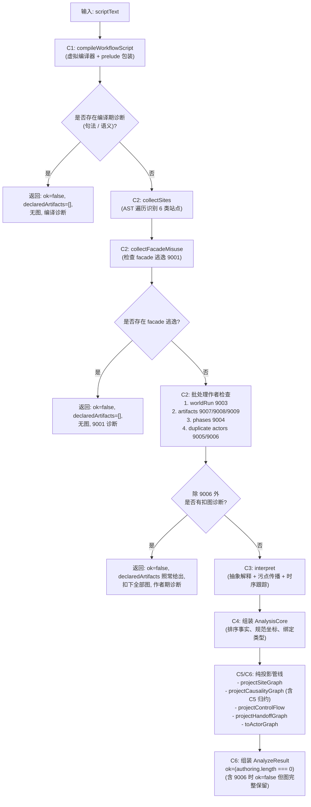

# dynamic-workflow-01 替换设计（design.md）

// SPDX-License-Identifier: Apache-2.0

本文档描述 `dynamic-workflow-01` 合同范围（53 个重写目标文件，位于 `apps/cli/packages/dynamic-workflow/src/analysis/*.ts` 与 `src/compiler/compile.ts`）的独立实现设计。本实现保持全部 55 个模块路径及其对外导出签名、类型与行为（`interface.md` 与 `behavior.md`），确保 324 个 golden 样例逐字节等价，并满足代码相似度与接入门禁。

---

## 1. 模块划分与簇设计

全包 53 个重写文件按依赖关系与功能阶段分为 6 个执行簇。两个 `unreviewed` 分类文件（`analysis/operators.ts` 与 `analysis/placeholder-resolution.ts`）不在此范围，新代码按相对路径正常消费。

| 簇 | 覆盖模块（53 个目标） | 职责与设计思路 | 覆盖条目 |
|---|---|---|---|
| **C1 编译基底与契约类型** | `compiler/compile.ts`、`analysis/constants.ts`、`analysis/artifact-types.ts`、`analysis/causality-graph-types.ts`、`analysis/causality-order-types.ts`、`analysis/types.ts` | 内存虚拟 TS 编译环境、前缀包装与坐标映射、环境修饰符改写、核心类型与常量表 | B1, B3, B7, B18, B19 |
| **C2 站点收集与作者检查** | `analysis/sites.ts`、`analysis/sites-labels.ts`、`analysis/facade-misuse.ts`、`analysis/world-run.ts`、`analysis/phases.ts`、`analysis/actor-names.ts`、`analysis/artifacts.ts` | AST 单趟站点识别、facade 逃逸检查 (9001)、命令字面量检查 (9003)、阶段标记检查 (9004)、actor 重名检查 (9005/9006)、产物合法性与声明提取 (9007/9008/9009) | B4, B5, B6, B7, B8, B15 |
| **C3 抽象解释与污点追踪** | `analysis/domain.ts`、`analysis/state.ts`、`analysis/heap-ops.ts`、`analysis/literals.ts`、`analysis/patterns.ts`、`analysis/assign.ts`、`analysis/calls.ts`、`analysis/control-flow.ts`、`analysis/array-methods.ts`、`analysis/callbacks.ts`、`analysis/classes.ts`、`analysis/promise-ops.ts`、`analysis/relays.ts`、`analysis/taint.ts`、`analysis/interpret.ts` | 基于环境帧与虚拟堆的抽象解释器，符号值传播、控制流分支合并、Promise 与数组高阶函数展开、数据流与 actor 绑定污点事实生成 | B4, B9 |
| **C4 核心表示与确定性序列化** | `analysis/core.ts`、`analysis/core-json.ts`、`analysis/serialize.ts` | `AnalysisCore` 事实组装、ASCII/规范序排序、无歧义文本序列化器、JSON 往返无损编解码 | B9, B10, B17 |
| **C5 因果偏序分析与传递归约** | `analysis/causality-reduce.ts`、`analysis/causality-order-state.ts`、`analysis/causality-order-calls.ts`、`analysis/causality-order-functions.ts`、`analysis/causality-order-loops.ts`、`analysis/causality-order-settle.ts`、`analysis/causality-order-strands.ts`、`analysis/causality-order-walk.ts`、`analysis/causality-order.ts` | 异步时序轨迹步序解析、Barrier 结清规则、循环 carry 边分析、多源可达性贪心不可约传递归约 | B7, B12 |
| **C6 投影图谱、渲染与总入口** | `analysis/graph.ts`、`analysis/actor-graph.ts`、`analysis/causality-graph-lanes.ts`、`analysis/causality-graph.ts`、`analysis/phase-graph.ts`、`analysis/flow-tree.ts`、`analysis/flow-strands.ts`、`analysis/flow-phase.ts`、`analysis/flow-graph.ts`、`analysis/handoff-graph.ts`、`analysis/fanout-cardinality.ts`、`analysis/mermaid.ts`、`analysis/analyze.ts` | 从 Core 纯投影生成 SiteGraph、ActorGraph、CausalityGraph、ControlFlowGraph、HandoffGraph；Mermaid 渲染；`analyzeWorkflowScript` 总管线短路与组装 | B2, B4, B6, B7, B11, B13, B14, B15, B16 |

---

## 2. 状态所有者与生命周期

- **纯无状态静态编译器**：输入为脚本文本，输出为诊断数组与结构化图/序列化文本。全流程无磁盘 I/O、无环境时钟、无进程全局可变状态。同一脚本任意并发调用完全互不干扰。
- **虚拟编译宿主**：由 `createWorkflowProgram` 建立在内存 Map 中，加载内嵌 TS 库和 `workflow-facade.d.ts`，禁止任何磁盘写（`noEmit`）。生命周期仅属于单次分析调用，随 GC 回收。
- **Core 状态拥有者**：`interpret` 铸造出不可变的 `AnalysisCore`，包含所有站点、污点事实、时序事件与类型注解。后序所有投影（图、Mermaid、控制流）均为 Core 的纯投影变换，不二次读取 AST，不导入 `typescript` 运行时。

---

## 3. 分析阶段管线与执行顺序不变量

### 顺序与短路不变量
1. **诊断次序保证**：TS 句法诊断 → TS 语义诊断 → facade-misuse (9001) → 作者期检查 (9003, 9007-9009, 9004, 9005, 9006)。
2. **两级短路**：
   - 第一级：编译诊断非空，直接返回，不提取产物清单，不生成图。
   - 第二级：facade-misuse 非空，直接返回，产物清单为空，不生成图。
3. **9006 异常放行**：9006 (fanout 内部静态 actor 名) 仅标识运行时潜在冲突，不阻止形状解析。当且仅当只有 9006 时，`ok: false` 但图与产物清单全部保留。
4. **投影单源性**：所有图投影严格只消费 `AnalysisCore`，杜绝任何对 AST 或 TypeScript Program 的二次引用。

---

## 4. 关键数据结构

- `WorkflowProgram`：`{ program: ts.Program, scriptFile: ts.SourceFile, toScriptLoc: (pos: number) => ScriptLoc }`。
- `SiteTable`：分类存储 `askSites`、`worldRunSites`、`fileSites`、`gitSites`、`phaseSites`、`artifactSites`，并维护 AST 节点与 Site 的映射。
- `AbstractValue`：表示抽象解释过程中的值类型：
  - `PrimitiveValue`（常量字符串、数字、布尔等）
  - `ObjectValue`（具名属性与字段映射，支持不可变派生）
  - `ArrayValue`（有序元素列表及展开状态）
  - `NodeValue`（`agent().ask()` 返回的 Promise-like 句柄，挂载 siteId 与 taint 信息）
  - `FunctionValue`（闭包、AST 声明、参数列表）
- `OrderTrace`：时序追踪记录：
  - `regions`：序列区、循环、分支、选择、调用、fanout、try-catch 等层次结构。
  - `events`：`issue`（派发）、`settle`（结清）、`mark`（阶段标记）、`jump`（分支跳转）、`spawn`（参与者创建）。
  - `controls`：控制依赖与条件守护关系。
- `AnalysisCore`：
  - `sites`：`CoreSites`（剥离 AST 的规范站点描述：ask、worldRead、join、actor、fanout）。
  - `facts`：`CoreFacts`（以有序 Map 存储的数据流与 actor 关联污点事实）。
  - `types`：`CoreTypes`（由编译宿主推导物化后的产物类型与 Join 端口类型映射）。
  - `trace`：`OrderTrace`（有序时序事件与区域表）。

---

## 5. B 项落点映射（条目 → 实现模块）

| 条目 | 契约规定行为 | 实现落点模块 | 核心逻辑与校验点 |
|---|---|---|---|
| **B1** | 诊断位置映射回作者坐标，剥离 prelude 行 | `compiler/compile.ts` | 包装 `async function __workflowScript() { ... }` 恰好占据第 1 行；`toScriptLoc` 计算 1-based 行列偏移 |
| **B2** | 诊断顺序与短路：编译 → misuse → 作者期 | `analysis/analyze.ts` | 逐级检查 `diagnostics.length` 与 `misuse.length`，严格保证错误短路次序 |
| **B3** | 环境修饰符消息改写 (declare/export TS1184) | `compiler/compile.ts` | 针对顶层 TS1184 消息替换为 "The \`declare\` modifier is not allowed..." / "\`export\` is not allowed..." |
| **B4** | 分析管线短路与扣图规则 | `analysis/analyze.ts` | 编译/misuse 失败时 `declaredArtifacts: []` 且无图；作者检查失败时不产出图 |
| **B5** | 产物清单在作者期诊断下照常给出 | `analysis/analyze.ts`, `analysis/artifacts.ts` | 作者期即使存在 9003 等诊断，`declaredArtifacts` 依然从站点表中解析给出 |
| **B6** | 9006 唯一不扣图的诊断规则 | `analysis/analyze.ts` | `withholding = authoring.filter(d => d.code !== 9006)`，仅 9006 时保留全部图 |
| **B7** | 编译期常量与错误码数值即契约 | `analysis/constants.ts` 等 | 冻结 9001-9009 常量、`FANOUT_EXPAND_CAP=8`、`FLOW_ENTRY="entry"`、`SINK_ID="sink"` 等 |
| **B8** | 产物 id 字符集正则与数量上限 | `analysis/artifacts.ts` | 正则 `^[A-Za-z0-9_.-]+$`，长度不超过 64，单次运行上限 32 个 |
| **B9** | 确定性输出（同一脚本两次分析逐字节一致） | `analysis/serialize.ts`, `analysis/core.ts` | 避免任何随宿主环境波动的逻辑；Map 与集合一律按严格规则排序输出 |
| **B10** | Core JSON 往返无损序列化 | `analysis/core-json.ts` | Map 展开为有序 `[k, v][]`，往返反序列化后 `serializeCore` 结果逐字节一致 |
| **B11** | projections 桶与根桶投影同源 | `analysis/causality-graph.ts`, `analysis/graph.ts` | 图投影仅依赖 `AnalysisCore`，projections 桶重投影与 analyze 内建输出一致 |
| **B12** | reduceOrdering 贪心不可约归约 | `analysis/causality-reduce.ts` | 自环保留，空输入返回空数组，按强度序与可达性做传递闭包消减 |
| **B13** | Mermaid 渲染器输出确定且非空 | `analysis/mermaid.ts` | 五类图导出确定的 Mermaid 语法文本，图例节点统一格式 |
| **B14** | 入口导出面与历史记录严格一致 | `src/index.ts`, `src/projections.ts` | 运行时 84 + 32 个导出符号名与 `fixtures/entry-exports.json` 完全匹配 |
| **B15** | collectSites / collectWorldRunCommands 等公开面 | `analysis/sites.ts`, `analysis/world-run.ts` | 导出收集函数，`world.run` 首参字面量收集去重排序；9005 函数不从入口导出 |
| **B16** | 空脚本与纯逻辑脚本合法支持 | `analysis/analyze.ts` | 无站点脚本输出 `ok: true`，诊断空，core 存在，因果图序列化为空 |
| **B17** | ASCII 键排序的 locale 独立性 | `analysis/core.ts`, `analysis/serialize.ts` | 站点排序与事实分组采用标准的 ASCII 序比较，不受运行环境 locale 影响 |
| **B18** | 模块路径兼容面（55 个源文件存在） | 全包 55 个模块文件 | 53 个重写目标 + 2 个 unreviewed，在源码目录中全部存在且导出完备 |
| **B19** | dist 产物存在（构建后 55 个 js/d.ts） | 构建产物层 | `tsc` 构建产出完整的 55 个 `.js` 与 `.d.ts` 对应产物 |
| **B20** | 桩面一致性 | `stubs/` (退役前) | 桩结构在合同阶段锁定，替换完成最后步骤予以清理 |

---

## 6. 计分模式预标注

按合同规划与复盘规则，所有 53 个重写文件均在**普通模式**（三门槛：行包含率 `< 0.20`，最长相同段 `< 8`，结构相似度 `< 0.40`）下接受 `node scripts/provenance/similarity.mjs` 门禁检验。纯声明接口文件（如 `artifact-types.ts`、`causality-graph-types.ts`、`causality-order-types.ts`、`types.ts`）在需要时可使用 `--declaration --interface specs/contracts/dynamic-workflow-01/interface.md`。

---

## 7. 簇序实施规划与验收策略

1. **C1 (编译基底与常量)**：独立实现 `compile.ts`、`constants.ts` 及各 types 文件，跑通类型检查与 B1/B3/B7 基础测试。
2. **C2 (站点与检查)**：实现 AST 遍历与诊断收集模块，通过 B4/B5/B6/B8/B15 断言。
3. **C3 (解释器与污点)**：重写抽象解释虚拟机与污点传播，支撑完整 AST 语义。
4. **C4 (Core 与序列化)**：组装不可变 Core，实现稳定序列化与 JSON 往返，校验 B9/B10/B17。
5. **C5 (因果分析与归约)**：实现时序追踪解析与图规约算法，通过 B12 及 legacy 归约夹具。
6. **C6 (投影与总管线)**：实现各类图投影、Mermaid 渲染及入口 `analyzeWorkflowScript`，跑通全部 324 个 golden 样例。
7. **全量接入与门禁验收**：`pnpm fmt` → `pnpm build:cli-packages` → contract-gate（双入口 39/39 全过、324 golden 全过）→ similarity 全量通过 → typecheck / lint / architecture:check / knipdiff 通过 → 清理 `stubs/`。
