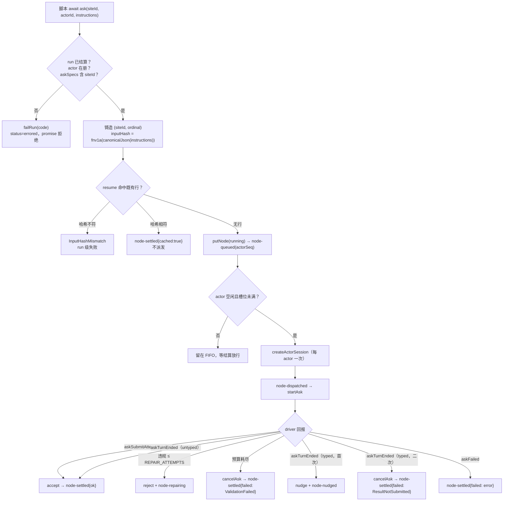
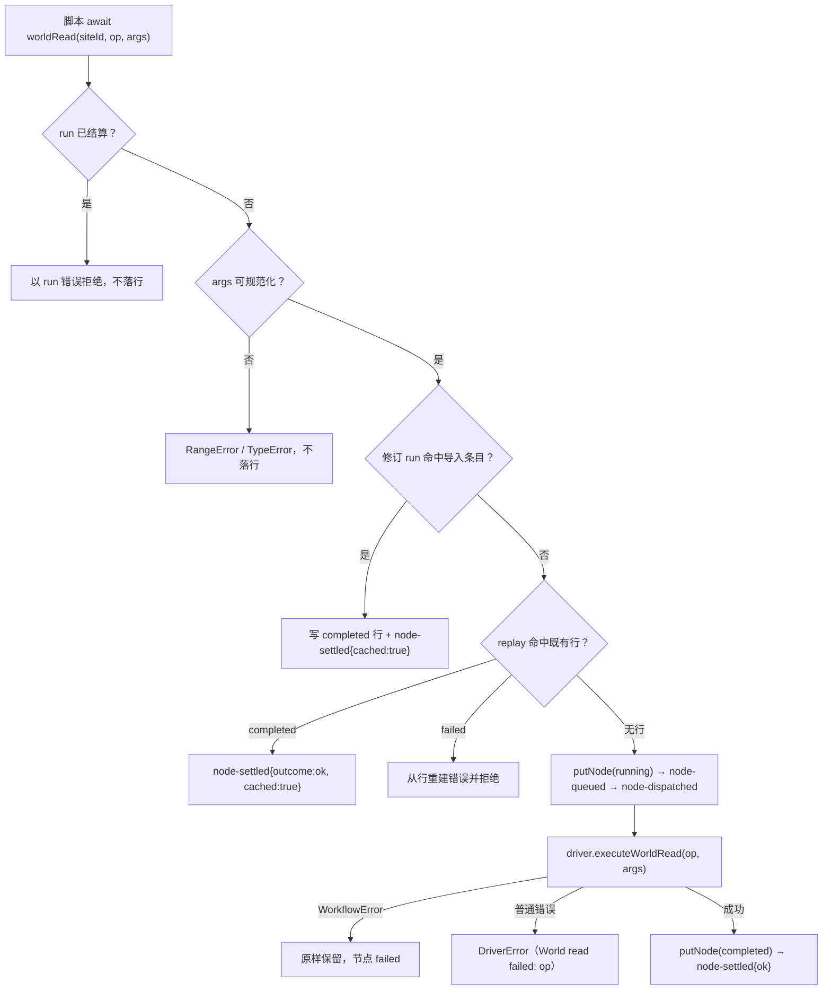
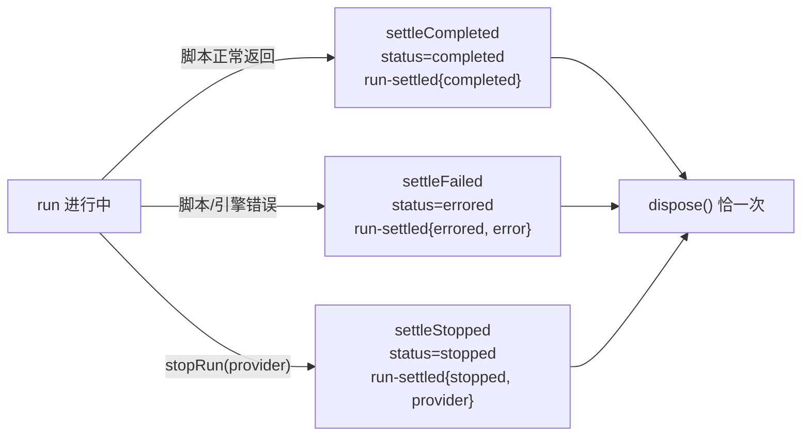

# dynamic-workflow-02 替换设计（design.md）

// SPDX-License-Identifier: Apache-2.0

v3（2026-10-19）：替换收尾记录。v1 起本文描述 `dynamic-workflow-02` 合同范围（`analysis/`、`compiler/` 之外的 `src/`）的独立实现设计；v3 补充替换阶段的实测计分模式与验收策略，并记下删除 `stubs/`、登记来源后的树状态。合同行为以 `behavior.md`（B1–B30）为准，本文只讲实现如何组织、状态归谁、各条目落在哪。

本包从 40 个继承文件出发：**37 个重写目标**（upstream-unchanged 24 + upstream-modified 13）全部重写，**3 个 `unreviewed`**（`engine/ask-journal-projection.ts`、`engine/scheduler-helpers.ts`、`engine/workflow-error.ts`）原样保留；重写时另拆出 **4 个新模块**（`facade/registry-tables.ts`、`lowering/ast-rewriter.ts`、`schema/definition-scope.ts`、`schema/value-describer.ts`），因此本包共有 **41 个自有/重写源文件**进入相似度与来源登记。兼容面仍是原 40 个模块、537 项顶层导出（`interface.md`）。

---

## 1. 模块划分与簇设计

| 簇                            | 覆盖模块                                                                                                                                                                                                                                            | 职责与设计思路                                                                                                                                                                                 | 覆盖条目                           |
| ----------------------------- | --------------------------------------------------------------------------------------------------------------------------------------------------------------------------------------------------------------------------------------------------- | ---------------------------------------------------------------------------------------------------------------------------------------------------------------------------------------------- | ---------------------------------- |
| **C1 入口、类型与终态词汇**   | `index.ts`、`projections.ts`、`engine/index.ts`、`engine/types.ts`、`engine/ask-observation-types.ts`、`engine/imported-cache-types.ts`、`engine/run-terminal.ts`、`engine/scheduler-types.ts`、`engine/engine-state.ts`、`engine/engine-launch.ts` | 两个根桶维持冻结的导出面；引擎侧全部 record/端口/事件/上限常量集中定义；调度器与 run 状态的类型只声明不放行为                                                                                  | B1, B2, B8, B9, B19, B20, B22, B30 |
| **C2 确定性身份与审计输入**   | `engine/hash.ts`、`engine/world-read-input.ts`                                                                                                                                                                                                      | 规范化 JSON（键序、无空白）+ 32 位 FNV-1a；世界读审计载荷按字节预算降级成参数摘要，绝不抛错                                                                                                    | B7, B12, B21                       |
| **C3 journal 端口与导入缓存** | `engine/journal-memory.ts`、`engine/imported-cache.ts`、`engine/artifact-spec.ts`                                                                                                                                                                   | 内存 journal 的行 upsert、事件 sequence、深拷贝边界与结算袋写入规则；修订 run 的导入条目查询与 actor/world 队列；产物规格校验                                                                  | B13, B14, B16, B17, B23            |
| **C4 引擎主体与调度**         | `engine/engine.ts`、`engine/scheduler.ts`、`engine/scheduler-submit.ts`、`engine/engine-world.ts`、`engine/engine-artifacts.ts`、`engine/engine-report.ts`、`engine/engine-settlement.ts`、`engine/concurrency.ts`                                  | `WorkflowEngine` 六个宿主入口 + run 级观察；`AskScheduler` 负责准入、每 actor FIFO、并发闸门、repair/nudge 预算与 driver 回报；世界读/产物/report 三条执行路径；三条终态结算；自适应并发控制器 | B1–B11, B15, B18, B19, B24         |
| **C5 facade 资产**            | `facade/dts.ts`、`facade/registry.ts`、`facade/registry-tables.ts`、`facade/artifact-caps.ts`、`facade/world-read-caps.ts`、`facade/report-caps.ts`                                                                                                 | 两份 `.d.ts` 声明文本（注释自写）、world-read/artifact 两张注册表、三张上限常量表与 artifact id 正则                                                                                           | B22, B29                           |
| **C6 lowering**               | `lowering/index.ts`、`lowering/lower.ts`、`lowering/ast-rewriter.ts`                                                                                                                                                                                | TS 源码 → async 函数体文本：站点注入、可选链守卫、`args` 读数位改写、类型擦除、打印器逐字节形状                                                                                                | B25, B26                           |
| **C7 schema**                 | `schema/types.ts`、`schema/emit.ts`、`schema/jsdoc.ts`、`schema/synthesize.ts`、`schema/actor-submit-profiles.ts`、`schema/serialize.ts`、`schema/validate.ts`、`schema/definition-scope.ts`、`schema/value-describer.ts`                           | TypeScript 类型 → JSON Schema 发射器；JSDoc 约束收集；类型定义域遍历；submit profile 派生；确定性序列化；违反模型与校验器                                                                      | B27, B28                           |

四个新拆模块都只有单一消费者，拆分的目的是把数据表与遍历/描述逻辑从旧文件里分离出来，而不是扩大兼容面：

- `facade/registry-tables.ts`：`WORLD_READ_REGISTRY` / `ARTIFACT_REGISTRY` 两张常量表与相关 op 类型；`registry.ts` 只保留查询与身份判定。
- `lowering/ast-rewriter.ts`：`WorkflowAstRewriter` 与 `SitedAction`，站点改写与可选链守卫的实现细节；`lower.ts` 只保留入口与文本组装。
- `schema/definition-scope.ts`：`DefinitionScope`，类型定义的作用域与递归访问。
- `schema/value-describer.ts`：`isEqualJson` / `formatSummary`，违规摘要与 JSON 深比较。

三个 `unreviewed` 文件不重写也不删（K12）：`workflow-error.ts` 继续提供 `WorkflowError`；`scheduler-helpers.ts` 提供 `hashMismatch` / `describeCause` / `headOfInstructions`；`ask-journal-projection.ts` 提供 `askJournalRecord`。

---

## 2. 状态所有者与生命周期

| 状态                                                 | 所有者                                          | 生命周期与边界                                                                                               |
| ---------------------------------------------------- | ----------------------------------------------- | ------------------------------------------------------------------------------------------------------------ |
| 每站点序号表、阶段名计数、当前阶段、出生阶段表       | `WorkflowEngine` 实例                           | 随引擎实例；resume 的新世从 1 重新铸造，实例串靠命中既有行接续（B1、B9、B13）                                |
| 有效 actor 名认领表                                  | `WorkflowEngine` 实例（内存）                   | 不落 journal；逐字节重放不会自撞名（B2）                                                                     |
| run 结算位、run 失败错误、累计 token 数              | `WorkflowEngine` 实例                           | first-wins；累计量一世一份，`dwf_run.spent_tokens` 是唯一持久所有者（B3、B8、B19）                           |
| 在飞节点表、每 actor 队列与 actorSeq、槽位、会话缓存 | `AskScheduler`                                  | 准入即入表；结算移除并重新放行；会话每 actor 至多铸一次（B4–B7、B10、B18）                                   |
| 每节点 repair / nudge 预算与 settled 位              | `AskScheduler` 的节点对象                       | 逐节点实例，终局后重复回报为 no-op（B4、B5）                                                                 |
| 导入缓存的门与修订 run 的缓存                        | `WorkflowEngine`（门）+ `imported-cache.ts`     | 门一次置真永不重开；跨世只从 `import-cache-closed` 事件恢复（B9、B14）                                       |
| `dwf_run` / `dwf_node` 行、事件轨、sequence/时刻     | journal 存储端口（生产侧为 SQLite，本包为内存） | 引擎只构造、搬运与 upsert；`timeCreated` 与 `sequence` 由存储分配（B7、B23）                                 |
| driver 效应与会话                                    | 宿主 driver                                     | 引擎只按顺序发 `startAsk` / `respondToSubmit` / `cancelAsk` / `executeWorldRead`，并统一 `emit` 与 `dispose` |
| 校验器、schema、站点表、caps                         | 调用方注入                                      | 引擎只读；`askSpecs` 缺席是 `MissingAskSpec`，不降级成 untyped（B3）                                         |

生命周期不变量：引擎核心**不读时钟、不起定时器、不做 I/O**；所有顺序来自调用方同步回合与 journal 的 `sequence`。run 结算路径统一调一次 `driver.dispose`，在飞节点以 run 错误中止（B18、B19）。

---

## 3. 执行管线与顺序不变量

### 3.1 ask：准入 → 排队 → 派发 → 结算

不变量：

1. **身份只在一个分配点铸造**：六个宿主入口共用 `(siteId, ordinal)` 计数器，阶段名走另一张独立的表（B1）。
2. **准入即落 running 行**：`node-queued` 与 `putNode(running)` 在同一次同步调用里完成，与是否派发无关（B6、B7）。
3. **事件漏斗唯一**：先 `appendEvent` 落 journal、再 `driver.emit`，两侧拿到同一个事件对象（B7）。
4. **误差 first-wins**：run 级错误让 `status()` 立刻 `errored`，在飞节点以同一错误拒绝；之后的调用一律回吐首个 run 错误（B3、B18、B19）。
5. **预算按节点实例**：repair 与 nudge 互不扣减，终局后重复回报零新事件（B4、B5）。

### 3.2 世界读取、replay 与导入缓存

修订 run 的 `world.run` 在派发前关导入门并发 `import-cache-closed{cause:"world-run"}`；`askMutating` 同样关门（B9、B14）。世界读审计载荷超过字节预算时降级为参数摘要，不改变脚本拿到的结果（B12）。

### 3.3 run 的三条终态路径

结算时先中止在飞 ask（promise 以 run 错误拒绝、节点行留 `running`、已派发节点收到一次 `cancelAsk`），再写 run 行与 `run-settled`，最后 `dispose`。`stopRun` 的 enrich 只补 subagent 出生阶段的 `phase`，其余明细原样转发（B9、B18、B19）。

---

## 4. 关键数据结构

- **`RunRecord` / `dwf_run` 行**：run 身份、状态、caps 快照、`spent_tokens`、`failure`；引擎只在构造与结算时整行写给存储端口。
- **`AskNodeRecord` / `dwf_node` 行**：`(siteId, ordinal)` 键上的 upsert；running 九字段（runId、siteId、ordinal、kind、actorSiteId、actorOrdinal、actorSeq、inputHash、status），终态追加 `result` / `error`，`stats` 只在有回报时在场（B7）。
- **`RunEvent`**：Boundary C 的判别联合；出生事件（`actor-created`、`node-queued`、命中缓存的 `node-settled`）可带 `phaseName`（B9）。
- **`AskNode`（调度器）**：实例串、指令、`inputHash`、typed/schema、`settled` 位、剩余 repair/nudge 预算、`lastStats`（B4、B5、B8）。
- **`Actor`（调度器）**：actorSeq 计数、待派发 FIFO、在跑节点、缓存的会话 promise（B6）。
- **`EngineState`**：run 结算袋、token 累计、阶段表、每站点序号表、出生阶段表、actor 名认领表（B1、B2、B8、B9）。
- **`ImportedRunCache`**：ask 条目、actor 候选、world 条目与 world 队列；只读、按 `(siteId, ordinal)` 查询（B14）。
- **`InMemoryJournalStore`**：按 runId 分桶的行表 + 事件数组；写入深拷贝，`sequence` 从 0 连续递增（B23）。
- **`ConcurrencyController`**：cap 上下界、乘性减少 / 加性递增、`lastGood`/`lastBad`、空闲重置；输入只有信号与调用方给的 `now`（B24）。
- **schema 面**：`JsonSchema` 判别联合、`Violation`、`SchemaEmitter`、`DefinitionScope`、`ActorSubmitProfile`（B27、B28）。

---

## 5. B 项落点映射（条目 → 实现模块）

| 条目    | 契约规定行为                                   | 实现落点                                                                                                                                            | 核心逻辑与校验点                                                                           |
| ------- | ---------------------------------------------- | --------------------------------------------------------------------------------------------------------------------------------------------------- | ------------------------------------------------------------------------------------------ |
| **B1**  | 实例身份 = 站点 × 每站点序号，六入口共用分配点 | `engine/engine.ts`、`engine/engine-state.ts`                                                                                                        | 单一 `mintIdentity`；阶段名另表；resume 从 1 重新铸造靠行接续                              |
| **B2**  | actor 身份、persona 规范化、重名与匿名         | `engine/engine.ts`、`engine/types.ts`                                                                                                               | persona 浅拷贝与 `name` 补齐；有效名认领表；`DuplicateActorName` 同步抛出并 failRun        |
| **B3**  | ask 准入两条硬错误与闸门顺序                   | `engine/engine.ts`、`engine/scheduler.ts`                                                                                                           | 结算 → actor 注册表 → askSpecs 顺序判定；`UnknownActor` / `MissingAskSpec` 均 failRun      |
| **B4**  | typed submit 裁决与 repair 预算                | `engine/scheduler.ts`、`engine/scheduler-submit.ts`                                                                                                 | 原样校验 → JSON 解码再校验；`REPAIR_ATTEMPTS = 3`；终局 `cancelAsk` + `ValidationFailed`   |
| **B5**  | untyped 结算与 typed nudge 预算                | `engine/scheduler.ts`、`engine/scheduler-submit.ts`                                                                                                 | untyped 直接以末轮文本 completed；typed `NUDGE_ATTEMPTS = 1` 后 `ResultNotSubmitted`       |
| **B6**  | 每 actor FIFO、actorSeq、并发上限、会话铸造    | `engine/scheduler.ts`、`engine/scheduler-types.ts`                                                                                                  | 准入即发 queued；双闸门（actor 空闲 + 全局槽位）；会话每 actor 一次                        |
| **B7**  | ask 行的两世写与事件序列                       | `engine/scheduler.ts`、`engine/types.ts`                                                                                                            | running/终态 upsert；`instructionsHead` 240；`inputHash` 覆盖原样指令                      |
| **B8**  | 进度与用量观察                                 | `engine/engine.ts`、`engine/ask-observation-types.ts`                                                                                               | `node-progress` 纯透传；tokens 累加先写列再发同值事件；`inheritedTokens` 归一              |
| **B9**  | log / phase / 展示通道 / stopRun               | `engine/engine.ts`、`engine/run-terminal.ts`                                                                                                        | 阶段计数与出生阶段；live 门；导入缓存关门；provider stop 的 phase enrich                   |
| **B10** | driver 侧 askFailed 结算该 ask                 | `engine/scheduler.ts`、`engine/types.ts`                                                                                                            | 只结算命中的在飞节点；错误码原样搬运；重复回报 no-op                                       |
| **B11** | 世界读取准入、结算与 replay                    | `engine/engine-world.ts`、`engine/types.ts`                                                                                                         | 结算后拒绝、规范化失败即抛、WorkflowError 原样、普通错误包 `DriverError`                   |
| **B12** | 世界读取的有界输入                             | `engine/world-read-input.ts`                                                                                                                        | 超过字节预算降级为参数摘要（`truncated: true`），不改变执行结果                            |
| **B13** | resume：同一 runId 的第二世                    | `engine/engine.ts`、`engine/engine-state.ts`、`engine/journal-memory.ts`                                                                            | 行命中即复用结果/错误；哈希不符 `InputHashMismatch`；继承用量从行读回                      |
| **B14** | amend-resume 的导入缓存                        | `engine/imported-cache.ts`、`engine/engine-world.ts`                                                                                                | 导入条目按身份命中；`import-cache-closed` 后不再导入                                       |
| **B15** | report 的发布路径                              | `engine/engine-report.ts`                                                                                                                           | 序列化探针 + `ReportCapExceeded` run 级失败；事件与行写入顺序                              |
| **B16** | 内容族：发布是效应                             | `engine/engine-artifacts.ts`、`engine/artifact-spec.ts`                                                                                             | `publishContentArtifact` 调 driver；未知 op 拒绝；id 状态记账                              |
| **B17** | 预置族：声明不是效应                           | `engine/engine-artifacts.ts`、`engine/artifact-spec.ts`                                                                                             | `declarePresetArtifact` 只落行/记账，不调 driver                                           |
| **B18** | 结算时对在飞 ask 的中止                        | `engine/engine-settlement.ts`、`engine/scheduler.ts`                                                                                                | 以 run 错误拒绝、节点行留 running、每个已派发节点一次 `cancelAsk`                          |
| **B19** | 三条终态路径                                   | `engine/engine-settlement.ts`、`engine/run-terminal.ts`                                                                                             | completed / errored / stopped(provider)；`dispose` 恰一次；`run-settled` 收口              |
| **B20** | 兼容面（范围清单 / interface.md / 根桶归属面） | `index.ts`、`projections.ts`、合同资产                                                                                                              | 40 文件 / 537 导出；v3 起 scope 从登记后的册归位继承范围                                   |
| **B21** | 确定性哈希                                     | `engine/hash.ts`                                                                                                                                    | `canonicalJson` 键排序 + 无空白；32 位 FNV-1a；`inputHash` 覆盖原样文本                    |
| **B22** | 上限常量表                                     | `facade/*-caps.ts`、`schema/types.ts`、`engine/types.ts`                                                                                            | 逐字常量与 id 字符集；`MAX_UNION_MEMBERS`、`WORLD_READ_INPUT_MAX_BYTES` 等                 |
| **B23** | journal 内存端口                               | `engine/journal-memory.ts`                                                                                                                          | run 行建立、深拷贝、upsert、结算袋三规则、事件 sequence 与分页                             |
| **B24** | 自适应并发控制器                               | `engine/concurrency.ts`                                                                                                                             | 乘性减少 / 加性递增 / 空闲重置 / reason 词汇表；不读时钟                                   |
| **B25** | lowering：facade 调用按站点身份改写            | `lowering/lower.ts`、`lowering/ast-rewriter.ts`、`lowering/index.ts`                                                                                | 站点注入、可选链守卫、`args` 改写、类型擦除、逐字节打印形状                                |
| **B26** | golden 回放（350 + 26）                        | `lowering/*` 与引擎各模块（由合同夹具驱动）                                                                                                         | 旧实现录制的 lowering 文本与整轮运行结果逐字节比对                                         |
| **B27** | schema 合成                                    | `schema/synthesize.ts`、`schema/emit.ts`、`schema/jsdoc.ts`、`schema/actor-submit-profiles.ts`、`schema/definition-scope.ts`、`schema/serialize.ts` | typed 判定、标量/union/递归发射、JSDoc 约束、JSDoc 描述、report 实参、短路、submit profile |
| **B28** | schema 校验器与违规模型                        | `schema/validate.ts`、`schema/value-describer.ts`、`schema/types.ts`                                                                                | 关键字优先级、对象/数组/字符串/数值约束、`$ref` 解析域、`formatViolation(s)`               |
| **B29** | facade 资产与两张注册表                        | `facade/dts.ts`、`facade/registry.ts`、`facade/registry-tables.ts`、`facade/*-caps.ts`                                                              | 去注释声明面逐字节锁定；注册表逐行；身份按声明判定                                         |
| **B30** | projections 桶：浏览器安全子集                 | `projections.ts`                                                                                                                                    | 只从 `analysis/` 的可移植投影再导出，不含 Node 运行时依赖                                  |

---

## 6. 计分模式与实测结果

门槛不变：行包含率 `< 0.20`、最长相同段 `< 8`、结构相似度 `< 0.40`。旧实现取提交 `8c9a9e86`，上游取固定树 `872ad960`，工具为 `node scripts/provenance/similarity.mjs`（新工具：先格式化、再去注释）。

**普通模式：29 个文件全过**（max containment / longest run / structural）：

`engine/artifact-spec.ts` 0.1068/1/0.1613、`engine/concurrency.ts` 0.1299/6/0.0690、`engine/engine-artifacts.ts` 0.1752/7/0.0328、`engine/engine-launch.ts` 0.0800/1/0、`engine/engine-report.ts` 0.1111/7/0、`engine/engine-settlement.ts` 0.1833/6/0.0244、`engine/engine-world.ts` 0.1439/7/0.0112、`engine/engine.ts` 0.0734/3/0.0181、`engine/hash.ts` 0.1143/1/0、`engine/imported-cache.ts` 0.1667/6/0、`engine/journal-memory.ts` 0.1910/1/0、`engine/scheduler-submit.ts` 0.1711/3/0.0400、`engine/scheduler.ts` 0.0906/3/0.1351、`engine/world-read-input.ts` 0.1707/2/0、`facade/dts.ts` 0.1225/2/0.0909、`facade/registry.ts` 0.1383/3/0、`facade/report-caps.ts` 0/0/0、`lowering/ast-rewriter.ts` 0.0932/3/0.0677、`lowering/index.ts` 0/0/0、`lowering/lower.ts` 0.0820/2/0.0656、`projections.ts` 0/0/0、`schema/actor-submit-profiles.ts` 0.1364/5/0.0313、`schema/definition-scope.ts` 0.0667/2/0.1000、`schema/emit.ts` 0.0615/4/0.0189、`schema/jsdoc.ts` 0.1587/4/0.0682、`schema/serialize.ts` 0.0714/1/0、`schema/synthesize.ts` 0.1828/4/0、`schema/validate.ts` 0.0556/3/0.1905、`schema/value-describer.ts` 0.0667/1/0。

**声明模式：12 个纯声明/桶/数据表文件全过**（`--declaration --interface specs/contracts/dynamic-workflow-02/interface.md`，residual-lines 全为 0，其余三项全 0）：

| 文件                              | 被剔除的声明块 | 理由                                                          |
| --------------------------------- | -------------: | ------------------------------------------------------------- |
| `engine/ask-observation-types.ts` |              6 | 观察载荷与 64/120/240 常量的纯类型/常量面                     |
| `engine/engine-state.ts`          |              3 | run 结算袋与引擎状态的纯类型面                                |
| `engine/imported-cache-types.ts`  |              4 | 导入缓存条目与队列的纯类型面                                  |
| `engine/index.ts`                 |              2 | 引擎桶，只有再导出                                            |
| `engine/run-terminal.ts`          |              2 | `ProviderStopDetails` / `RunStallInfo` 的纯类型面             |
| `engine/scheduler-types.ts`       |              4 | 调度器数据结构与 `defer` 兼容工具                             |
| `engine/types.ts`                 |             41 | Boundary A/B/C、record 与上限常量的总类型面（兼容面占比最高） |
| `facade/artifact-caps.ts`         |              2 | 8 键常量表与 id 正则，值由合同 B22 逐字钉住                   |
| `facade/registry-tables.ts`       |              7 | 两张注册表的数据行与 op 类型，身份按声明判定                  |
| `facade/world-read-caps.ts`       |              1 | 9 键常量表，值由合同 B22 逐字钉住                             |
| `index.ts`                        |             17 | 根桶，只有再导出与类型转发                                    |
| `schema/types.ts`                 |              6 | JSON Schema/违规/诊断码的纯类型与常量面                       |

41 个候选 = 29 普通 + 12 声明，全部通过。`facade/dts.ts` 的注释全部自写，普通模式三项全过，不需要单开声明面计分（合同 README 原「待决事项 2」在 v3 关闭）。

---

## 7. 簇序实施与验收策略

1. **C1/C2（类型与哈希）**：先钉 `types.ts`、record 与 `hash.ts`，让六个入口、事件与行字段有稳定骨架，跑 B21/B22。
2. **C3（journal 与导入缓存）**：实现内存端口与深拷贝/结算袋规则，跑 B23、B13/B14 的夹具。
3. **C4（调度与引擎）**：按「准入 → queued → 派发 → 裁决 → 结算」顺序实现，逐条跑 B1–B11、B18/B19；保持事件漏斗与 first-wins。
4. **C5（facade）**：先录两份去注释声明面，再实现注册表与常量表，跑 B22/B29。
5. **C6/C7（lowering 与 schema）**：以 350 例 lowering golden 与 schema 单测驱动；打印器形状与校验器关键字优先级是主要回归点，跑 B25–B28。
6. **入口与兼容面**：最后收两个根桶与 `interface.md`，跑 B20/B30。
7. **验收**：合同门源码与 dist 各 420/420（v3 不带桩替换）；相似度 41/41（29 普通 + 12 声明）；`pnpm fmt:check`、`lint`、`typecheck`、`knip`、`provenance:check`、`test:studio` 全绿；`stubs/` 已删除，不保留回退副本。实测记录见 `docs/knorvia-dynamic-workflow-02-acceptance.md`。
