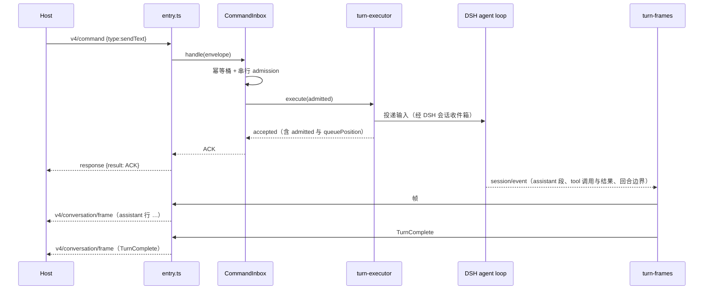
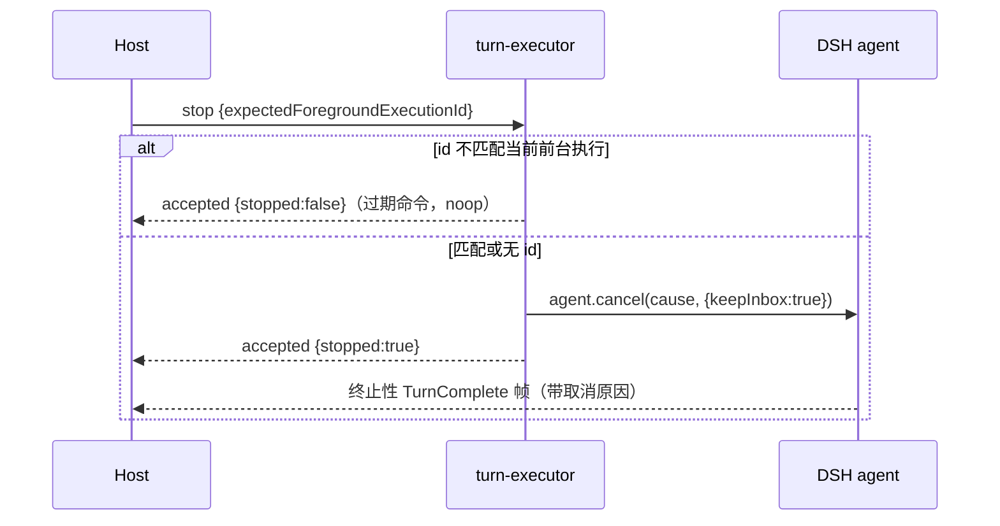
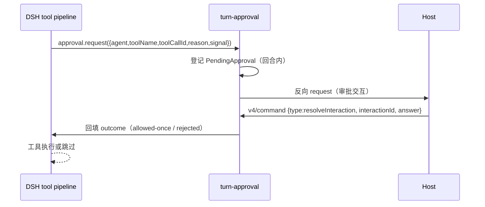
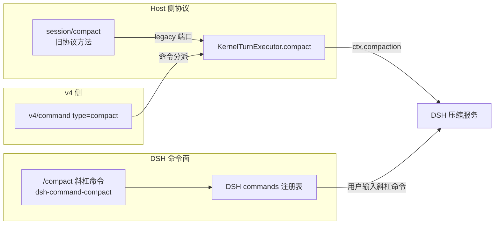

# kernel-bridge-02 设计

> 本文件在实现阶段编写。当前是合同阶段的**骨架**，只固定状态所有者、模块划分与事件顺序，
> 具体实现细节随实现 PR 补齐。合同见 [README.md](README.md)、[behavior.md](behavior.md)、[interface.md](interface.md)。

## 一、状态所有者

| 状态                                       | 所有者                                                  | 本包的角色                  |
| ------------------------------------------ | ------------------------------------------------------- | --------------------------- |
| 输入准入（排队、幂等、CAS）                | `CommandInbox`（`kernel-bridge-01`）                    | 只调用，不改                |
| 会话正文、消息、工具调用与结果、压缩检查点 | **DSH 会话日志**                                        | 只读事件派生帧，不另存正文  |
| 回合活动信号（运行中/取消）                | DSH `Agent`（`agent.cancel`、`agent.status`）           | 映射 v4 `stop` 到它         |
| 审批决定                                   | DSH `ApprovalService` + 会话日志的审批事件              | 桥成 v4 交互并回填          |
| 帧序号与水位                               | `SequenceWatermark`（`kernel-bridge-01`）               | 只产出事件，不改水位规则    |
| 订阅与两条链路                             | `LinksRegistry`（`kernel-bridge-01`）                   | 不改                        |
| 旧协议回合方法的执行                       | **本包的 `KernelTurnExecutor`**（经 legacy 注册面暴露） | 唯一实现，v4 与 legacy 共用 |

## 二、模块划分（实现阶段落地）

```text
apps/cli/packages/bootstrap/src/kernel-bridge/
├── bridge-engine.ts            （改：execute() 补 5 个分支，委托给下面的执行器）
├── turn-executor.ts            （新：KernelTurnExecutor 的实现，v4 与 legacy 共用）
├── turn-frames.ts              （新：DSH 回合事件 → v4 帧的派生规则）
├── turn-approval.ts            （新：审批请求 ↔ v4 交互的桥接）
└── legacy-port/
    └── index.ts                （新：createLegacyTurnPort，把 legacy 端口接到 turn-executor）
```

- `turn-executor.ts` 是**唯一**实现回合动作的地方；`bridge-engine.ts` 与 `legacy-port/index.ts` 都只是它的调用方（C2）。
- `turn-frames.ts` 只做纯派生：输入 DSH 事件，输出帧描述；不持有状态。
- `turn-approval.ts` 持有未决请求表（`interactionId` → pending），这是**唯一**新增的进程内状态，且随回合释放。

## 三、关键数据结构

| 结构              | 内容                                                | 生命周期     |
| ----------------- | --------------------------------------------------- | ------------ |
| `TurnSession`     | 会话 id、当前 agent 引用、当前前台执行 id、活动信号 | 会话期       |
| `PendingApproval` | `interactionId`、toolCallId、发出时刻、resolver     | 单次工具调用 |
| `TurnFrameInput`  | 一条 DSH 事件 + 会话身份                            | 单次派生     |

## 四、事件顺序（v4 `sendText` 一次完整回合）



**不变量**：ACK 先于该命令产生的第一帧；`TurnComplete` 在该回合所有行之后。

## 五、事件顺序（`stop`）



## 六、审批交互顺序



**fail closed**：通道关闭、超时或应答非法 → `unavailable`，工具不执行。

## 七、每条 B 在哪里实现

| 条目                       | 实现位置                                                  |
| -------------------------- | --------------------------------------------------------- |
| B1 分派                    | `bridge-engine.ts` `execute()`                            |
| B2 `sendText`              | `turn-executor.ts` + `turn-frames.ts`                     |
| B3 `firstInput`            | `bridge-engine.ts` `createSession()` + `turn-executor.ts` |
| B4 排队                    | `CommandInbox`（既有）+ `turn-executor.ts` 映射           |
| B5 `guide`                 | `turn-executor.ts`（DSH steering 通道）                   |
| B6 `stop`                  | `turn-executor.ts`（`agent.cancel`）                      |
| B7a `heldQueueDisposition` | `turn-executor.ts`                                        |
| B7b `compact`              | `turn-executor.ts`（`ctx.compaction`）                    |
| B8 幂等                    | `CommandInbox`（既有，不改）                              |
| B9 审批桥                  | `turn-approval.ts`                                        |
| B10 fail closed            | `turn-approval.ts`                                        |
| B11 帧形状                 | `turn-frames.ts`                                          |
| B12 序号单调               | `turn-frames.ts` + `SequenceWatermark`（既有）            |
| B13 两条链路               | `LinksRegistry`（既有，不改）                             |
| B14 legacy C2              | `legacy-port/index.ts`                                    |
| B15 单一 admission         | `CommandInbox`（既有，不改）                              |
| B16 bridge-01 回归         | 无新代码，靠既有用例                                      |

## 八、C2 接缝：与 legacy 注册面的逐字对照表

> 来源：`specs/contracts/kernel-bridge-legacy/interface.md` §四（该文件已合并到 main，本表为**原文抄录**）。
> 用途：C2 是 `kernel-switch` 的准入项，审查时两侧必须能一眼比对；实现阶段任何一处签名不符，都说明接缝没对上。

### 8.1 三个签名（原文）

```ts
/** 旧协议方法的执行结果：result 或既有协议错误。 */
export type LegacyMethodOutcome =
  | { readonly kind: "result"; readonly result: unknown }
  | {
      readonly kind: "error";
      /** 既有错误码族；不得新增。 */
      readonly code: number;
      readonly message: string;
      readonly data?: unknown;
    };

/** 执行端口收到的请求（已通过参数 schema 校验）。 */
export interface LegacyExecutionRequest {
  readonly method: string;
  readonly params: unknown;
  /** 调用方 trace（客户端 request.trace 原样透传）。 */
  readonly trace?: Readonly<Record<string, unknown>>;
}

/**
 * 回合类方法的执行端口。由 kernel-bridge-02/03 在组合根注册。
 * 未注册的方法由本包按 capability 缺席语义返回（behavior B10）。
 */
export interface LegacyExecutionPort {
  /**
   * 执行一个回合类方法。抛错表示内部失败（桥折叠为 -32603），
   * 返回 {kind:"error"} 表示业务错误（桥原样透传）。
   */
  execute(request: LegacyExecutionRequest): Promise<LegacyMethodOutcome>;
}

/** 注册执行端口；返回解绑函数。重复注册抛错（唯一所有者）。 */
export function registerLegacyExecutionPort(port: LegacyExecutionPort): () => void;
```

**本包的义务（对照检查）**：

| 检查项                               | 本包必须做到                                                                                                  | 落点                   |
| ------------------------------------ | ------------------------------------------------------------------------------------------------------------- | ---------------------- |
| `LegacyExecutionPort.execute` 的入参 | 只接受 `LegacyExecutionRequest`（`method` / `params` / `trace?`），**不扩字段**                               | `legacy-port/index.ts` |
| 返回值                               | 只能是 `LegacyMethodOutcome` 的两个分支；内部失败**抛错**（由桥折叠 `-32603`），业务错误返回 `{kind:"error"}` | `legacy-port/index.ts` |
| 注册                                 | 调用 `registerLegacyExecutionPort(port)`，且**只调一次**（启动期）；重复注册会抛错                            | 组合根                 |
| 解绑                                 | 保存返回的解绑函数，桥关闭时调用                                                                              | 组合根                 |
| 方向                                 | **本包 → legacy**；legacy 不得 import 本包                                                                    | 全包                   |

### 8.2 legacy 侧收口的 11 个回合类旧协议方法（原文抄录）

`kernel-bridge-legacy` 的 `interface.md` §四 与 README §二 列明：回合类旧协议方法在旧协议侧由 legacy 路由器收口，但**执行落到本包注册的端口**。这 11 个是：

| #   | 旧协议方法                     | 本包对应实现                              | 归属与依据                                                                                            |
| --- | ------------------------------ | ----------------------------------------- | ----------------------------------------------------------------------------------------------------- |
| 1   | `session/send`                 | `KernelTurnExecutor.sendText`             | **归 02**：计划书 02 明列「sendText」（B14）                                                          |
| 2   | `session/stop`                 | `KernelTurnExecutor.stop`                 | **归 02**：计划书 02 明列「取消」                                                                     |
| 3   | `session/cancelBackgroundTask` | `KernelTurnExecutor.stop`（后台作业分支） | **归 02**：属于「取消」的一类（v4 对应 `cancelBackgroundWork`），取消正在跑的回合内后台任务；不杀进程 |
| 4   | `session/compact`              | `KernelTurnExecutor.compact`              | **归 02**：属回合内行为（「排队」+ 回合内压缩）；否则 03 要重复实现回合内压缩                         |
| 5   | `session/fork`                 | 不实现 → capability 缺席                  | **归 03**：计划书 03 明列「fork」                                                                     |
| 6   | `session/goal`                 | 不实现 → capability 缺席                  | **归 03**：计划书 03 明列「目标与计划相关命令」                                                       |
| 7   | `session/setModel`             | 不实现 → capability 缺席                  | **归 03**：配置类「其余 v4 命令」（v4 对应 `switchModelConfig`）                                      |
| 8   | `session/setThoughtLevel`      | 不实现 → capability 缺席                  | **归 03**：配置类（v4 对应思考档 / `switchCollaborationMode`）                                        |
| 9   | `session/setMode`              | 不实现 → capability 缺席                  | **归 03**：配置类（v4 对应 `switchCollaborationMode` / `setFollowupMode`）                            |
| 10  | `session/resume`               | 不实现 → capability 缺席                  | **归 03**：会话物化类（触发 `requestRuntimePreferences` 第二档）                                      |
| 11  | `session/subscribe`            | 不实现 → capability 缺席                  | **归 03**：会话结构类（事件订阅）                                                                     |

**划界依据（Lead 2026-10-20 裁决，按计划书原文）**：

- 计划书 02 原文：「输入与回合：sendText、`createSession.firstInput`、排队、steer、取消、审批交互、回合帧」；
- 计划书 03 原文：「**其余 v4 命令**：fork、编辑重发、文件回退入口、**目标与计划相关命令**等」。

**C2 状态（必读）**：C2 准入项要求「11 个回合方法全部实到 legacy 执行端口并转绿」。**本包只交付 4/11**，其余 7 个随 `kernel-bridge-03` 交付。因此 **C2 在本包合并后是「部分满足（4/11）」**，完整满足待 03；这个结论已同步到 issue #222 与 #124。本包不得为了让 legacy 侧看起来「全通」而伪造成功——未交付的 7 个按 `kernel-bridge-legacy` behavior B10 返回 capability 缺席（`-32031`），并在实现 PR 的 `known-differences.md` 里逐条登记归属。

### 8.2b `session/compact` 与 DSH `/compact` 是两条路径（不要混）

`kernel-dsh-builtins` 已挂载 DSH 的 `dsh-command-compact`，那是**模型可见的斜杠命令面**（`/compact`），由 DSH 命令注册表提供。本包的 `session/compact` 是**Host 调用的旧协议方法**，必须经 legacy 端口 → `KernelTurnExecutor.compact` → 最终触发 DSH 压缩。两者关系：



- **两条入口、一个下游**：`session/compact`（旧协议）与 `v4/command compact`（v4）**共用 `KernelTurnExecutor.compact`**；`/compact` 斜杠命令走 DSH 自己的命令面，**不经过**本包。
- **不得合并**：不能把 `session/compact` 实现成「向会话投递一条 `/compact` 文本」——那会让 Host 调用变成模型可见输入，改变语义。
- 审查要点：本包实现里不得出现「把 `session/compact` 转成斜杠命令字符串」的路径。

### 8.3 与 v4 协议面的名字对照（防止两侧用不同的词）

| 概念     | v4 侧（本包实现）                         | 旧协议侧（legacy 收口）                    | 共同实现                      |
| -------- | ----------------------------------------- | ------------------------------------------ | ----------------------------- |
| 投递输入 | `sendText`（`requestedDelivery`）         | `session/send`                             | `KernelTurnExecutor.sendText` |
| 停止回合 | `stop`（`expectedForegroundExecutionId`） | `session/stop`                             | `KernelTurnExecutor.stop`     |
| 压缩     | `compact`                                 | `session/compact`                          | `KernelTurnExecutor.compact`  |
| 审批应答 | `resolveInteraction`                      | `interaction/requestPermission` 的反向应答 | `turn-approval.ts`            |

**禁止出现的自造名**（两侧都不得使用）：`cancelTurn`、`steer`。v4 侧已在 `command-surface.test.mjs` 里做反向断言；旧协议侧由 legacy 自己的方法清单约束。

## 九、待实现阶段确认

| #   | 事项                                                  | 说明                                                                                                                                                                           |
| --- | ----------------------------------------------------- | ------------------------------------------------------------------------------------------------------------------------------------------------------------------------------ |
| 1   | 旧协议 `session/send` 参数到 `TurnSendRequest` 的映射 | 以 `@knorvia/shared` 的旧协议 schema 为准                                                                                                                                      |
| 2   | `firstInput` 失败时的回滚粒度                         | 二选一：整条拒绝（不留半建会话）或先建后投递；在实现 PR 说明并登记                                                                                                             |
| 3   | 假 provider 驱动回合时是否需要 `modelSelection`       | 侦察后定；不影响帧断言本身                                                                                                                                                     |
| 4   | 8.2 表里 7 个归 03 的方法                             | **已裁决**（Lead 2026-10-20，按计划书原文）：fork/goal/setModel/setThoughtLevel/setMode/resume/subscribe 归 03；本包对它们返回 capability 缺席（`-32031`）并在实现 PR 逐条登记 |
