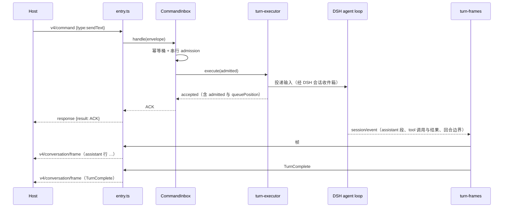
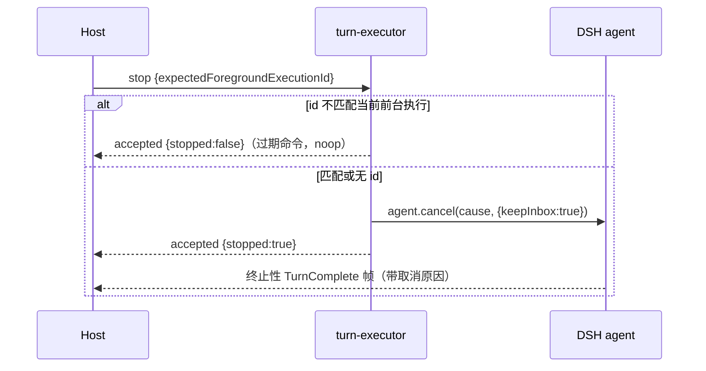
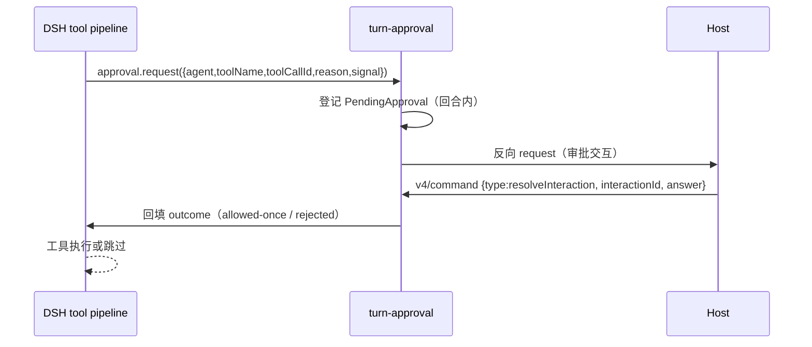

# kernel-bridge-02 设计

> 本文件在实现阶段编写。当前是合同阶段的**骨架**，只固定状态所有者、模块划分与事件顺序，
> 具体实现细节随实现 PR 补齐。合同见 [README.md](README.md)、[behavior.md](behavior.md)、[interface.md](interface.md)。

## 一、状态所有者

| 状态                                       | 所有者                                                  | 本包的角色                  |
| ------------------------------------------ | ------------------------------------------------------- | --------------------------- |
| 输入准入（排队、幂等、CAS）                | `CommandInbox`（`kernel-bridge-01`）                    | 只调用，不改                |
| 会话正文、消息、工具调用与结果、压缩检查点 | **DSH 会话日志**                                        | 只读事件派生帧，不另存正文  |
| 回合活动信号（运行中/取消）                | DSH `Agent`（`agent.cancel`、`agent.status`）           | 映射 v4 `stop` 到它         |
| 审批决定                                   | DSH `ApprovalService` + 会话日志的审批事件              | 桥成 v4 交互并回填          |
| 帧序号与水位                               | `SequenceWatermark`（`kernel-bridge-01`）               | 只产出事件，不改水位规则    |
| 订阅与两条链路                             | `LinksRegistry`（`kernel-bridge-01`）                   | 不改                        |
| 旧协议回合方法的执行                       | **本包的 `KernelTurnExecutor`**（经 legacy 注册面暴露） | 唯一实现，v4 与 legacy 共用 |

## 二、模块划分（实现阶段落地）

```text
apps/cli/packages/bootstrap/src/kernel-bridge/
├── bridge-engine.ts            （改：execute() 补 5 个分支，委托给下面的执行器）
├── turn-executor.ts            （新：KernelTurnExecutor 的实现，v4 与 legacy 共用）
├── turn-frames.ts              （新：DSH 回合事件 → v4 帧的派生规则）
├── turn-approval.ts            （新：审批请求 ↔ v4 交互的桥接）
└── legacy-port/
    └── index.ts                （新：createLegacyTurnPort，把 legacy 端口接到 turn-executor）
```

- `turn-executor.ts` 是**唯一**实现回合动作的地方；`bridge-engine.ts` 与 `legacy-port/index.ts` 都只是它的调用方（C2）。
- `turn-frames.ts` 只做纯派生：输入 DSH 事件，输出帧描述；不持有状态。
- `turn-approval.ts` 持有未决请求表（`interactionId` → pending），这是**唯一**新增的进程内状态，且随回合释放。

## 三、关键数据结构

| 结构              | 内容                                                | 生命周期     |
| ----------------- | --------------------------------------------------- | ------------ |
| `TurnSession`     | 会话 id、当前 agent 引用、当前前台执行 id、活动信号 | 会话期       |
| `PendingApproval` | `interactionId`、toolCallId、发出时刻、resolver     | 单次工具调用 |
| `TurnFrameInput`  | 一条 DSH 事件 + 会话身份                            | 单次派生     |

## 四、事件顺序（v4 `sendText` 一次完整回合）



**不变量**：ACK 先于该命令产生的第一帧；`TurnComplete` 在该回合所有行之后。

## 五、事件顺序（`stop`）



## 六、审批交互顺序



**fail closed**：通道关闭、超时或应答非法 → `unavailable`，工具不执行。

## 七、每条 B 在哪里实现

| 条目                       | 实现位置                                                  |
| -------------------------- | --------------------------------------------------------- |
| B1 分派                    | `bridge-engine.ts` `execute()`                            |
| B2 `sendText`              | `turn-executor.ts` + `turn-frames.ts`                     |
| B3 `firstInput`            | `bridge-engine.ts` `createSession()` + `turn-executor.ts` |
| B4 排队                    | `CommandInbox`（既有）+ `turn-executor.ts` 映射           |
| B5 `guide`                 | `turn-executor.ts`（DSH steering 通道）                   |
| B6 `stop`                  | `turn-executor.ts`（`agent.cancel`）                      |
| B7a `heldQueueDisposition` | `turn-executor.ts`                                        |
| B7b `compact`              | `turn-executor.ts`（`ctx.compaction`）                    |
| B8 幂等                    | `CommandInbox`（既有，不改）                              |
| B9 审批桥                  | `turn-approval.ts`                                        |
| B10 fail closed            | `turn-approval.ts`                                        |
| B11 帧形状                 | `turn-frames.ts`                                          |
| B12 序号单调               | `turn-frames.ts` + `SequenceWatermark`（既有）            |
| B13 两条链路               | `LinksRegistry`（既有，不改）                             |
| B14 legacy C2              | `legacy-port/index.ts`                                    |
| B15 单一 admission         | `CommandInbox`（既有，不改）                              |
| B16 bridge-01 回归         | 无新代码，靠既有用例                                      |

## 八、待实现阶段确认

| #   | 事项                                                  | 说明                                                               |
| --- | ----------------------------------------------------- | ------------------------------------------------------------------ |
| 1   | 旧协议 `session/send` 参数到 `TurnSendRequest` 的映射 | 以 `@knorvia/shared` 的旧协议 schema 为准                          |
| 2   | `firstInput` 失败时的回滚粒度                         | 二选一：整条拒绝（不留半建会话）或先建后投递；在实现 PR 说明并登记 |
| 3   | 假 provider 驱动回合时是否需要 `modelSelection`       | 侦察后定；不影响帧断言本身                                         |
