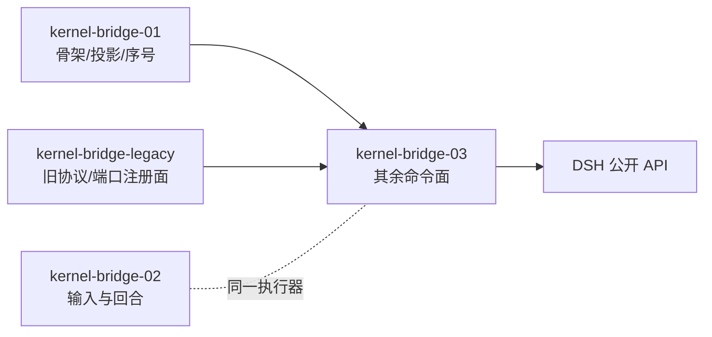

# kernel-bridge-03 合同：其余命令面（收口包）

> 本包是 **M2 接入的收官包**。完成后 **34 个 v4 命令全部有实现，不再有 `unsupported`**，
> 且 legacy 执行端口的 **12 个回合方法全部有实现**（C2 完整满足）。

## 一、范围

### 1. 本包做什么

| 类别 | 数量 | 说明 |
| --- | --- | --- |
| v4 命令 | **29** | `kernel-bridge-01` 交付骨架 + 02 交付 5 个之后的**其余全部** |
| 旧协议回合方法 | **8** | legacy 执行端口的剩余方法（C2 的 8/12） |
| 「无 unsupported」收口断言 | 1 | 34 个命令逐个断言「不再回 `unsupported`」 |

### 2. 本包不做什么

- **不改 DSH 源码**，只用公开配置与插件 API；
- **不碰 `entry.ts`**（`route()` 六个已接方法与 `default` 分支的归属见 `kernel-bridge-legacy` 合同 §五）；
- **不实现文件回退机制**：`applyFileRewind` 的**命令面**归本包，**文件回退的存储与恢复**归 `kernel-plugin-rewind`（见 §六 边界）；
- **不实现审批的 Host 通道**（归 legacy 的 `LegacyHostChannel`）；
- **不改帧结构与序号规则**（归 `kernel-bridge-01`）。

#### 2.1 责任边界（用户裁决，**钉在合同里**）

> **本包不实现任何缺口命令的业务逻辑。** 10 条缺口命令的**后端**分别归：
> - **`kernel-plugin-workflow`（4 条）**：`resumeWorkflowRun` / `startSavedWorkflow` / `amendWorkflowRunSettings` / `discardSharedContext`
> - **`kernel-plugin-hooks`（5 条）**：工作区钩子 5 条
> - **`kernel-plugin-rewind`（1 条）**：`applyFileRewind`
>
> `discardSharedContext` 由 Lead 2026-10-20 裁决并入 `kernel-plugin-workflow`（与工作流同属跨会话数据传递，不为一条命令新开包）。
>
> **本包只保证「命令面存在 + 如实回 `fault.command.capabilityAbsent`」**，
> 即：从 v4 协议面可达、回专门的能力缺失码、不伪造成功、载荷校验仍生效（B20–B23 四条判据）。
>
> **这条边界是 `kernel-switch` 的前置条件**：三（四）个插件包必须在 switch 前完成，
> 否则 switch 后这 10 条命令是**功能降级**（legacy 有、dsh 没有），不是「尚未实现」。

### 3. 分支与状态

| 项 | 值 |
| --- | --- |
| 分支 | `contract/kernel-bridge-03` |
| 基线 | `origin/main` `6830d9dd`（含 legacy `#230`、02 合同 `#229`） |
| 依赖包 | `kernel-bridge-01`（骨架，已合并）、`kernel-bridge-02`（输入与回合，PR #236）、`kernel-bridge-legacy`（`#230` 已合并） |

## 二、依赖与已核实的权威字面量

### 1. 依赖



**依赖方向**：`bridge-03 → {bridge-01, bridge-02, legacy}`，**不反向**。
`bridge-02` 与 `bridge-03` **互不 import**：两者都向 legacy 的执行端口注册，但一个进程只允许一个端口所有者，
所以 03 落地时要么并入 02 的端口对象、要么替换它——见 §五 的裁决点。

### 1.1 v4 命令的权威字面量（28 个新做 + 1 个已做）

以 `packages/shared/src/protocol-v4/command.ts` 的 `commandPayloadSchemas` 为**唯一事实源**，
实测 **34 条**。02 已交付 5 条，本包覆盖其余 **29 条**：

| 分组 | 命令 | payload（实测） |
| --- | --- | --- |
| 会话派生 | `createSelectionSideSession` | `{ firstInput: { text, modelSelection?, ... } }` |
| 分叉 / 编辑重发 | `forkAssistant` | `{ target: conversationRowTarget }` |
| | `editUserQuery` | `{ target, newText, attachments?, workspaceMode: "preserve"\|"rewind" }` |
| | `retryTurn` | `{ target }` |
| 文件回退入口 | `applyFileRewind` | `{ target }` |
| 反馈 | `setAssistantFeedback` | `{ target, feedback: "like"\|"dislike"\|null }` |
| 队列操作 | `sendQueuedNow` | `{ queueItemId }` |
| | `editQueueItem` | `{ queueItemId, newText }` |
| | `reorderQueueItem` | `{ queueItemId, beforeQueueItemId: string\|null }` |
| | `deleteQueueItem` | `{ queueItemId }` |
| | `setAutoDrain` | `{ autoDrain: boolean }` |
| 工作区钩子审批 | `respondWorkspaceHookReview` | 见 §二.1.2 |
| | `toggleWorkspaceHookReviewItem` | 同上 |
| | `revokeWorkspaceHookTrust` | 同上 |
| | `requestWorkspaceHookReview` | 同上 |
| | `snoozeInteractionAutoResolution` | 同上 |
| 模型 / 模式 | `switchModelConfig` | `{ provider, model, thought }` |
| 目标 | `sendGoalCommand` | `{ text, displayText?, modelSelection?, mode?, planEnabled? }` |
| | `pauseGoal` | `{}` |
| | `resumeGoal` | `{}` |
| 后台作业 | `cancelBackgroundWork` | `{ workId }` |
| 工作流 | `resumeWorkflowRun` | `{ workId, name? }` |
| | `startSavedWorkflow` | `{ name, scope?: "project"\|"global", args? }` |
| | `amendWorkflowRunSettings` | `amendWorkflowRunSettingsPayloadSchema` |
| 会话维护 | `renameSession` | `{ title }` |
| | `deleteSession` | `{}` |
| 共享上下文 | `discardSharedContext` | `{ contextId }`（`.strict()`） |

> `switchCollaborationMode` / `setFollowupMode` 已由 `kernel-bridge-01` 实现（配置类命令），
> 02 与 03 都不重复实现——本包只在收口断言里确认它们仍 `accepted`。

### 1.2 待实现阶段补全的字面量

`respondWorkspaceHookReview`、`toggleWorkspaceHookReviewItem`、`revokeWorkspaceHookTrust`、
`requestWorkspaceHookReview`、`snoozeInteractionAutoResolution`、`amendWorkflowRunSettings`
六个的 payload 在 `command.ts` 里引用外部 schema 或较长对象，**合同阶段先登记「以 `command.ts` 为唯一事实源」**，
实现阶段逐个抄录原文到本表（与 02 的 `design.md` §10 同一做法：抄原文、不自造）。

## 二之二、legacy 剩余 8 个方法（C2 的 8/12）

`legacy/method-table.ts` 的 `PORT_BACKED_METHODS` 实测是 **12 个**：

```
session/send ✅02        session/stop ✅02          session/cancelBackgroundTask ✅02
session/compact ✅02     session/resume             session/subscribe
session/fork             session/goal               session/setModel
session/setThoughtLevel  session/setMode            session/close
```

**02 已交付 4 个 → 本包交付 8 个**（不是 7 个：`session/close` 也在端口面里，
它既没有 legacy 侧 handler、也没有 02 的实现，因此归本包）。

> **这是对计划书「7 个」的一处修正**，依据是 `PORT_BACKED_METHODS` 的实际内容与
> `legacy/session-handlers.ts` 里没有 `session/close` 的实测。实现阶段须在
> `known-differences` 记录这条计数修正。

## 三、v4 命令面的当前缺口（本包要补的部分）

`kernel-bridge-01` 的 `BridgeEngine.execute()` 现状（02 落地后）：

```ts
switch (envelope.type) {
  case "createSession":        // 01 骨架 + 02 首输入
  case "setFollowupMode":      // 01
  case "switchCollaborationMode": // 01
  case "sendText": case "stop": case "compact":  // 02
  default: return { status: "failed", reasonCode: "unsupported" };
}
```

**本包要把 `default` 分支清零**：29 条命令各有一条真实路径。收口断言（B-final）：
对 34 条命令逐条断言 `reasonCode !== "unsupported"`。

## 四、命令分组与实现策略

按「是否需要 DSH 回合栈」分成四类，这是本包最主要的架构决定：

| 类 | 命令 | 实现策略 |
| --- | --- | --- |
| **A. 纯投影/配置** | `renameSession`、`setAssistantFeedback`、`switchModelConfig`、`discardSharedContext`、`deleteSession` | 走 `projection.applyConfigMutation`（既有路径），与 `switchCollaborationMode` 同族 |
| **B. 队列操作** | `sendQueuedNow`、`editQueueItem`、`reorderQueueItem`、`deleteQueueItem`、`setAutoDrain` | **队列的唯一所有者是 `CommandInbox`**，不是 DSH。这五条命令直接操作 admission 层 |
| **C. 需要回合栈** | `forkAssistant`、`editUserQuery`、`retryTurn`、`createSelectionSideSession`、`sendGoalCommand`、`pauseGoal`、`resumeGoal` | 经 `KernelTurnExecutor` 扩展方法（与 02 共用同一执行器实例） |
| **D. 其余子系统** | 工作流 3 条、后台作业 1 条、工作区钩子审批 5 条、`applyFileRewind` | 需要先确认 DSH/插件侧是否已有对应能力；没有则登记到 §十 缺口清单 |

**B 类是最大的设计要点**：02 已经确立「所有输入经 `CommandInbox` 单一 admission」。
队列操作命令也必须在 admission 层完成，**不能让 DSH 的 inbox 变成第二个队列所有者**。
实现阶段必须证明：操作队列后，DSH 侧的 `nextTurn` 队列与 v4 的 `order.queuePosition` 仍然一致。

## 五、裁决点（实现前必须由 Lead 定）

| # | 问题 | 选项 | 我的倾向 |
| --- | --- | --- | --- |
| Q1 | **端口所有权**：一个进程只允许一个 `registerLegacyExecutionPort` 所有者，02 与 03 都需要它 | (a) 03 扩展 02 的 `createLegacyTurnPort`，把 8 个方法加进同一张表；(b) 03 自己注册并替换；(c) 把端口聚合提取成独立模块，02 与 03 都向它贡献方法 | **(a)**：端口对象只有一个，02 的表加行即可。但这样 03 要改 02 的文件（同线，可接受） |
| Q2 | `applyFileRewind` 的边界 | 命令面归 03；文件回退机制归 `kernel-plugin-rewind` | 需要在合同写清，避免两边重复实现 |
| Q3 | 工作流 3 条命令（`resumeWorkflowRun`/`startSavedWorkflow`/`amendWorkflowRunSettings`）在后端是否有对应服务 | 需侦察 | 若无服务，这 3 条按「已受理但无后端」处理还是登记缺口？**倾向登记缺口，不伪造成功** |

## 六、`applyFileRewind` 的边界（Q2 详述）

规格原文：

> 「`applyFileRewind` 与文件回退：Knorvia 文件回退插件（DSH 无对应能力时）；现有检查点数据继续可读」

**两侧分工**：

| 侧 | 负责 | 不负责 |
| --- | --- | --- |
| **本包（03）** | 命令面：校验载荷、经 admission、调能力、产出冻结 ACK、失败翻译 | 不实现文件快照的存储/恢复算法 |
| **`kernel-plugin-rewind`** | 文件回退能力：快照读取、安全恢复、检查点兼容 | 不碰 v4 命令面 |

**取决于 Q2 裁决**：若 `kernel-plugin-rewind` 尚未存在，本包对 `applyFileRewind` 回
「能力缺席」（`unsupported` + 明确 reasonCode），**不伪造成功、也不假装文件已回退**。

## 七、不变量（锁定的冻结面）

实现阶段**不得改动**以下任何一条：

1. **34 个命令字面量与 payload 形状**（`commandPayloadSchemas` 为准）；
2. **ACK 结果形状**（`commandResultSchema`，见 02 的 `design.md` §10.2）；
3. **帧结构与序号规则**（`kernel-bridge-01`）；
4. **单一 admission**：所有输入经 `CommandInbox`，不自建第二条写入路径；
5. **`entry.ts` 零改动**（`route()` 与 `RunBridgeOptions`）；
6. **错误码族**不新增（`-32004`/`-32031`/`-32601`/`-32602`/`-32603`）；
7. **不 fork/修改 DSH 源码**，只用公开 API。

## 八、测试与门禁

### 1. 测试结构（沿用 02 的做法）

| 文件 | 覆盖 |
| --- | --- |
| `command-surface.test.mjs` | B1 34 条命令字面量与 payload 形状（对 `commandPayloadSchemas` 反向断言） |
| `turn-seam.test.mjs` | B2 8 个 legacy 方法走同一执行器 + 4 个已交付方法仍可用 + 反向断言 |
| `queue-ops.test.mjs` | B3 队列 5 条命令在 admission 层完成，队列位置与 DSH 一致 |
| `fork-edit.test.mjs` | B4 `forkAssistant` / `editUserQuery` / `retryTurn` 的 DSH `fork(atSeq)` 映射 |
| `goal-commands.test.mjs` | B5 目标 3 条 |
| `config-session.test.mjs` | B6 纯投影/配置类 5 条 |
| `no-unsupported.test.mjs` | **B-final 收口断言：34 条命令逐条 `reasonCode !== "unsupported"`** |
| `capability-gaps.test.mjs` | 缺口类命令**如实回能力缺席**（不伪造成功） |

### 2. 门禁

与 02 相同：`fmt` → `fmt:check` → 登记 → `fmt`（关键）→ `fmt:check` → `provenance:report` → `provenance:check`。
另有：`typecheck`、`lint`、`architecture:check`、`build:cli-packages`、相似度 normal/declaration、`knip` 条目级为零新增。

## 九、完成度

| 条目 | 本包 | 说明 |
| --- | --- | --- |
| 34 个 v4 命令全部有实现 | **是** | 收口断言 B-final |
| C2 完整 12/12 | **是** | 02 交付 4 + 本包 8 |
| 「不再有 `unsupported`」 | **是**（命令面）| 缺口类命令用**专门 reasonCode** 而非 `unsupported`，以区分「未实现」与「能力缺席」 |

## 十、缺口清单（待实现阶段确认）

| # | 命令 | 疑点 | 处置 |
| --- | --- | --- | --- |
| G1 | `applyFileRewind` | 文件回退机制属 `kernel-plugin-rewind` | 见 §六 |
| G2 | `resumeWorkflowRun` / `startSavedWorkflow` / `amendWorkflowRunSettings` | 后端工作流服务是否存在 | 侦察后定 |
| G3 | 工作区钩子的 5 条 | DSH 侧是否有 hook review 能力 | 侦察后定 |
| G4 | `discardSharedContext` | 「共享上下文」的存储所有者 | 侦察后定 |

## 十一、接口与调用方

见 `interface.md`（实现阶段冻结）与 `callers.md`（谁用本包）。
