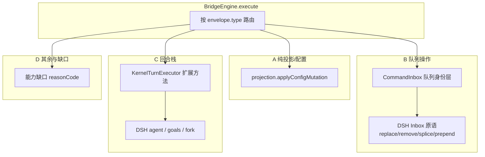
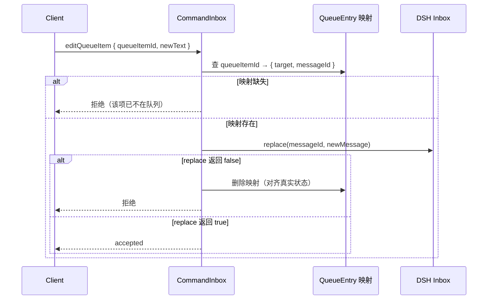
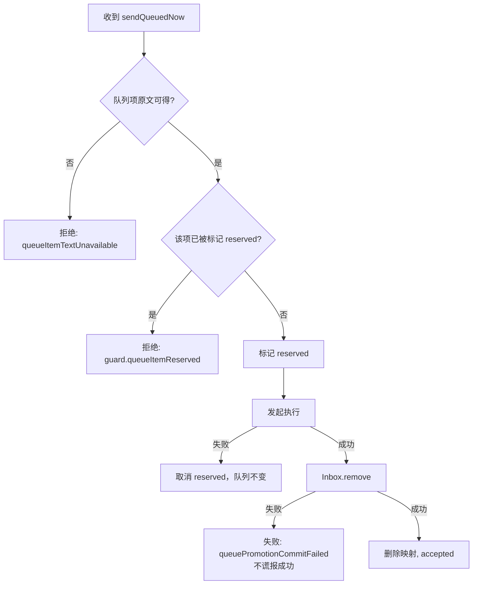

# kernel-bridge-03 设计

> 记录**实现结构的选择与理由**，以及那些「看起来可以但实际不行」的方案。
> 与 `known-differences.md` 的分工：本文件讲「怎么建」，那里讲「与计划书的差异」。

## 一、整体结构



## 二、为什么这样分组

分组依据是**「这条命令需要谁的状态」**，而不是「它属于哪个业务域」：

| 组 | 需要谁的状态 | 为什么不能混 |
| --- | --- | --- |
| A 纯投影 | 只需 `ProjectionLayer` | 与 01 的配置类命令同路径，走 `applyConfigMutation` 即可，**不需要回合栈** |
| B 队列 | 需 `CommandInbox`（身份）+ DSH `Inbox`（原语） | **必须双写且原子**：身份层与内容层分开，见 §三 |
| C 回合栈 | 需 `KernelTurnExecutor` + DSH agent | 要真实执行回合，**不能只改投影** |
| D 其余 | 需**不存在的**后端 | 只能如实回能力缺席 |

**关键判断**：A 组**不能**走 C 组的路径。`switchModelConfig` 若经执行器触发一次模型轮，就会
产生一次真实的模型调用——而 v4 语义是「配置切换」，不是「发一条消息」。这是最容易犯的错。

## 三、队列的「双写原子性」是难点

### 3.1 结构



### 3.2 为什么必须「映射 + DSH 双写」

- **只有映射**：DSH 里那条消息还是旧文本，模型会看到旧内容 → 用户改了却没生效；
- **只有 DSH**：v4 的 `order.queuePosition` 与 `queueItemId` 都失去依据 → 客户端队列视图错乱；
- **两者都写但不同步**：`replace` 返回 `false`（该项已被 drain）而映射还在 → 后续命令会操作一个不存在的项。

**因此**：`replace`/`remove` 的**布尔返回值是唯一权威**，映射必须跟着它收敛（见 3.1 的 `alt false` 分支）。

### 3.3 被否决的方案

| 方案 | 为什么不行 |
| --- | --- |
| 只维护 v4 侧队列，DSH 每次重建 | 会丢失 DSH 的持久记录（`splice` 的「durably record」语义），重启后队列丢失 |
| 直接用 DSH 的 `MessageId` 当 `queueItemId` | 违反「v4 身份由服务端发号」；且 `MessageId` 在 drain 后可能被复用/不可得 |
| 队列命令绕开 `CommandInbox`，直接调 DSH | 违反单一 admission（02 的 B15），会产生第二条写入路径 |
| `sendQueuedNow` 用「先移除再提交」 | 「移除成功但提交失败」会让用户输入**静默丢失**；必须先提交再移除，或显式失败 |

## 四、`sendQueuedNow` 的顺序选择

legacy 用 `V4QueuePromotionCommitError` 表达「已开始执行但移除失败」。本包沿用同一语义：



**核心**：**宁可显式失败，不可谎报成功**。若「执行已开始但移除失败」，用户会看到「发送失败」，
但消息其实发出去了——这比「说成功了但没发」好，因为用户会重试而不是错过。

## 五、12 行端口表（C2 完整）

```ts
/**
 * 本包交付的旧协议方法 → 执行形态。
 *
 * **这张表是 C2 的唯一事实来源**：它的行集合必须与
 * kernel-bridge-legacy 的 `PORT_BACKED_METHODS` 逐条对应（12 个）。
 * 人工清单已经两次漏掉 `session/close`，所以规模由测试直接对比集合，
 * 不靠清单核对。
 */
const HANDLED_METHODS: ReadonlyMap<string, HandledMethodShape> = new Map([...]);
```

**为什么用 `Map` 而不是 switch**：`Map` 的 `.size` 可以直接断言等于 12；
switch 的规模只能数 `case`，容易漏。且新方法必须显式加一行，不会因为漏写分支而静默缺席。

## 六、`session/close` 与 `session/stop` 的区别（实现前必须查清）

两者都「结束回合」，但语义不同：

| 命令 | 预期语义 | 待确认 |
| --- | --- | --- |
| `session/stop` | 停止**当前回合**，会话仍可继续 | 02 已实现（`agent.cancel({kind:"user"}, {keepInbox:true})`） |
| `session/close` | **关闭会话**：结束回合 + 释放会话资源 | 需查旧引擎行为：是否等价于 `stop` + 会话销毁？ |

**实现阶段要求**：查 legacy 的 `session/close` 语义（`contracts.ts` 有 schema，
但 `session-handlers.ts` **没有 handler**——需查更早的实现或 `@knorvia/shared` 的协议注释），
**在代码注释里写明依据**，不允许「照 `stop` 抄一份」。

## 七、缺口命令的 reasonCode 边界

```ts
/** 命令面已实现，但当前引擎没有该能力后端。 */
const CAPABILITY_ABSENT = "fault.command.capabilityAbsent";
```

**为什么不复用 `unsupported`**：
- `unsupported` 在 01/02 里的语义是「命令面还有未实现的命令」；
- 03 的收口断言（B25）要求 **34 条全部非 `unsupported`**；
- 若缺口命令也回 `unsupported`，收口断言将**永远无法通过**——那不是放宽断言能解决的，
  而是语义错误。

**客户端影响**：`fault.command.capabilityAbsent` 让客户端显示「当前内核暂不支持此功能」，
而 `unsupported` 会显示「未知命令」——两者对用户的意义完全不同。

## 八、测试的分组与解耦

| 测试文件 | 只测什么 | 不测什么 |
| --- | --- | --- |
| `config-session.test.mjs` | A 组：投影变化 | 不碰回合栈 |
| `queue-ops.test.mjs` | B 组：身份层与 DSH 原语的**一致性** | 不碰模型 |
| `fork-edit.test.mjs` | C 组：fork/edit/retry 的 DSH 映射 | 不碰队列 |
| `goal-commands.test.mjs` | C 组：目标 3 条 | 不碰 fork |
| `capability-gaps.test.mjs` | D 组：10 条缺口如实回缺席 | 不碰真实执行 |
| `no-unsupported.test.mjs` | B25 收口：34 条遍历 | 不断言具体语义 |
| `turn-seam.test.mjs` | B24：12/12 端口 | 不断言回合语义 |

**为什么这样分**：任一组改动只影响自己那个测试文件，定位快；
且 `no-unsupported.test.mjs` 是**纯收口断言**，不与语义断言混在一起——它失败时能立刻判断是
「某条命令漏接线」而不是「语义错了」。
