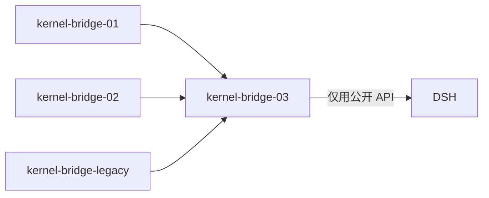

# kernel-bridge-03 接口

> 本包**不新增对外公开 API**：它补齐的是既有协议面的命令实现与 legacy 执行端口的方法行。
> 因此本文件冻结的是「本包对外可见的行为边界」，而非新的导出面。

## 一、对外可见面：零新增导出

| 项 | 结论 |
| --- | --- |
| 新增 `package.json` exports | **无** |
| 新增对外函数 / 类 | **无** |
| 修改既有导出签名 | **无** |

本包的实现**全部落在既有模块内部**：

| 文件（既有） | 本包对它做什么 |
| --- | --- |
| `kernel-bridge/bridge-engine.ts` | `execute()` 的 `default` 分支清零：26 条命令各接一条真实路径 |
| `kernel-bridge/turn-commands.ts` | 扩 `TURN_COMMAND_TYPES`，新增分组 C（回合栈）与 D（其余）的分派 |
| `kernel-bridge/legacy-port/index.ts` | `HANDLED_METHODS` 从 4 行扩到 **12 行**（C2 完整） |
| `kernel-bridge/command-inbox.ts` | 队列 5 条命令的 admission 层实现（`queueItemId` 发号与映射） |
| `kernel-bridge/turn-executor.ts` | 新增 fork / edit / retry / goal 等执行方法 |
| `kernel-bridge/projection-layer.ts` | 新增行派生（`modelChange`、`goalSet` 等既有行类型） |

**`entry.ts` 不动**（`route()` 与 `RunBridgeOptions` 归 legacy 边界）。

## 二、内部契约：本包内部模块间的接口

这些是包内契约（不对外），但必须冻结，因为它们决定了实现结构。

### 2.1 队列身份映射（`command-inbox.ts` 内部）

```ts
/** v4 队列项身份 ↔ DSH 消息身份的映射；它是「谁在队里、第几位」的唯一事实来源。 */
interface QueueEntry {
  /** 对外身份（v4 `order.queuePosition` 与队列命令都用它）。 */
  readonly queueItemId: string;
  /** 内部目标：回合级或步级（对应 DSH `Inbox.nextTurn` / `nextStep`）。 */
  readonly target: "next-turn" | "next-step";
  /** DSH 侧消息身份（`Inbox.replace` / `remove` 的入参）。 */
  readonly messageId: string;
}
```

**不变量**：
- `queueItemId` 只由 `CommandInbox` 发号；
- 任何队列变更都必须**同时**更新这份映射与 DSH `Inbox`；
- 映射缺失 = 该项已不在队列（drain/删除）→ 队列命令按拒绝处理。

### 2.2 回合执行器的新增能力（`turn-executor.ts` 内部）

```ts
/** 分组 C 的能力；缺席时对应命令回能力缺席，不伪造。 */
interface KernelTurnExecutor {
  // …02 已有的 sendText / stop / compact / createSession…
  forkAssistant?(request: { sessionId: string; rowId: string }): Promise<{ sessionId: string }>;
  editUserQuery?(request: { sessionId: string; rowId: string; newText: string }): Promise<void>;
  retryTurn?(request: { sessionId: string; rowId: string }): Promise<void>;
  sendGoalCommand?(request: { sessionId: string; text: string }): Promise<void>;
  pauseGoal?(request: { sessionId: string }): Promise<void>;
  resumeGoal?(request: { sessionId: string }): Promise<void>;
  createSelectionSideSession?(request: {
    parentSessionId: string;
    text: string;
  }): Promise<{ sessionId: string; admitted: "startNow" | "queue" | "guide" }>;
}
```

**为什么成员可选**：DSH 版本的 `fork` / `goals` 能力若在某个组合里缺席，
对应命令必须回**能力缺席**而不是崩溃。可选成员让「缺席」成为编译期可表达的合法状态。

## 三、能力缺席的 reasonCode（已冻结：`fault.command.capabilityAbsent`）

### 3.1 冻结值

```ts
/** 命令面已实现，但该能力在当前引擎/组合里尚缺（有归属包，待补）。 */
const CAPABILITY_ABSENT = "fault.command.capabilityAbsent";
```

### 3.2 三个 reasonCode 的语义各不相同（不得混用）

| reasonCode | 语义 | 谁产生 | 客户端应如何显示 |
| --- | --- | --- | --- |
| `unsupported` | **实现进度**语义：段 A 尚未接入这条命令 | 01/02 的骨架 | 「未知命令」（不该再出现） |
| `fault.command.capabilityUnsupported` | **设计如此**：该能力**永不支持**（既有先例） | 更早的层 | 「不支持此功能」（终态） |
| **`fault.command.capabilityAbsent`** | **当前缺失**：能力**待补**，有明确归属包 | 本包（缺口 10 条） | 「当前内核暂不支持，后续版本提供」（过渡态） |

**为什么必须三分**：客户端据此给出的用户提示完全不同——
「未知命令」是 bug 信号，「不支持」是产品边界，「暂不支持」是进度承诺。混用会让用户误解。

### 3.3 为什么选这个字面量（同族依据）

既有先例 **`fault.command.capabilityUnsupported`** 的形状是 `fault.<域>.<原因>`，
本包的 `fault.command.capabilityAbsent` 与之**同域同形**，只把「Unsupported（永不）」换成
「Absent（当前缺）」。因此它**不是新错误码族**，而是同一族里的一个新成员。

**与「不新增错误码」红线的区分**（Lead 已澄清）：

- 红线指的是**不新增 JSON-RPC 数字错误码**（`-32004` / `-32031` / `-32601` / `-32602` / `-32603`）；
- `data.reasonCode` 是**业务层字符串**，可以新增（既有 `unsupported`、`alreadyResolved`、
  `capabilityUnsupported` 都在这一层）。

### 3.4 适用命令（10 条缺口）

| 分组 | 命令 |
| --- | --- |
| 工作流 **4** | `resumeWorkflowRun`、`startSavedWorkflow`、`amendWorkflowRunSettings`、**`discardSharedContext`**（与工作流同属跨会话数据传递） |
| 工作区钩子 5 | `respondWorkspaceHookReview`、`toggleWorkspaceHookReviewItem`、`revokeWorkspaceHookTrust`、`requestWorkspaceHookReview`、`snoozeInteractionAutoResolution` |
| 文件回退 1 | `applyFileRewind`（待 `kernel-plugin-rewind`） |

**归属包**（`kernel-switch` 硬前置，三包合并前不得切换）：
`kernel-plugin-workflow`（4 条）、`kernel-plugin-hooks`（5 条）、`kernel-plugin-rewind`（1 条）。

> `discardSharedContext` 由 Lead 2026-10-20 裁决**并入 `kernel-plugin-workflow`**，理由：它与工作流同属「跨会话数据传递」，且不为一条命令新开一个包（计划书按功能模块分包）。计划书未单独登记 shared-context 包。

### 3.5 约束

1. **不复用 `unsupported`**：它是实现进度语义，而 B25 收口断言要求 34 条全部**非** `unsupported`；
2. **不得伪造成功**：缺口命令绝不回 `accepted` / `noop`（B20–B23 已断言）；
3. **载荷校验仍然生效**：非法载荷应回参数错误，与能力缺席区分开；
4. reasonCode 是**稳定词表**，一旦发布不改字面量。

## 四、对 legacy 端口面的契约（`registerLegacyExecutionPort`）

本包**扩大**了端口对象的 `HANDLED_METHODS` 表，但**不改变端口接口本身**：

```ts
// kernel-bridge-legacy/interface.md §四（冻结，本包不改）
interface LegacyExecutionPort {
  execute(request: LegacyExecutionRequest): Promise<LegacyMethodOutcome>;
}
```

**注册仍是启动期一次动作**，由 `BridgeEngine.start()` 完成（02 已建立，见 02 的 `design.md` §十三）。
本包只把表从 4 行扩到 12 行，**注册调用点不变**。

## 五、依赖方向



- `03 → 01/02/legacy`，**不反向**；
- `01`、`02`、`legacy` **不 import `03`**；
- `03` 与 `02` **同一个执行器实例**（C2 的实质要求），因此 03 不新建执行器。

## 六、冻结面（不得改动）

| # | 冻结项 | 事实源 |
| --- | --- | --- |
| 1 | 34 个命令字面量 | `packages/shared/src/protocol-v4/command.ts` 的 `commandPayloadSchemas` |
| 2 | 每条的 payload 形状 | 同上 |
| 3 | ACK 结果形状 | `commandResultSchema`（`command.ts` L367 起） |
| 4 | 帧结构与序号规则 | `kernel-bridge-01` |
| 5 | legacy 端口接口 | `kernel-bridge-legacy/interface.md` §四 |
| 6 | 错误码族 | `-32004` / `-32031` / `-32601` / `-32602` / `-32603`（不新增） |
| 7 | `entry.ts` | 本包不改 |
