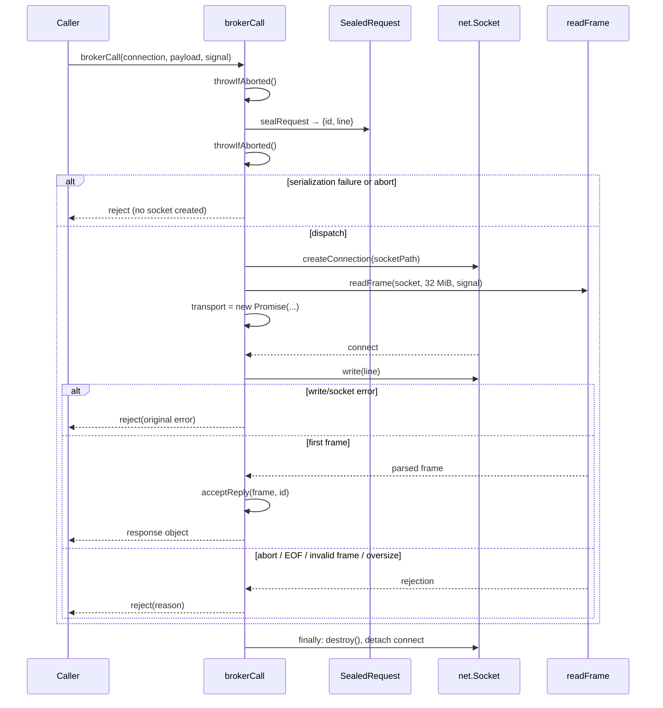

// SPDX-License-Identifier: Apache-2.0

# node-repl-host-broker 设计（v1）

## 状态所有者

每次 `brokerCall` 独占以下状态，模块级没有连接、响应或取消状态：

| 状态             | 所有者                         | 生命周期                                         |
| ---------------- | ------------------------------ | ------------------------------------------------ |
| 请求 id 与请求行 | 本次调用的 `SealedRequest`     | 建连前一次生成；调用方修改载荷不影响它           |
| socket           | 本次调用                       | `finally` 中销毁；成功、失败、取消都走同一路径   |
| 传输故障         | 本次调用的 `transport` Promise | `error` 事件或写回调错误拒绝；结算后不再改变结果 |
| 读取终态         | `readFrame`                    | 首帧、EOF、错误或调用方取消中第一个生效          |
| 调用方取消       | 传入的 `AbortSignal`           | 本层只读，不创建新控制器；reason 原样保留        |

## 模块划分

| 单元          | 职责                                                                 |
| ------------- | -------------------------------------------------------------------- |
| `sealRequest` | 生成 UUID、覆盖 `token`/`id`、在建立连接前完成 JSON 序列化并封装错误 |
| `acceptReply` | 响应对象校验、id 关联、`ok` 判定与业务错误原文                       |
| `brokerCall`  | 调度一次连接：连接事件、写入、传输故障通道、帧读取竞争与资源释放     |
| `readFrame`   | 既有帧解码边界；本包不重写，也不改变其 32 MiB 与错误文案             |

与旧实现的关键差别：不再创建内部 `AbortController` 并把组合信号交给帧读取，而是让
“传输故障 Promise”与“帧读取 Promise”竞争同一个终态。帧读取仍然只观察调用方信号；
写失败与 socket 错误从独立通道以原始 reason 拒绝。

## 事件顺序

错误监听不随结算立即移除，而是保留到 `close`：结算后、销毁前的异步写错误因此不会成为
未处理事件。`close` 同时移除该监听；`finally` 只负责标记结算、移除 `connect` 监听并销毁 socket。

## 行为条目落点

| 条目 | 实现位置                                                            |
| ---- | ------------------------------------------------------------------- |
| B1   | `BrokerConnection` / `brokerCall` 导出；每次调用局部状态            |
| B2   | `sealRequest` + 两处 `abort.throwIfAborted()`                       |
| B3   | `acceptReply`；固定文案常量                                         |
| B4   | `fail`/`transport` 通道、`dispatch` 守卫、`finally` 与 `close` 清理 |
| B5   | `readFrame(socket, RESPONSE_LIMIT, abort)`；帧层负责具体文案        |
| B6   | 无模块级状态；`createConnection(socketPath)` 直接接受两种平台路径   |

## 资源与并发不变式

1. 任何终态都只结算一次 Promise；`settled` 之后的迟到事件被忽略，但错误监听在 `close` 前仍存在。
2. 每次调用只创建一个 socket、只写一次请求；没有重试、队列或缓存。
3. 并发调用之间没有共享对象；取消或失败只作用于自己的连接。
4. `readFrame` 的读取监听由它自己在终态释放；本层移除 `connect` 监听并销毁 socket。
