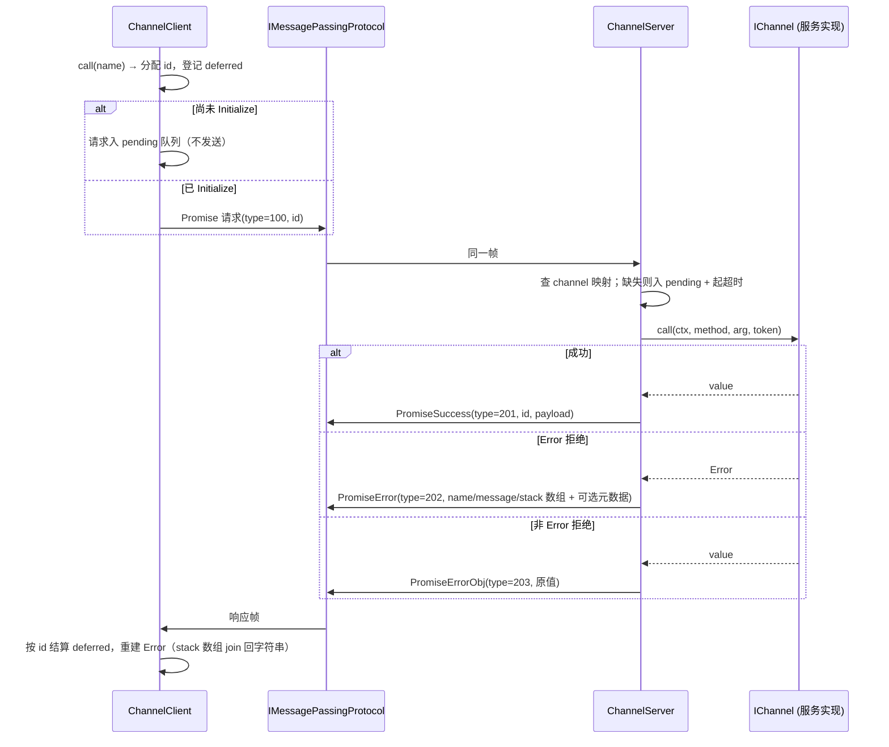
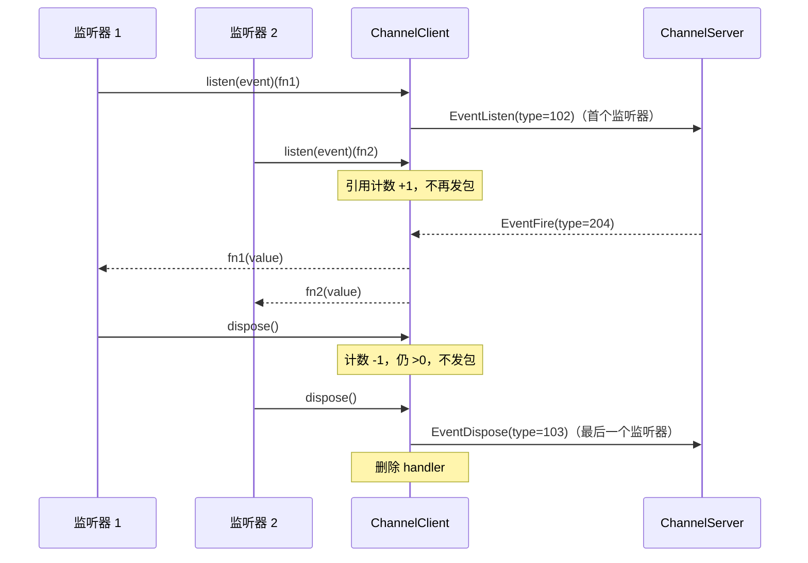
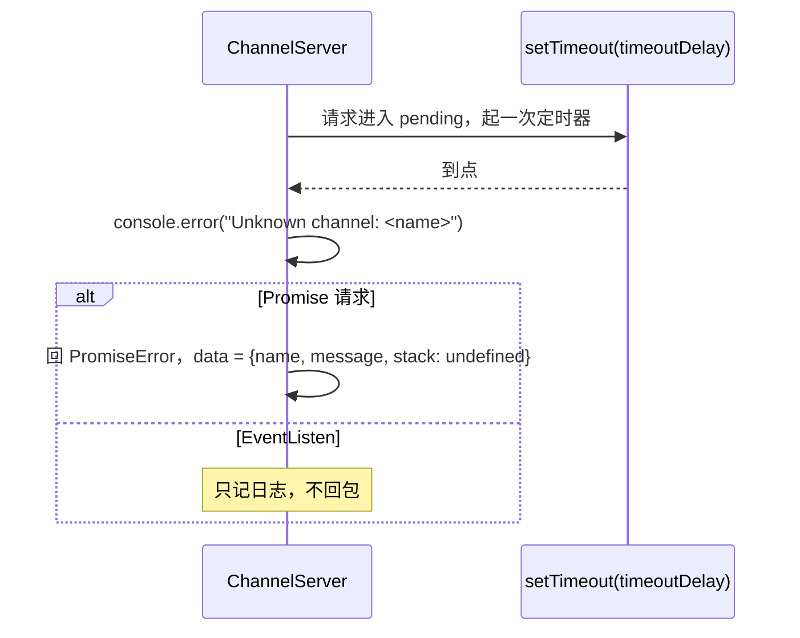
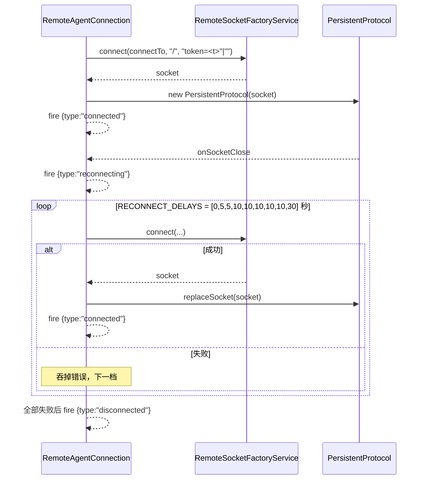
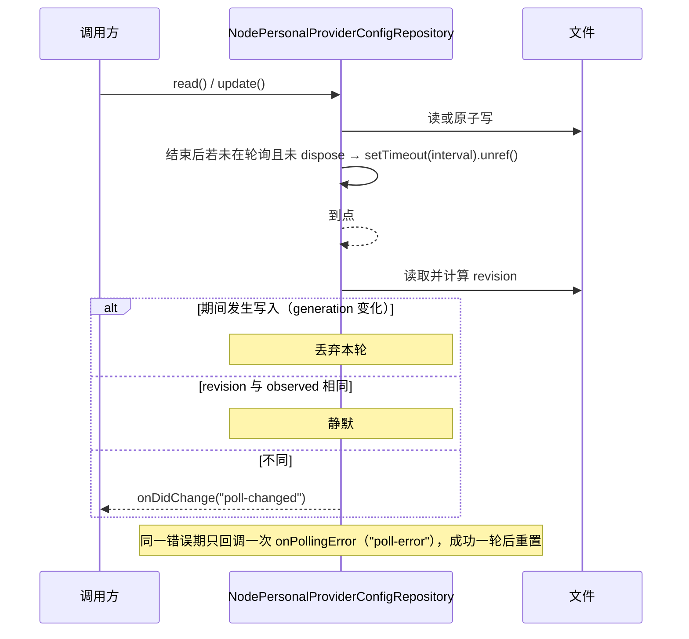

# packages-02 设计（design.md）

替换实现的设计说明。合同（`interface.md` / `behavior.md` / `acceptance.md`）是不可变部分；
本文件描述**内部怎么组织**。替换阶段可以继续调整内部结构，但 `interface.md` 列出的模块路径、
导出名与签名必须逐字一致。

范围：20 个 rpc 文件（16 个 `src/*.ts` + 4 个 `examples/*.ts`）与 9 个 `provider-node/src` 模块，
清单见 `scope-files.json`。

## 1. 状态所有者

本包的 rpc 部分是**框架**：每个实例拥有自己的表与生命周期，模块级只有一个「装配点」；
provider-node 部分把文件与既有服务（`@knorvia/provider`、`@knorvia/shared/node`）当作唯一事实来源，
自己只持有缓存与生命周期。没有跨模块的可变全局状态。

| 状态                                    | 所有者                                                         | 生命周期与说明                                                                             |
| --------------------------------------- | -------------------------------------------------------------- | ------------------------------------------------------------------------------------------ |
| 监听器集合与 dispose 标记               | `Emitter` 实例（`foundation.ts`）                              | 构造到 `dispose()`；`fire` 对快照迭代（B1）                                                |
| 注册表（resolver / socket factory）     | `RemoteAuthorityResolverService`、`RemoteSocketFactoryService` | 服务实例持有；register 返回只移除本次登记的 disposable（B15）                              |
| 连接集 + channel 注册表                 | `IPCServer` 实例（`ipc.ts`）                                   | 首条 protocol 消息建立连接，断开事件移除；`dispose` 清两份表（B13）                        |
| channel 映射 + 活动请求 + pending 队列  | `ChannelServer` 实例（`channelServer.ts`）                     | 实例持有；`dispose` 取消活动请求，不清未到点的 pending 定时器（旧行为，B9）                |
| 请求表 + 初始化状态机 + 事件 handler    | `ChannelClient` 实例（`channelClient.ts`）                     | 实例持有；`dispose` 拒绝未决请求并冻结入口（B8）                                           |
| 协议会话：发送 id、ack、replay 缓冲     | `PersistentProtocol` 实例（`persistent-protocol.ts`）          | 实例持有；`replaceSocket` 换传输但不换会话 id 序列（B6）                                   |
| 连接状态机（connected/reconnecting）    | `RemoteAgentConnection` 实例（`remote.ts`）                    | 实例持有；每次 `socketClose` 启动独立重连循环（旧行为，B16）                               |
| 遥测 sink                               | `network-telemetry-middleware.ts` 的模块级变量                 | 由 `setNetworkTelemetrySink` 装配；**发出时**读取，后设置的 sink 对已构造中间件生效（B18） |
| observed revision + 监听器 + 轮询定时器 | `NodePersonalProviderConfigRepository` 实例                    | 实例持有；文件是事实来源，revision 由编码后字节的 sha256 派生（B23/B24）                   |
| Built-in source / 远端同步器 / 定时器   | `NodeProviderConfigRuntime` 实例                               | 实例持有；`dispose` 顺序固定：定时器→监听器→远端→configService→personal→source（B27）      |
| 两个 service 的生命周期                 | `NodeProviderRegistryRuntime` 实例                             | 先 registryService 再 configRuntime（B28）                                                 |

设计约束：不引入第二份可变副本（例如不在 client 侧缓存服务端状态、不在 runtime 里镜像仓储快照）；
异步时序用事件与 promise 表达，不用 sleep 或固定超时凑时序（唯一允许的定时器是合同规定的
轮询间隔、60s 检查与 B9 的未知 channel 超时）。

## 2. 模块划分

模块路径与导出面由 `interface.md` 冻结，因此**文件边界不能动**；能在文件内部调整的是职责切分。
旧实现在每个文件里按「类型 → 实现 → 组合器」顺序平铺；新实现按**数据流方向**分层：每个文件先
定义自己的数据形状，再写纯转换，最后才是拥有状态的类。下面是各文件内部的职责带：

```
packages/rpc/src/
  foundation.ts                  // 值语义：disposable、Event 组合器、Emitter/Relay/Multiplexer、取消
  buffer.ts                      // 字节容器（VSBuffer）与其视图/拼接
  serialization.ts               // 读写游标 + VQL 编码/解码（标签、7 位 varint、嵌套 Uint8Array 标记）
  protocol.ts                    // 帧头与分帧（ChunkStream/SocketProtocol）、QueuePair、MessagePort 流控
  persistent-protocol.ts         // 会话层：id/ack/replay/keepalive 与收发状态机
  channels.shared.ts             // 请求/响应枚举与两个 transport 无关的 channel 接口
  channelClient.ts               // 客户端请求表 + 初始化门 + listen 引用计数
  channelServer.ts               // 服务端 channel 映射 + 每个请求一个取消源 + pending 超时
  delayedChannel.ts              // Promise<IChannel> 的门面（call 等待、listen 延迟订阅）
  channels.ts                    // 对外装配：ChannelServer/ChannelClient/getDelayedChannel
  proxy-channel.ts               // 服务对象 ↔ IServerChannel/IChannel 的双向适配
  ipc.ts                         // 连接装配（IPCServer/IPCClient）+ 静态路由
  remote.ts                      // authority 解析、socket 工厂、URI 变换、重连循环
  logging-middleware.ts          // 日志装饰器（服务端/客户端两侧）
  network-telemetry-middleware.ts// 观测装饰器 + 模块级 sink
  index.ts                       // 冻结入口：按基础设施→序列化→传输→channel→连接→远程的顺序再导出
packages/rpc/examples/           // 四个可执行示例，各自自洽（不共享模块）
packages/provider-node/src/
  runtime-paths.ts               // 环境变量名 + 路径解析（纯函数）
  provider-config-file-codec.ts  // 存储文档 ↔ 快照（严格校验 + 版本迁移链）
  personal-provider-config-repository.ts // 文件仓储：锁、规范化、revision、轮询
  model-selection-config-repository.ts   // 默认模型选择的仓储视图（委托 + 本地订阅集）
  model-selection-facade.ts      // 对外门面装配（分类器 + 旧档位解析器）
  legacy-reasoning-level-renames.ts      // 25 条 rename 表（模块内，不进包入口）
  legacy-reasoning-level.ts      // 旧档位解析（WeakMap 缓存）
  provider-config-runtime.ts     // Built-in source + 远端同步器 + 60s 检查的生命周期
  provider-registry-runtime.ts   // registry service + account source 的生命周期
```

与旧实现的差别（这是替换的核心，不是改名）：

- rpc 的 `protocol.ts` 把「帧编解码」与「socket 事件泵」拆成两个对象（`ChunkStream` 只管字节、
  `SocketProtocol` 只管订阅与投递），旧实现把两者混在一个类里；`persistent-protocol.ts` 因此只
  处理会话语义（id/ack/replay），不再碰帧头布局。
- `channelServer.ts` 与 `channelClient.ts` 各自持有单侧的请求表，`channels.shared.ts` 只留枚举与
  接口；旧实现把两侧放进同一个文件，读的时候必须来回跳。
- `provider-config-file-codec.ts` 把「版本校验 → 迁移链 → 结构解析 → 规范化输出」写成四个独立步骤
  （纯函数），旧实现是一串嵌套的条件分支。

## 3. 关键数据结构

- **帧头**（B5）：`type:u8 | id:u32BE | ack:u32BE | length:u32BE`，共 13 字节；`ProtocolMessageType`
  是运行时枚举，数值不可变。
- **VQL**（B4）：`Undefined=0/String=1/Buffer=2/VSBuffer=3/Array=4/Object=5/Int=6`；整数用 7 位
  LE varint，按有符号 32 位回读；嵌套 `Uint8Array` 用两键标记对象
  `{__knorvia_rpc_nested_uint8array_v1: <b64>}`（同时接受旧的 `__zcode_rpc_nested_uint8array_v1`），
  键数不是恰好 2 时按普通对象处理。
- **请求/响应编号**（B8/B9）：`RequestType.Promise=100/PromiseCancel=101/EventListen=102/EventDispose=103`；
  `ResponseType.Initialize=200/PromiseSuccess=201/PromiseError=202/PromiseErrorObj=203/EventFire=204`。
- **会话层常量**（B6）：高水位 1 MiB、低水位高/4、replay 上限 8 MiB、grace 45 s、keepalive 5 s、
  ack 检查 20 s；首帧 `id=1, ack=0`。
- **MessagePort 控制对象**（B7）：`{__knorviaRpcControl:"connection-flow-v1", state:"saturated"|"drained"}`，
  恰好两个键；`send` 投递 `buffer.buffer`（保留同一 ArrayBuffer 身份）。
- **仓储快照**（B23）：`{revision, providers, models, providerOrder, defaultModelSelection?}`，
  对象冻结；`revision = sha256(JSON.stringify(encodeProviderConfigFile(update)))`。
- **观测记录**（B18）：`{transport:"rpc", interface:"<channel>.<command>", durationMs, ok,
errorKind?, attempt:1}`；`errorKind` 只在失败时出现。

## 4. 事件顺序

### 4.1 客户端调用（B8）与服务端结算（B9）



Initialize 到达时 client 按登记顺序 flush pending 队列（宏任务内）；服务端 `registerChannel`
在下一个宏任务 flush 同名 pending 请求。取消与响应竞态时先到者胜：前者发 `PromiseCancel` 并以
`Error("Cancelled")` 拒绝，后者正常结算。

### 4.2 事件订阅与释放（B8）



新监听器加入后事件继续分发；`dispose()` 后 `listen` 返回 `Event.None`。

### 4.3 未知 channel（B9）



`dispose()` 不清理尚未到点的 pending 定时器（旧行为，`known-differences.md` §5）。

### 4.4 远端重连（B16）



每次 `socketClose` 启动**独立**循环（旧行为：可能重叠）；`dispose` 不发状态事件。

### 4.5 provider 配置轮询（B24）



## 5. 每条 B 的落点

| 条目                          | 实现落点                                                                                        | 契约测试                                                        |
| ----------------------------- | ----------------------------------------------------------------------------------------------- | --------------------------------------------------------------- |
| B1 Foundation 原语            | `packages/rpc/src/foundation.ts`                                                                | `rpc-foundation.test.mjs`                                       |
| B2 CancellationTokenSource    | `foundation.ts`（`CancellationToken` 命名空间 + `CancellationTokenSource`）                     | `rpc-foundation.test.mjs`                                       |
| B3 VSBuffer                   | `packages/rpc/src/buffer.ts`                                                                    | `rpc-foundation.test.mjs`                                       |
| B4 VQL 序列化                 | `packages/rpc/src/serialization.ts`                                                             | `rpc-wire.test.mjs`                                             |
| B5 ChunkStream 与帧头         | `packages/rpc/src/protocol.ts`（`ChunkStream`）                                                 | `rpc-wire.test.mjs`                                             |
| B6 SocketProtocol 分帧        | `protocol.ts`（`SocketProtocol` + `createQueuePair`）                                           | `rpc-wire.test.mjs`                                             |
| B7 MessagePortProtocol        | `protocol.ts`（`MessagePortProtocol`）                                                          | `rpc-wire.test.mjs`                                             |
| B8 ChannelClient              | `packages/rpc/src/channelClient.ts`                                                             | `rpc-channels.test.mjs`                                         |
| B9 ChannelServer              | `packages/rpc/src/channelServer.ts`                                                             | `rpc-channels.test.mjs`                                         |
| B10 getDelayedChannel         | `packages/rpc/src/delayedChannel.ts` + `channels.ts` 的装配                                     | `rpc-channels.test.mjs`                                         |
| B11 ProxyChannel.fromService  | `packages/rpc/src/proxy-channel.ts`                                                             | `rpc-proxy.test.mjs`                                            |
| B12 ProxyChannel.toService    | `proxy-channel.ts`                                                                              | `rpc-proxy.test.mjs`                                            |
| B13 IPCServer / IPCClient     | `packages/rpc/src/ipc.ts`                                                                       | `rpc-ipc-remote.test.mjs`                                       |
| B14 StaticRouter              | `ipc.ts`                                                                                        | `rpc-ipc-remote.test.mjs`                                       |
| B15 远程解析/工厂/URI         | `packages/rpc/src/remote.ts`                                                                    | `rpc-ipc-remote.test.mjs`                                       |
| B16 RemoteAgentConnection     | `remote.ts`                                                                                     | `rpc-ipc-remote.test.mjs`                                       |
| B17 日志中间件                | `packages/rpc/src/logging-middleware.ts`                                                        | `rpc-middleware.test.mjs`                                       |
| B18 网络遥测中间件            | `packages/rpc/src/network-telemetry-middleware.ts`                                              | `rpc-middleware.test.mjs`                                       |
| B19 示例程序                  | `packages/rpc/examples/01..04-*.ts`                                                             | `rpc-examples.test.mjs`（仅源码入口）                           |
| B20 rpc 冻结导出面            | `packages/rpc/src/index.ts`                                                                     | `rpc-surface.test.mjs`                                          |
| B21 运行时路径与环境变量      | `packages/provider-node/src/runtime-paths.ts`                                                   | `provider-paths-codec.test.mjs`                                 |
| B22 Provider Config 编解码    | `packages/provider-node/src/provider-config-file-codec.ts`                                      | `provider-paths-codec.test.mjs`                                 |
| B23 仓储读取/写入/恢复/事件   | `packages/provider-node/src/personal-provider-config-repository.ts`                             | `provider-repository.test.mjs`                                  |
| B24 轮询                      | `personal-provider-config-repository.ts`                                                        | `provider-repository.test.mjs`                                  |
| B25 Model Selection 仓储      | `packages/provider-node/src/model-selection-config-repository.ts`                               | `provider-repository.test.mjs`                                  |
| B26 门面与旧档位映射          | `model-selection-facade.ts` + `legacy-reasoning-level.ts` + `legacy-reasoning-level-renames.ts` | `provider-facade.test.mjs`                                      |
| B27 Provider Config Runtime   | `packages/provider-node/src/provider-config-runtime.ts`                                         | `provider-runtime.test.mjs`                                     |
| B28 Provider Registry Runtime | `packages/provider-node/src/provider-registry-runtime.ts`                                       | `provider-runtime.test.mjs`                                     |
| B29 provider 冻结导出面       | `packages/provider-node/src/index.ts`（re-export 桶，不在重写清单）                             | `provider-surface.test.mjs`                                     |
| B30 Provider Config 往返      | `provider-config-file-codec.ts` + `personal-provider-config-repository.ts`                      | `provider-paths-codec.test.mjs`、`provider-repository.test.mjs` |

## 6. 未覆盖项的落地口径

`acceptance.md` 列出的未覆盖项（示例的中间输出顺序、遥测 sink 的宿主实现、`@knorvia/provider`
规则表的全部字段、Windows 专属路径分支）按「与旧实现接受/拒绝集合等价」自查：实现只依赖合同
列出的公开行为，未在合同里出现的分支不额外添加兜底逻辑；差异若出现，登记进
`known-differences.md` 而不是就地放宽测试。

## 7. 桩与回退

替换开始时用 `stubs/` 覆盖 29 个目标文件，契约测试 13/13 文件全部失败（`gate-old.json` 的
`stubs` 段）。实现完成后删除全部桩与旧实现，不留回退路径；`grep -r "not implemented: packages-02"`
必须为空。
