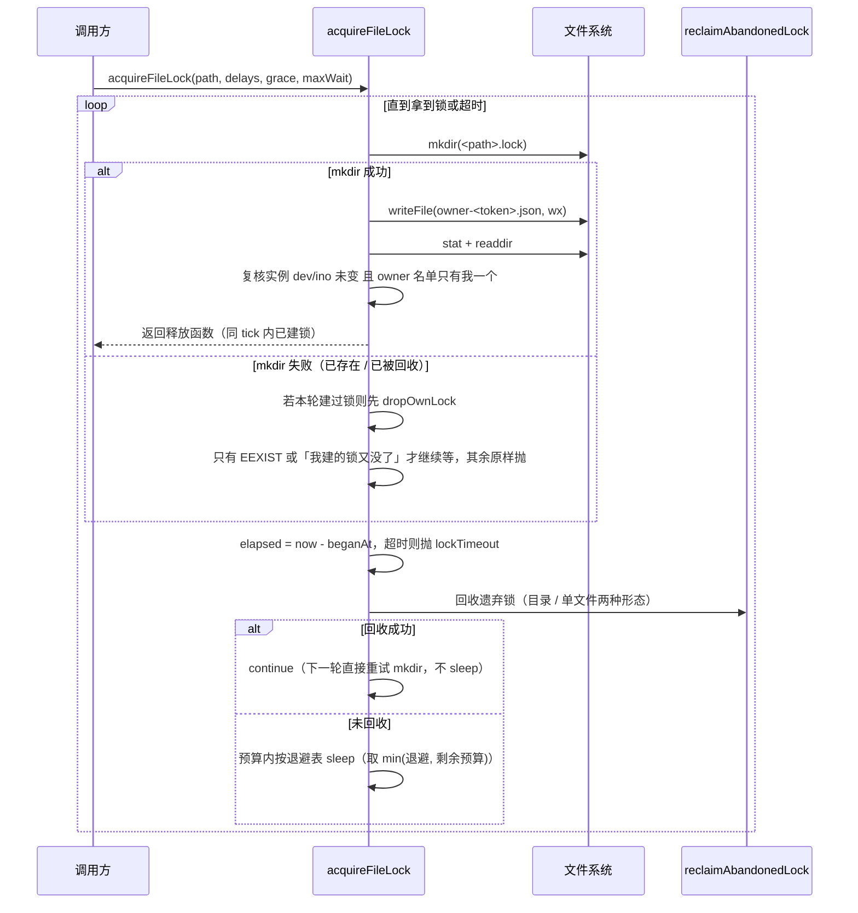
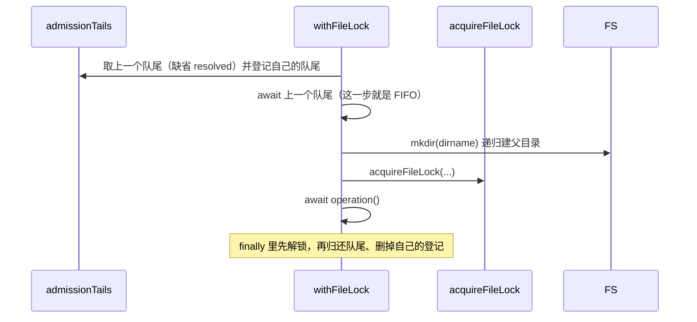

# shared-01 替换设计（design.md）

合同 `specs/contracts/shared-01` **v2**；本文件描述替换实现的模块划分、状态所有者、关键数据结构、
异步事件顺序与 B1–B44 的落点，供「替换验收」清单的「`design.md` 与实现一致」逐项核对。
实现全部落在 `packages/shared/src/node/**` 与 `packages/shared/src/protocol-v4/**` 的 27 个继承文件里
（就地重写，模块路径与两个入口导出面不变）。

## 一、范围与不变量

| 不变量                                                                             | 落点                                                                                               |
| ---------------------------------------------------------------------------------- | -------------------------------------------------------------------------------------------------- |
| `@knorvia/shared/node` 13 个导出、`@knorvia/shared/protocol-v4` 571 项导出逐名对应 | `src/node.ts`、`src/protocol-v4/index.ts` 两个 re-export 桶；`interface.md` / 附录为 oracle（B43） |
| 27 个继承模块路径存在                                                              | B44（`surface.test.mjs` 读 `scope-files.json` 逐个 `existsSync`）                                  |
| wire 帧字节级不变                                                                  | `fixtures/frames/encode-cases.json`、`measure-cases.json` 录制金样（B13/B14/B16）                  |
| 限额数字、错误词表、zod issue 文案与 path 不变                                     | 各常量表与错误构造（B2/B15/B17/B31/B34/B41/B42）                                                   |
| 不写日志（`behavior.md` 通用约定）                                                 | 全包无 `logger`/`console`；错误只以抛出的错误对象表达                                              |

## 二、模块划分

### `node/`（6 个继承文件）

| 文件                           | 职责                                                        | 关键私有件                                                                                                                                                                                                                                                                                                    |
| ------------------------------ | ----------------------------------------------------------- | ------------------------------------------------------------------------------------------------------------------------------------------------------------------------------------------------------------------------------------------------------------------------------------------------------------- |
| `atomicFileLock.ts`            | 跨进程文件锁：抢锁、等待退避、遗弃锁回收、超时错误          | `systemCode` / `trustedClock` / `decodeOwnerRecord` / `processResponds` / `looksLikeOwnerFile` / `ownerRecyclable` / `everyOwnerRecyclable` / `reclaimAbandonedLock` / `lockTimeout` / `isAccessRefusal` / `ignoreCleanupFault` / `dropOwnLock`；定值 `LOCK_STILL_HELD`、`LOCK_TAKEN_DOWN`、`ACCESS_REFUSALS` |
| `lockInstanceObserver.ts`      | 「这把锁我第一次看见是什么时候」的读数表，供无主 grace 起算 | `LockSighting`、`signatureOf`（dev/ino/birthtime/mtime 模板串）、`rememberSighting`                                                                                                                                                                                                                           |
| `privateFilePersistence.ts`    | 三件工具：进程内串行锁包装、原子文本写、损坏文件备份        | `withFileLock`（队列 `admissionTails`）、`stageTempName`、`moveIntoPlaceWithBudget`、`ioCode`、`worthRenamingAgain`、`RENAME_HICCUPS`                                                                                                                                                                         |
| `nodeSelfResourceTelemetry.ts` | CPU/时钟差分 → 资源样本；无 IO、无定时器                    | `CpuReading` / `ReadingSnapshot` / `toFixedRatio` / `clampCoreCount` / `busyCoresBetween` / 采样器闭包内的 `takeReading` 与 `baseline`                                                                                                                                                                        |
| `subagentMarkdownMigration.ts` | 状态 JSON 迁移 + 用户目录 markdown 递归迁移                 | `verifyUntouched`、`rewriteUnderLock`、`walk` 闭包、`MARKDOWN_EXT`                                                                                                                                                                                                                                            |
| `officialPluginCache.ts`       | 官方插件市场缓存根扫描（旧写布局 → 新读）                   | 私有条目判定与排序、临时条目跳过                                                                                                                                                                                                                                                                              |

### `protocol-v4/`（21 个继承文件）

按「schema 词汇表 → 帧编解码 → run 归约 → 展示/审核载荷」四组：

1. **帧与编码**：`wire.ts`（帧 schema 与联合类型，含 `createTopicWireFrameSchema` 的跨字段规则）、
   `wire-codec.ts`（分片二分探测、三层承载计量、编码错误族）、`delta.ts`、`submission.ts`、`fork.ts`。
2. **run 状态**：`workflow-runs.ts`（限额表 + run/actor/node/usage/concurrency/report/question 各
   输入输出 schema，纯词汇表、不含归约逻辑）、`workflow-runs-started.ts`（`reduceRunStarted`：
   残影剥除、用量归零）、`workflow-runs-lineage.ts`（`readRunIdField` / `readWorkflowRunStopReason`：
   lineage 两端读取与停止原因白名单）、`workflow-run-settings-command.ts`（三态载荷与拒绝词表）。
3. **展示与产物**：`create-workflow-display.ts`（工具卡 display + 私有因果图 schema）、
   `workflow-artifact.ts`、`workflow-workspace.ts`、`workflow-workspace` 的两条 v4 查询、
   `workspace-hook-review.ts`（信任态词表、审核请求载荷与三处计数一致性）。
4. **会话与配置**：`profiles.ts`、`session-config.ts`、`sessions-index.ts`、`input-intent.ts`、
   `shared-context-import.ts`、`shared-context-ref.ts`、`attachment-ref.ts`、`cuaPermission.ts`。

> 公开模块只承担「导出 + 转发 + 词汇表」，实现内部怎么重组由本设计决定；两个入口桶不放逻辑。

## 三、状态所有者

| 状态             | 唯一所有者                                                                 | 生命周期                                          | 备注                                                                         |
| ---------------- | -------------------------------------------------------------------------- | ------------------------------------------------- | ---------------------------------------------------------------------------- |
| 跨进程互斥       | 锁目录 `<file>.lock`（含 `owner-<token>.json`）                            | 抢到锁 → 释放函数被调用                           | 目录 `mkdir` 的原子性是互斥判据；owner 名单是复核判据                        |
| 进程内 FIFO 队列 | `privateFilePersistence` 模块级 `admissionTails: Map<path, Promise<void>>` | 入队 → 该轮 finally 里归还并自删                  | 只在 `withFileLock` 内读写，没有第二条写入路径                               |
| 锁实例首观测时刻 | `createLockInstanceObserver()` 返回的闭包，表 `ledger`                     | **单次 `acquireFileLock` 调用内**，调用结束即丢弃 | 换锁（四元组变）即重新起算                                                   |
| 自采样基线       | `createNodeSelfResourceSampler()` 返回对象的 `baseline` 局部量             | 采样器实例存活期                                  | 构造时即取一次读数，第一个 tick 就能出样本；每次采样先取新读数再整体替换基线 |
| 迁移结果清单     | `migrateUserSubagentMarkdown` 的 `outcome` 局部量                          | 单次调用                                          | 只读递归，不跨调用共享                                                       |
| run 状态         | **无本包状态**：reducer 全是纯函数，状态由调用方（会话快照）持有           | —                                                 | 不存在本包内的第二份副本                                                     |

## 四、关键数据结构

- `OwnerRecord { bornAt, holder }`：owner 元数据解码结果，两个字段独立降级为 `null`。
- `ReclaimOutcome`：只取两个定值 `LOCK_STILL_HELD` / `LOCK_TAKEN_DOWN`（`trouble` 仅在未知错误时出现）。
- `LockSighting { openedAt, signature }`：按锁路径索引的观测记录。
- `ReadingSnapshot { cpu, clockNs }`：CPU 微秒与单调时钟纳秒必须成对出现。
- `SweepFailure { path, error }`：迁移失败记录；`MarkdownSweepResult { migrated, failures }` 为汇总。
- `RoutingShape`（`wire.ts`）：两种物理帧共享的外层可路由字段，键序即线上字节序。
- `WireEnvelope<F>`（`wire-codec.ts`）：complete/fragment 共享的七个外壳字段，逐键赋值装配。
- `WORKFLOW_RUNS_LIMITS` / `WORKFLOW_WORKSPACE_LIMITS`：限额常量表，**取值即契约**。

## 五、事件顺序（异步与时序）

### 1. 抢锁：`acquireFileLock` 的一轮

- 无主 grace 的实际生效值 = `min(max(grace,0), max(floor(maxWait/2), 0))`，在进入循环前钳好一次。
- 释放函数 `await dropOwnLock(...)`：owner 文件与锁目录各自容错删除，删不掉不算错。

### 2. `withFileLock`：进程内排队 + 跨进程互斥

- **顺序不可换**：先 `await unlock?.()`，再 `releaseTurn()` 并按「登记仍是自己」的条件自删；
  内层再套一层 `try/finally`，保证 `unlock()` 抛错时队列照样归还（否则后续调用方永久等待）。
- `operation` 的异常原样向外传，锁与队列在任何退出路径上都释放（B5）。

### 3. 原子写 `atomicWritePrivateTextFile`

1. 算临时名（`pid`+`时间`+`随机`，`.` 前缀）→ 递归建父目录 → `writeFile(staging, {flag:"wx", mode:0o600})`
2. `moveIntoPlaceWithBudget`：`rename` 失败且错误码 ∈ `{EPERM, EBUSY, EACCES}` 才按预算退避重试，
   预算用尽或其它错误直接抛。
3. 任何一步失败 → `rm(staging, {force:true})` 后重抛；成功路径不留临时文件（B6）。

### 4. 子代理文件迁移 `rewriteUnderLock`

`lstat(是普通文件)` → `withFileLock` → 锁内再判可写 → 读原文 → 变换 → 内容没变就跳过 →
写临时文件 + 补权限 → **复核 `verifyUntouched`（inode/dev/目录真实路径/当前内容四选一不符即中止）** →
`rename` 顶上 → `finally` 清临时文件。坏 JSON / 缺文件安静返回（B8、B9）。

### 5. run 归约

`workflow-runs-started` / `workflow-runs-lineage` 等都是**纯函数**：输入 `(state, payload)` → 输出新 state，
无 IO、无定时器、无共享状态；时序断言用状态序列（B35/B36）。

## 六、B1–B44 落点

| B       | 落点（文件 · 关键件）                                                                                                                                                                                                                                                                                                                                                                       |
| ------- | ------------------------------------------------------------------------------------------------------------------------------------------------------------------------------------------------------------------------------------------------------------------------------------------------------------------------------------------------------------------------------------------- |
| B1–B4   | `atomicFileLock.ts`：`acquireFileLock` 的 mkdir→owner→复核三步、`decodeOwnerRecord`/`trustedClock` 的承认规则、`ownerRecyclable` 的 pid/grace 判定                                                                                                                                                                                                                                          |
| B5      | `privateFilePersistence.ts`：`withFileLock` 的队列与双层 finally                                                                                                                                                                                                                                                                                                                            |
| B6      | `privateFilePersistence.ts`：`atomicWritePrivateTextFile` + `stageTempName` + `moveIntoPlaceWithBudget`                                                                                                                                                                                                                                                                                     |
| B7      | `privateFilePersistence.ts`：`backupCorruptFile`（sha256 前 24 hex + `wx` 幂等）                                                                                                                                                                                                                                                                                                            |
| B8      | `subagentMarkdownMigration.ts`：`migrateSubagentStateFile` + `rewriteUnderLock`                                                                                                                                                                                                                                                                                                             |
| B9      | `subagentMarkdownMigration.ts`：`migrateUserSubagentMarkdown` + `walk` + `MARKDOWN_EXT`                                                                                                                                                                                                                                                                                                     |
| B10/B11 | `officialPluginCache.ts`：旧写布局扫描、排序与临时条目跳过                                                                                                                                                                                                                                                                                                                                  |
| B12     | `nodeSelfResourceTelemetry.ts`：`busyCoresBetween`、`toFixedRatio`、`clampCoreCount`                                                                                                                                                                                                                                                                                                        |
| B13–B16 | `wire-codec.ts`：`encodeTopicWireFrames`、`probeFragmentBudget`、`measureTopicNotificationEnvelopeBytes`、`utf8JsonByteLength`、`refuseFrame`                                                                                                                                                                                                                                               |
| B17–B19 | `wire.ts`：`topicWireFrameCandidateSchema`、`createTopicWireFrameSchema`、checksum/deliveryKind/版本常量                                                                                                                                                                                                                                                                                    |
| B20–B29 | `submission`/`shared-context-ref`/`attachment-ref`/`input-intent`/`session-config`/`shared-context-import`/`cuaPermission`/`delta`/`profiles` 各 schema 与过滤函数                                                                                                                                                                                                                          |
| B30     | `profiles.ts`：`filterConversationRowsForProfile` / `filterConversationDeltasForProfile`（等长拷贝、顺序与入参不变）                                                                                                                                                                                                                                                                        |
| B31     | `workflow-runs.ts`：`WORKFLOW_RUNS_LIMITS`                                                                                                                                                                                                                                                                                                                                                  |
| B32–B34 | `workflow-runs.ts` 的 run schema、`workflow-run-settings-command.ts` 的三态载荷与拒绝词表                                                                                                                                                                                                                                                                                                   |
| B35/B36 | 断言走 `reduceWorkflowRunsState`（`workflow-runs-reducer.ts`，`unreviewed`、不在本包冻结范围）；本包提供它依赖的 `workflow-runs.ts`（`WORKFLOW_RUNS_LIMITS` + run/actor/node/usage 等 schema）与 `workflow-runs-started.ts` 的 `reduceRunStarted`、`workflow-runs-lineage.ts` 的 `readRunIdField` / `readWorkflowRunStopReason`——后两者被 `workflow-run-projection.ts` 与 UI 渲染器直接消费 |
| B37     | `workflow-artifact.ts`：`serializeWorkflowArtifact`                                                                                                                                                                                                                                                                                                                                         |
| B38/B39 | `sessions-index.ts`：topic 键对偶、快照与增量必备键                                                                                                                                                                                                                                                                                                                                         |
| B40     | `create-workflow-display.ts`：display schema + 私有因果图 schema                                                                                                                                                                                                                                                                                                                            |
| B41     | `workflow-workspace.ts`：`WORKFLOW_WORKSPACE_LIMITS` 与两条 v4 查询 schema                                                                                                                                                                                                                                                                                                                  |
| B42     | `workspace-hook-review.ts`：信任态七词表、去重 `flagRepeated`、三处计数 `superRefine`                                                                                                                                                                                                                                                                                                       |
| B43/B44 | `surface.test.mjs`：导出面与模块路径兼容面（oracle = `interface.md`/附录/`scope-files.json`）                                                                                                                                                                                                                                                                                               |

## 七、实现约束（改写时逐条对照）

1. **wire 帧字节序**：`wireEnvelope` 逐键赋值、`Object.assign` 追加分片键；分片探测的整数二分顺序
   与最坏索引样片构造不得改（`probeFragmentBudget` 用 `Math.max(0, logicalSize-1)` 与 `logicalSize`
   同时当索引与片数，`"A".repeat(4*ceil(guess/3))` 当样片载荷）。
2. **错误族**：`TopicWireFrameEncodingError` 的 `name`/`reasonCode`/「message 即 reasonCode」；
   `KNORVIA_FILE_LOCK_TIMEOUT` 的 `message`/`code`/`path`/`syscall`。
3. **守卫不得简化**：判空、`Array.isArray`、`typeof` 分支逐处保留（改写纪律 B 家族）。
4. **共享状态只读一次并向下传**：采样器的 `baseline` 先取局部 `earlier` 再替换；
   归约与迁移不重复读同一份状态（时序纪律 A/A2 家族）。
5. **新增辅助一律私有**：`export` 集合必须与 `interface.md`/附录完全一致（B43）。
