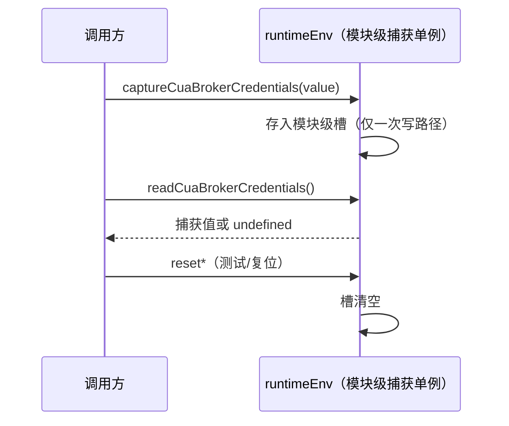

# shared-02 替换设计（replace/shared-02）

对应计划书「每包流程」四.2：状态所有者、模块划分、关键数据结构、事件顺序、每条 B 的落点。
合同 v1 见本目录 `README.md` / `behavior.md`（B1–B52）/ `interface.md`（兼容面）。

## 0. 兼容面（不可变）

- **58 个模块路径**全部保留（`interface.md` §2、B51）：`packages/shared/src/<path>.ts`
  与 `tsc -b packages/shared` 的 `dist/<path>.js` 两侧都必须存在且可加载。
- **逐文件导出名集合**与 `interface-appendix.json` 一致（B49/B50 + `interface.md` §3.1）；
  运行时值取值逐字不变（B 的逐字清单见 `known-differences.md` §4）。
- 根 barrel `index.ts`（shared-04 范围）不动；本包只保证「经 barrel 可达」的事实不变。
- 不改协议字段、`KNORVIA_*` 环境变量名、`.knorvia-studio` 数据目录、金样格式。

## 1. 状态所有者

本包几乎全部是**无状态纯函数/常量表**（`behavior.md` 通用约定）：

| 状态                                 | 唯有者                                      | 说明                                                        |
| ------------------------------------ | ------------------------------------------- | ----------------------------------------------------------- |
| CUA broker 凭据捕获 / 遥测环境捕获值 | `runtimeEnv.ts` 模块级单例（B10）           | `capture*` 写、`read*/reset*` 读/清；进程内唯一，无其它写点 |
| zod schema 单例                      | 各 schema 所在模块（`validation*.ts` 等）   | 构造后冻结复用，无运行时可变状态                            |
| 一切文件系统/会话状态                | **不在本包**（调用方：services / CLI / UI） | 本包只做换算、校验、编解码                                  |

B10 事件顺序（全部同步、同 tick）：

## 2. 模块划分（换骨原则）

旧文件结构不逐行照搬；每个公开模块保留路径与导出名，内部按下列手法重组
（`lead/GATE-PLAYBOOK` A–M、dw01 配方）：

1. **类型联合 → `as const` 表 + `(typeof T)[number]` 派生类型**（压行/结构命中，
   字面量逐个保留）。
2. **常量表 → 分组常量表 + 具名导出**（`const X_DEFAULTS = {…} as const;` +
   `export const NAME = X_DEFAULTS.name;`），导出名与取值逐字不变。
3. **逐字段行内前缀注解**（`field: /* 真实语义 */ T;`）、字段重排序（TS 结构兼容）。
4. **判定逻辑 → 显式表驱动分派**（Record/Map 查表 + 单一转换函数），替代 if/else 链。
5. **函数体重排形态**：参数/局部变量改名、中间变量、`satisfies`、模板串承载逐字文案、
   裸 `return`/`continue` 逐行前缀注解；注释全部自写（一行一义，禁裸 `//`、`/**`、`*/`）。
6. **必要时拆内部模块**：公开模块变薄壳（转发 + 少量导出），实现进
   `packages/shared/src/internal-s02/<name>.ts`（新文件收尾登记 `original`）；
   拆分只服务相似度 run/containment，不为拆而拆。
7. **逐字保留清单**（`known-differences.md` §4 的 8 组）在改写时逐条落实：
   环境变量名、错误码、频道名/RPC header、data-testid、供应商/模型 ID、身份键格式、
   限额/宽限常量、遥测关闭事实。lint 的 unused 常量告警当行为回归警报查。

## 3. 关键数据结构（不变项）

| 结构                                                  | 约束                                                                  |
| ----------------------------------------------------- | --------------------------------------------------------------------- |
| `modelSelectionSchema`（B28）                         | strict、trim 非空；`KNORVIA_MODEL_REASONING_SEPARATOR="$"`            |
| `appSettingsSchema` / `appSettingsPatchSchema`（B45） | **非 strict**（未知键剥离）；默认值金样 `old-write/*` 逐字节          |
| `shortcut` 绑定值（B23）                              | parse ∘ serialize 逐字往返；别名表/命名键表逐字                       |
| 身份键（B35/B36）                                     | `ssh:v1` 六元组 JSON、`wsl:`/`docker:` + `\0` 分隔                    |
| 供应商 key / 模型值前缀（B26/B27）                    | `native:`/`custom:`/`ghost:`、`custom:` 模型值前缀                    |
| 常量快照（B47/B48）                                   | `fixtures/constants-snapshot.json`、`test-ids-snapshot.json` 全表比对 |

## 4. 每条 B 的实现落点

| B 条目               | 模块（`packages/shared/src/`）                                                                                                |
| -------------------- | ----------------------------------------------------------------------------------------------------------------------------- |
| B1–B2 uuid 族        | `uuid.ts`                                                                                                                     |
| B3 错误归一化        | `errors.ts`                                                                                                                   |
| B4 日志前缀          | `log-format.ts`                                                                                                               |
| B5 版本/强制升级     | `forceUpdate.ts`（`version.ts` 提供 B52 常量）                                                                                |
| B6–B11 运行时环境    | `env.ts`（B6）、`runtimeEnv.ts`（B7–B11）                                                                                     |
| B12 ApiError         | `api.ts`                                                                                                                      |
| B13 sparseShape      | `config-schema.ts`                                                                                                            |
| B14 数据目录错误码   | `settings-errors.ts`                                                                                                          |
| B15 命令来源         | `command-types.ts`                                                                                                            |
| B16 媒体预览         | `media-preview.ts`                                                                                                            |
| B17 存储分类         | `storage.ts`                                                                                                                  |
| B18 遥测消毒         | `telemetry.ts`                                                                                                                |
| B19–B21 脱敏管线     | `telemetryRedaction.ts`                                                                                                       |
| B22–B23 快捷键       | `shortcutCommands.ts`                                                                                                         |
| B24–B25 供应商       | `model-provider-types.ts`、`model-provider-family.ts`                                                                         |
| B26 自定义模型值     | `custom-model-value.ts`                                                                                                       |
| B27 供应商 key       | `model-selection-key.ts`                                                                                                      |
| B28 模型选择         | `model-selection.ts`、`model-selection-types.ts`                                                                              |
| B29 旧 ID 迁移       | `legacy-model-provider-identity.ts`                                                                                           |
| B30 官方 GLM 名单    | `official-glm-model-id.ts`                                                                                                    |
| B31 家族连接 schema  | `provider-family-connection-selection.ts`                                                                                     |
| B32 账号不可用枚举   | `account-provider-state.ts`                                                                                                   |
| B33 Provider 枚举    | `providers.ts`                                                                                                                |
| B34–B38 远程身份     | `remoteTarget.ts`、`remoteSshHostKey.ts`、`remoteEnvironmentKey.ts`、`remoteAssetInstallMode.ts`、`remoteResourcePackages.ts` |
| B39 平台/open-editor | `platform.ts`                                                                                                                 |
| B40 定时任务/runId   | `automation-types.ts`                                                                                                         |
| B41 闲时常量         | `off-peak-types.ts`                                                                                                           |
| B42 子代理 ID        | `subagents-types.ts`                                                                                                          |
| B43 用量统计         | `usage-stats.ts`、`usage-quota.ts`                                                                                            |
| B44 zod 错误/基础    | `validation.ts`                                                                                                               |
| B45 AppSettings      | `validationAppSettings.ts`                                                                                                    |
| B46 默认语言         | `protocol.ts`                                                                                                                 |
| B47 频道名           | `channels.ts`                                                                                                                 |
| B48 data-testid      | `test-ids.ts`、`test-ids-workflow.ts`                                                                                         |
| B49–B51 入口面       | 全部 58 模块（脚本比对 + `surface.test.mjs`）                                                                                 |
| B52 构建期版本常量   | `version.ts`                                                                                                                  |

领域类型/同步常量文件（`task-realtime.ts`、`hooks.ts`、`git.ts`、`settings-source.ts`、
`settings-sync.ts`、`plugin-types.ts`、`plugin-sync.ts`、`skills-types.ts`、`skill-sync.ts`、
`mcp-sync.ts`、`cuaAccessibilitySettings.ts`、`workspacePurpose.ts`、`sessionCreateSource.ts`、
`handshake.ts`）承载 B 分组里点名的常量/类型，行为由对应条目与快照断言覆盖。

## 5. 簇计划（3–6 文件/簇，叶子先行，每簇小步提交）

| 簇  | 文件                                                                                                                                                              | B 条目                 | 计分模式（初判，实测两门都跑都记）                                         |
| --- | ----------------------------------------------------------------------------------------------------------------------------------------------------------------- | ---------------------- | -------------------------------------------------------------------------- |
| C1  | `uuid.ts`、`errors.ts`、`log-format.ts`、`api.ts`、`settings-errors.ts`、`version.ts`                                                                             | B1–B4、B12、B14、B52   | normal（逻辑）+ decl 双跑；`version.ts`/`settings-errors.ts` 常量型可 decl |
| C2  | `env.ts`、`runtimeEnv.ts`                                                                                                                                         | B6–B11                 | normal（`runtimeEnv.ts` 有捕获状态与函数体）                               |
| C3  | `forceUpdate.ts`、`config-schema.ts`、`command-types.ts`、`account-provider-state.ts`、`providers.ts`                                                             | B5、B13、B15、B32、B33 | `forceUpdate.ts`/`config-schema.ts` normal；其余 decl                      |
| C4  | `media-preview.ts`、`storage.ts`、`git.ts`、`task-realtime.ts`                                                                                                    | B16、B17、B40          | decl（常量表 + 小函数）；`task-realtime.ts` 有 runId 解析 normal 双跑      |
| C5  | `telemetry.ts`、`telemetryRedaction.ts`                                                                                                                           | B18–B21                | normal（脱敏管线逻辑）                                                     |
| C6  | `shortcutCommands.ts`、`custom-model-value.ts`                                                                                                                    | B22、B23、B26          | normal（parse/serialize 往返逻辑）                                         |
| C7  | `model-selection-key.ts`、`model-selection-types.ts`、`model-selection.ts`                                                                                        | B27、B28               | normal（构造函数）+ decl 双跑                                              |
| C8  | `model-provider-types.ts`、`model-provider-family.ts`、`legacy-model-provider-identity.ts`、`official-glm-model-id.ts`、`provider-family-connection-selection.ts` | B24、B25、B29–B31      | ID 表 decl；家族解析 normal                                                |
| C9  | `remoteTarget.ts`、`remoteSshHostKey.ts`、`remoteEnvironmentKey.ts`、`remoteAssetInstallMode.ts`、`remoteResourcePackages.ts`                                     | B34–B38                | normal（键构造/路径词法归一）                                              |
| C10 | `platform.ts`、`cuaAccessibilitySettings.ts`、`workspacePurpose.ts`、`sessionCreateSource.ts`、`handshake.ts`                                                     | B39                    | `platform.ts` normal（含 open-in-editor 构造）；小件 decl                  |
| C11 | `automation-types.ts`、`off-peak-types.ts`、`subagents-types.ts`、`usage-stats.ts`、`usage-quota.ts`、`hooks.ts`                                                  | B40–B43                | 常量 decl + 解析函数 normal 双跑                                           |
| C12 | `settings-sync.ts`、`settings-source.ts`、`plugin-types.ts`、`plugin-sync.ts`、`skills-types.ts`、`skill-sync.ts`、`mcp-sync.ts`                                  | 同步常量面             | decl（纯常量/类型）                                                        |
| C13 | `validation.ts`、`validationAppSettings.ts`                                                                                                                       | B44、B45               | normal（zod schema 运行时构造）；金样往返必须逐字节                        |
| C14 | `protocol.ts`、`channels.ts`                                                                                                                                      | B46、B47               | decl（常量大表，取值逐字）+ normal 双跑                                    |
| C15 | `test-ids.ts`、`test-ids-workflow.ts`                                                                                                                             | B48                    | decl（362+37 常量快照逐字）+ normal 双跑                                   |

每簇收尾标准序：`pnpm fmt` → 契约测试源码入口 81/81 → `tsc -b packages/shared` 无 error TS
→ 契约测试 dist 入口 81/81 → 相似度 normal + decl 两门（`scripts/provenance/similarity.mjs`，
`--old` 用继承路径、`--old-rev origin/main`）→ lint/arch 抽查 → 小步提交。
计分模式以实测为准：纯声明/常量表文件按 decl 计分（两门都跑都记实测值），
其余 normal；个别纯声明文件 normal 畸高降级 decl 并在验收文档标注理由（Lead 裁决 2026-10-15）。

## 6. 收尾（替换阶段五）

1. 删除 58 个旧实现与 `specs/contracts/shared-02/stubs/`（`not implemented: shared-02` 全仓 0）。
2. 登记顺序（GATE-PLAYBOOK L/M）：fmt → fmt:check → `lead/register-files.mjs` →
   `provenance:report` → `provenance:check`；合并 main 用 `lead/prepare-merge.mjs`，
   悬空条目 `lead/prune-missing-reviews.mjs`。
3. 接入门禁按 L 节标准序全跑；`docs/knorvia-shared-02-acceptance.md` 记逐文件计分模式 +
   双门实测 + 首败与修正；PR「replace: shared-02（继承 -60）」。
