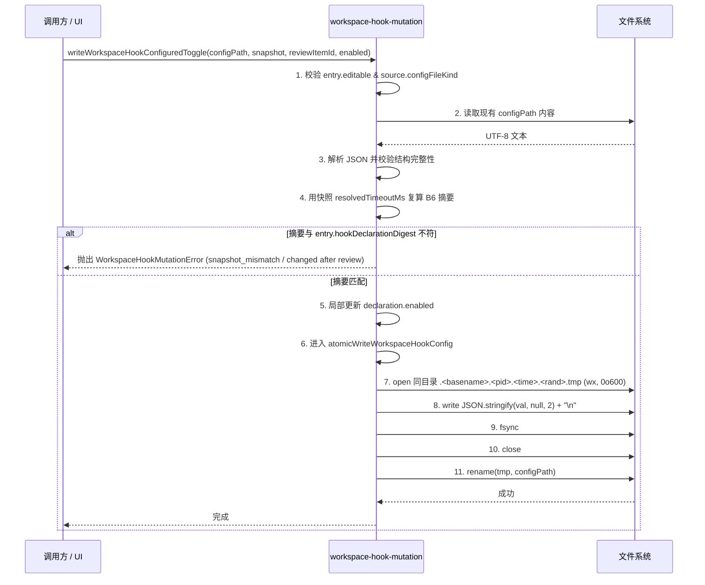
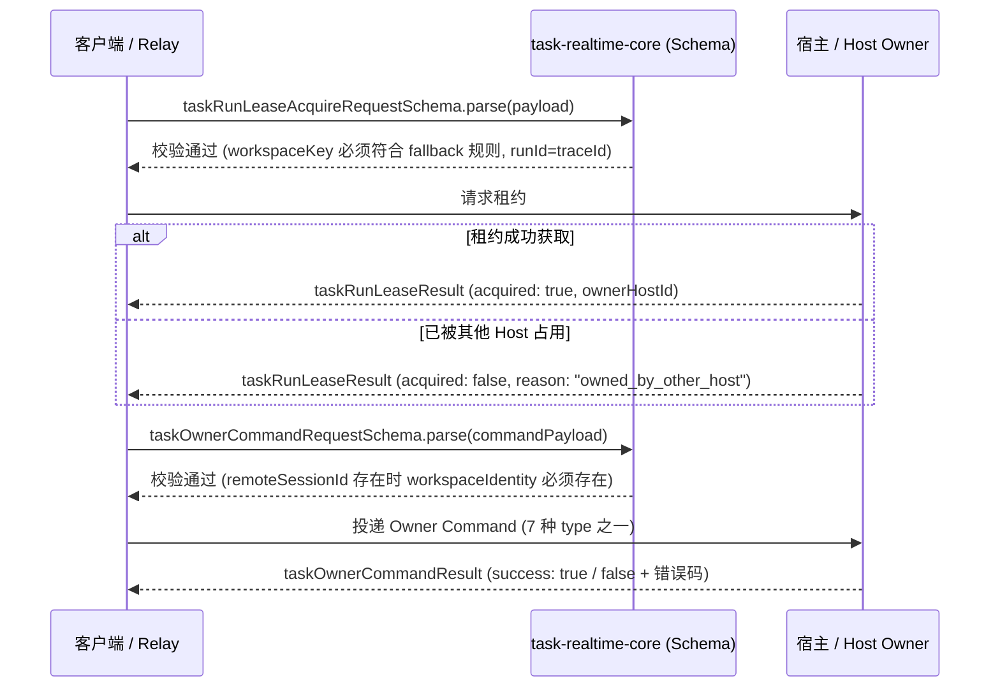
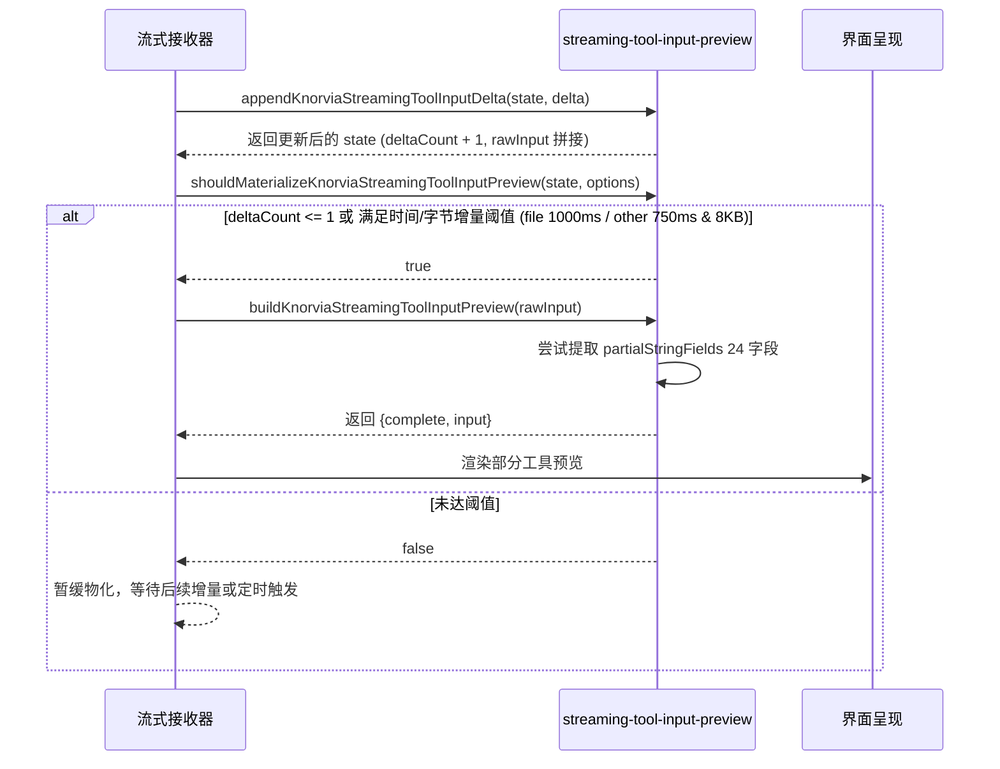

# shared-03 替换设计（replace/shared-03）

对应计划书「每包流程」四.2：状态所有者、模块划分、关键数据结构、事件顺序、每条 B 的落点。
合同 v1 见本目录 `README.md` / `behavior.md`（B1–B43）/ `interface.md`（兼容面）。

## 0. 兼容面（不可变）

- **34 个模块路径**全部保留（`interface.md` §2、B51）：`packages/shared/src/<path>.ts`
  与 `tsc -b packages/shared` 的 `dist/<path>.js` 两侧都必须存在且可加载。
- **逐文件导出名集合**与 `interface-appendix.json` 一致（运行时 195 项 / 纯类型 90 项）；
  运行时值取值逐字不变（`known-differences.md` §2 红线清单）。
- 根 barrel `index.ts`（shared-04 范围）不动；本包保证「经 barrel 可达」与已声明的子路径 / 协议桶再导出可达。
- 不改协议字段、`KNORVIA_*` 环境变量名、`.knorvia-studio` 数据目录、金样格式。
- 所有新实现及重写文件首行遵循 `// SPDX-License-Identifier: Apache-2.0`。

## 1. 状态所有者

本包几乎全部为**无状态纯函数 / zod schema / 常量表**（`behavior.md` 通用约定）：

| 状态 / 实体 | 状态所有者 | 读写路径与生命周期 |
| --- | --- | --- |
| 配置文件读写（`workspace-hook-mutation`） | 外部调用方（services / filesystem） | 通过原子写（临时文件 + `fsync` + `rename`）写入目标文件；函数内无常驻句柄与缓存 |
| 信任存储内容（`workspace-hook-trust-store-file`） | 外部调用方（services / CLI） | 纯解析与 schema 校验；fail-closed，无内部状态 |
| 流式工具输入累积（`streaming-tool-input-preview`） | 外部调用方（UI store / session state） | 累积函数接收只读 state 返回新 state 对象；节流判定为时间可注入的纯函数 |
| 后台作业与合并视图（`background-task-*`） | 外部调用方（CLI runtime / UI store） | 纯解析、归一化、Map 归并（保留首次插入序、后值覆盖） |
| 实时信令与租约（`task-realtime-core`） | 外部调用方（Relay / Host / Renderer） | strict schema 与 superRefine 校验，无内部单例状态 |

## 2. 模块划分（换骨重组原则）

旧文件结构绝不逐行照搬或改名克隆；每个公开模块保留路径与导出名，内部按下列方式重组：

1. **类型联合与枚举 → 表驱动与派生类型**：
   - 使用 `as const` 字典或元组派生类型，替代零散的字符串联合，同时保证字面量逐字匹配。
2. **常量与判别规则 → 显式字典查表**：
   - 替代深层 `if/else` 级联，例如 `background-task-controls` 的 kind 判定、status token 表，`tool-identity` 的 31 项工具名和 14 家族映射表。
3. **函数内部数据流重构**：
   - 提取更清晰的局部转换管道（parse -> sanitize -> normalize -> build），变量命名与流转结构与旧实现解耦。
4. **注释与解释性文本全新撰写**：
   - 全部采用中文清晰注释，一行一义，杜绝旧源码注释片段残留。
5. **逐字保留项的精确处理**：
   - 环境变量名、错误码、协议字段、金样匹配字符串、正则模式、违例文案等严格保留；较长文本必要时拆分常量组合。

## 3. 关键数据结构与不可变量

| 结构 / 概念 | 契约约束与不可变边界 |
| --- | --- |
| `workspaceHooksConfigSchema` (B1) | strict 根配置，events 恰为 7 个事件枚举；process/command 定义为 passthrough |
| `WorkspaceHookDeclarationDigest` (B6) | sha256 of `["workspace-hook-declaration", 1, ...]` 11 元组规范化载荷，载荷序敏感 |
| `WorkspaceHookBundleSnapshot` (B8) | sha256 of `["workspace-hook-bundle", 1, ...]`，不含 `discoveredAt` 与 `workspaceIdentity`；递归 Object.freeze |
| `WorkspaceHookTrustStoreFile` (B10) | schemaVersion=1，records 中 `workspaceIdentity + "\0" + hookDeclarationDigest` 键唯一 |
| `KnorviaBackgroundTaskControlItem` (B13) | 六状态枚举（running/pending/completed/failed/killed/lost）；jobId 合成模式；后值覆盖保留首次插入序 |
| `ConversationMessageProjectionPolicy` (B22) | 7 项策略枚举；17 项合成源名单与 6 项触发源名单序敏感 |
| `ConversationPreviewArtifact` (B23, B24) | 候选上限 15，展示上限 10；后缀与媒体格式精确映射；保护区重叠排除 |
| `ConversationShare` (B25, B26) | 出站 strict、入站宽容；17 个错误码；路径前缀 `/cn/share/` 与 `/share/` |
| `WorkspaceFileEntriesCodec` (B27) | `<type>\t<escaped>` 协议行；`\`, `\t`, `\n` 转义与逆转义；跨平台换行与分隔符兼容 |
| `WorkspaceFileSearch` (B28) | 上限 1000；前缀 (<100)、子串 (100+)、模糊 (200+) 三阶打分；空 query 时文件优先于目录 |
| `RuntimeToolRuntime` (B32) | bfs, ripgrep, ugrep 三工具表；平台特定部署版本（Linux 3 工具，Darwin legacy rg13） |
| `KNORVIA_KNOWN_TOOL_NAMES` (B33) | 31 项固定顺序与命名；14 个工具家族精确匹配 |
| `TaskRealtime` 协议族 (B42, B43) | reason 14 项；attachment 5 kind；workspaceKey 回退规则；runId === traceId；superRefine 严格校验 |

## 4. 关键异步与时序流程（Mermaid）

### 4.1 配置文件原子写入与开关修改（B11, B12）

### 4.2 实时任务租约与命令派发流程（B42, B43）

### 4.3 流式工具输入增量更新与物化节流（B35）

## 5. 每条 B 的实现落点

| B 条目 | 模块路径（`packages/shared/src/`） | 核心导出与职责 |
| --- | --- | --- |
| B1 | `workspace-hook-config.ts` | `workspaceHooksConfigSchema` 及子 schema、7 事件名、默认限额常量 |
| B2 | `workspace-hook-config.ts` | `discoverWorkspaceHookConfigPaths`, `readWorkspaceHookProjectSources` |
| B3 | `workspace-hook-config.ts` | `createWorkspaceHookSourceInput` |
| B4 | `workspace-hook-config.ts` | `resolveWorkspaceHookTimeoutMs`, `resolveWorkspaceHookMaxOutputBytes`, `resolveWorkspaceHookRuntimeRoot` |
| B5 | `workspace-hook-config.ts` | `resolveWorkspaceHookConfiguredGates` |
| B6 | `workspace-hook-digest.ts` | `createWorkspaceHookDeclarationDigest`（11 元组规范 sha256） |
| B7 | `workspace-hook-digest.ts` | `resolveWorkspaceHookEntries`（固定七序、四元组索引、reviewItemId） |
| B8 | `workspace-hook-digest.ts` | `buildWorkspaceHookBundleSnapshot`（快照深冻结、bundleDigest） |
| B9 | `workspace-hook-review-monotonicity.ts` | `evaluateWorkspaceHookReviewMonotonicity`（六种 verdict 裁决） |
| B10 | `workspace-hook-trust-store-file.ts` | `workspaceHookTrustStoreFileSchema`, `parseWorkspaceHookTrustStoreContent`（唯一键、fail-closed） |
| B11 | `workspace-hook-mutation.ts` | `atomicWriteWorkspaceHookConfig`（临时文件、fsync、rename 原子写） |
| B12 | `workspace-hook-mutation.ts` | `writeWorkspaceHookConfiguredToggle`, `WorkspaceHookMutationError` |
| B13 | `background-task-controls.ts` | `parseKnorviaBackgroundTaskControlItems`, `resolveKnorviaBackgroundTaskControlKind` |
| B14 | `background-task-controls.ts` | `isActiveKnorviaBackgroundTaskControlItem`, `getKnorviaBackgroundTaskControlItemElapsedMs`, `collectVisibleKnorviaBackgroundTaskControlItems` |
| B15 | `background-task-control-merge.ts` | `mergeKnorviaBackgroundTaskControlItems`（Map 归并保留首次位置） |
| B16 | `background-bash-jobs.ts` | `parseKnorviaBackgroundBashJobs` 及活跃/可见过滤包装 |
| B17 | `background-bash-output.ts` | `backgroundBashOutputSchema`, `backgroundBashOutputResultSchema` (8192 字符上限) |
| B18 | `bash-output-display.ts` | `bashOutputDisplaySchema` (150,000 字符上限，截断标志与输出路径) |
| B19 | `background-task-notifications.ts` | `parseKnorviaBackgroundTaskNotificationText`, `collectKnorviaBackgroundTaskNotificationsByToolUseId`, `attachKnorviaBackgroundTaskNotificationToRaw`, `knorviaBackgroundTaskNotificationToolUpdateStatus` |
| B20 | `assistant-message-parts.ts` | `appendAssistantMessagePart`, `getLatestAssistantContentPart`, `getLatestAssistantContentText` |
| B21 | `assistant-presentation.ts` | `buildKnorviaAssistantPresentation`（root 工具判定、latestPart 选定、blocks 组装） |
| B22 | `conversation-message-projection-policy.ts` | `getConversationMessageProjectionPolicy`, `isConversationRealUserTurnStarter`, `getConversationModelOnlyTurnTriggerSource` 等 |
| B23 | `conversation-preview-artifacts.ts` | `extractConversationPreviewFileReferences`, `resolveConversationPreviewPath`, 文件类型表与限额常量 |
| B24 | `conversation-preview-artifacts.ts` | `buildConversationPreviewArtifactCandidates`, `buildConversationPreviewArtifactCandidatesFromReferences` |
| B25 | `conversation-share.ts` | `parseConversationSharePathname`, `localizeConversationShareUrl` |
| B26 | `conversation-share.ts` | 分享 schema 族（preparation/confirm/continuation/integrity/preview），出站 strict/入站宽容，错误码 |
| B27 | `workspaceFileEntriesCodec.ts` | `packWorkspaceFileEntries`, `unpackWorkspaceFileEntries`, 转义与解包跨平台规则 |
| B28 | `workspaceFileSearch.ts` | `scoreWorkspaceFileFuzzyMatch`, `getWorkspaceFileSearchCandidateScore`, `filterWorkspaceFileSearchCandidates` |
| B29 | `workspaceSessionRestore.ts` | `resolveStartupLocalWorkspaceSessionIndex`（起始位回绕、仅限 local 会话） |
| B30 | `execution-output-preview.ts` | `executionOutputPreviewSchema` (4096 字符有界输出) |
| B31 | `execution-state.ts` | `resolveExecutionState`, `executionPermissionModeSchema`, `executionStateSchema` |
| B32 | `runtime-tool-runtime.ts` | `getRuntimeToolRuntime`, `getRemoteRuntimeToolsForPlatform`, `RUNTIME_TOOLS` 常量字典 |
| B33 | `tool-identity.ts` | `KNORVIA_KNOWN_TOOL_NAMES` (31 项), `TOOL_FAMILY_BY_NAME`, `normalizeKnorviaToolName`, `getKnorviaToolFamilyForName`, `isKnorviaFileContentWriteToolName` |
| B34 | `tool-call-summary.ts` | `getCompactToolCallSummary`, `summarizeInput`, `getChangeStat`, `countLines` |
| B35 | `streaming-tool-input-preview.ts` | `appendKnorviaStreamingToolInputDelta`, `buildKnorviaStreamingToolInputPreview`, `shouldMaterializeKnorviaStreamingToolInputPreview`, 24 个 partial 字段 |
| B36 | `permission-request-preview.ts` | `getPermissionRequestPreview`, 路径收集与变更行统计 |
| B37 | `process-diagnostic.ts` | `knorviaProcessDiagnosticSchema`, `parseKnorviaProcessDiagnostic`, 错误上限与前缀常量 |
| B38 | `process-names.ts` | `createProcessName` 系列函数（main/gpu/host/renderer/agent/utility 清洗规则） |
| B39 | `processResourceTelemetry.ts` | `checkProcessResourceEventProperties`, `resolveCliProcessResourceRole`, 白名单与限制常量 |
| B40 | `subagent-markdown-selection.ts` | `parseSubagentMarkdownSelection`, `formatSubagentMarkdownModel`, `migrateSubagentMarkdownProvider` |
| B41 | `subagent-state-migration.ts` | `importSubagentStateSelections`（权威字段优先、legacy 迁移） |
| B42 | `task-realtime-core.ts` | `resolveWorkspaceKey`, reason 14 项枚举, 事件信封, watermark 与失效事件 schema |
| B43 | `task-realtime-core.ts` | attachment 5 kind, mirror batch, lease acquire/result, owner command 7 type 与 result |

## 6. 分簇重写与提交计划

按照依赖拓扑分 6 个独立簇进行编写、验证和提交：

| 簇 | 涉及文件 | 覆盖行为 | 相似度计分模式 |
| --- | --- | --- | --- |
| **C1 (H4: workspaceFile)** | `workspaceFileEntriesCodec.ts`, `workspaceFileSearch.ts`, `workspaceSessionRestore.ts` (3) | B27–B29 | normal (编解码/打分算法); decl 对照 |
| **C2 (H2: background-task)** | `background-task-controls.ts`, `background-task-control-merge.ts`, `background-bash-jobs.ts`, `background-bash-output.ts`, `bash-output-display.ts`, `background-task-notifications.ts` (6) | B13–B19 | normal (控制项解析/通知/合并); schema/常量 decl |
| **C3 (H1: workspace-hook)** | `workspace-hook-config.ts`, `workspace-hook-digest.ts`, `workspace-hook-discovery.ts`, `workspace-hook-mutation.ts`, `workspace-hook-review-monotonicity.ts`, `workspace-hook-trust-store-file.ts` (6) | B1–B12 | normal (配置发现/摘要算法/原子写/单调性); decl 对照 |
| **C4 (H5: tool/execution)** | `execution-output-preview.ts`, `execution-state.ts`, `runtime-tool-runtime.ts`, `tool-identity.ts`, `tool-call-summary.ts`, `streaming-tool-input-preview.ts`, `permission-request-preview.ts`, `tool-plan-adapter.ts` (8) | B30–B36 | normal (流式提取/调用摘要/权限预览); 常量/表 decl |
| **C5 (H3: conversation)** | `assistant-message-parts.ts`, `assistant-presentation.ts`, `conversation-message-projection-policy.ts`, `conversation-preview-artifacts.ts`, `conversation-share.ts` (5) | B20–B26 | normal (投影策略/引用抽取/分享编解码); decl 对照 |
| **C6 (H6: process/subagent/realtime)** | `process-diagnostic.ts`, `process-names.ts`, `processResourceTelemetry.ts`, `subagent-markdown-selection.ts`, `subagent-state-migration.ts`, `task-realtime-core.ts` (6) | B37–B43 | normal (命名规则/实时协议 superRefine/subagent 迁移); decl 对照 |

每簇标准验证与提交闭环：
1. 编写簇内文件，确保每个文件开头均有 `// SPDX-License-Identifier: Apache-2.0`。
2. 运行 `tsc -p packages/shared --noEmit` 校验包内类型。
3. 运行 `npx tsc -b packages/shared` 构建最新 `dist`。
4. 运行 `node scripts/contract-gate.mjs --contract specs/contracts/shared-03 --tests '*.test.mjs' --dist-env KNORVIA_SHARED_03_ENTRY=dist --json /tmp/s03-gate-interim.json` 保证契约测试在源码与 dist 双入口均通过。
5. 运行关联既有测试 `node --import tsx --test packages/shared/test/shared-*.test.mjs`。
6. 运行相似度检查 `node scripts/provenance/similarity.mjs`，确保两道指标均在阈值内。
7. 对变动文件执行 eslint / prettier 检查。
8. 本地提交：`git add -A && git commit -m "replace: shared-03 <cluster>"`。
