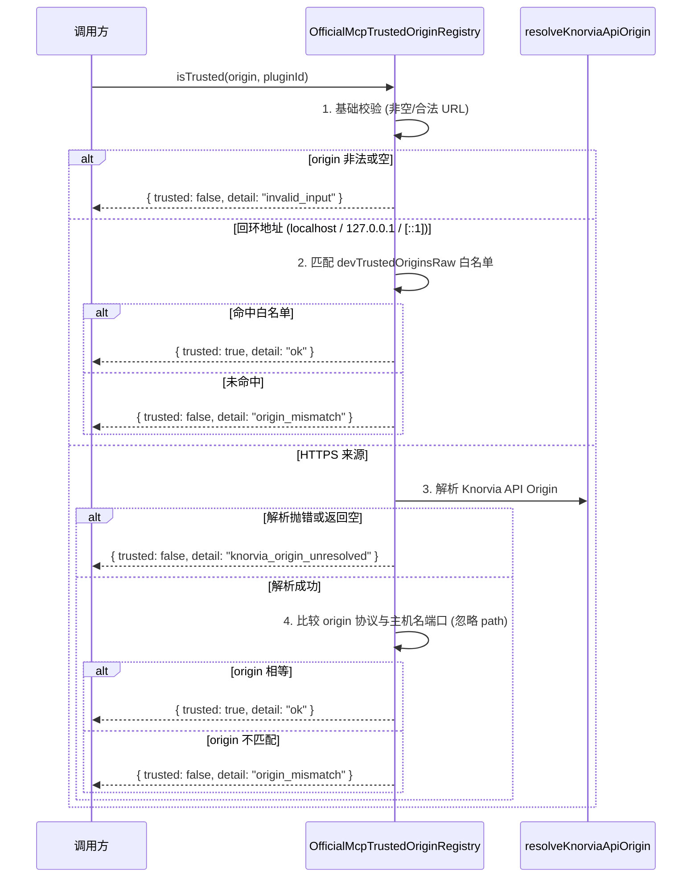
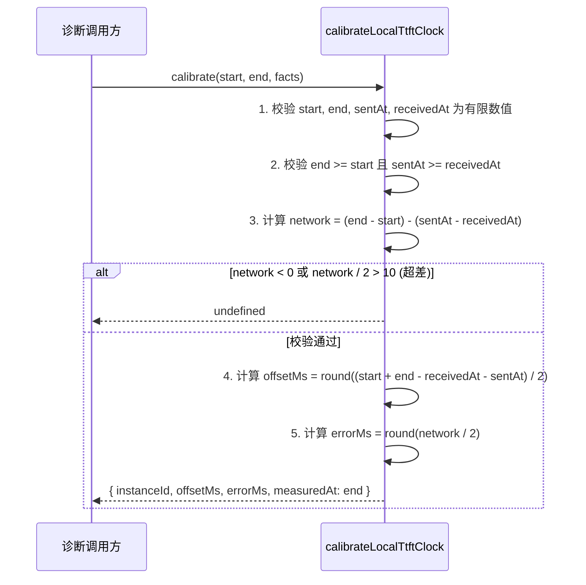
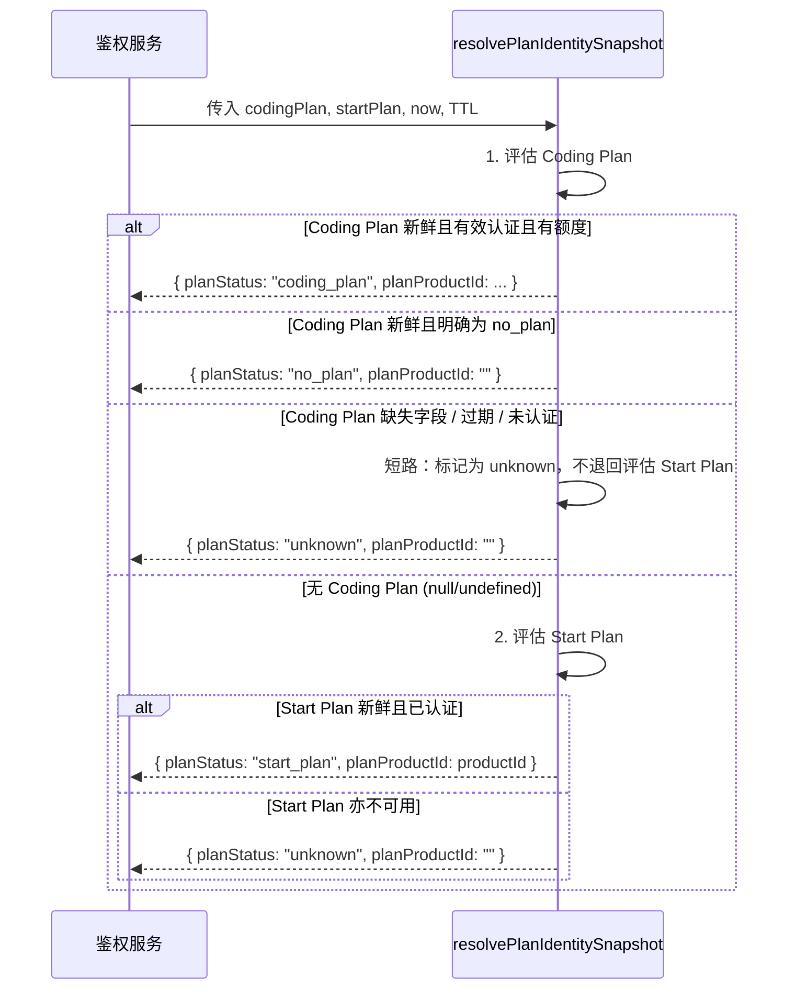

# shared-04 替换设计（replace/shared-04）

对应计划书「每包流程」四.2：状态所有者、模块划分、关键数据结构、事件顺序、每条 B 的落点。
合同 v1 见本目录 `README.md` / `behavior.md`（B1–B49）/ `interface.md`（兼容面）与 `known-differences.md`（红线清单）。

## 0. 兼容面（不可变约束）

- **44 个模块路径**必须在 `packages/shared/src/<path>.ts` 与编译后 `dist/<path>.js` 两侧完整存在且可正常加载（B27）。
- **导出集合与附录一致**：机器附录记录的 204 个运行时导出与 152 个纯类型导出逐名存在，参数签名、返回值与抛错行为符合契约。
- **纯类型模块无运行时值**：`update.ts`、`remote-sync.ts`、`intranetProbe.ts` 三件导出 Object.keys 严格为空（B3、B26、B28）。
- **入口归属不变**：`model-config.ts` 经 `@knorvia/shared/model-config` 导出；`model-execution.ts` 供内部协议消费；其余 42 模块运行时导出在根 barrel `@knorvia/shared` 可达；`node.ts` 经子路径 `@knorvia/shared/node` 及根 barrel 再导出 `./node/*` 的 10 个运行时与 3 个类型。
- **红线遵守**：协议字段、数据格式、环境变量（`KNORVIA_*`、`INTRANET_*` 等）、数据目录（`.knorvia-studio`）一字不改；金样按旧实现录制不可放宽断言；所有新文件添加 `// SPDX-License-Identifier: Apache-2.0`。

## 1. 状态所有者

本包 44 个模块主要为无状态纯函数、短时解析器、Zod Schema 校验器与语义常量表：

| 模块 / 领域                        | 状态所有者                                           | 读写路径与生命周期                                                                 |
| ---------------------------------- | ---------------------------------------------------- | ---------------------------------------------------------------------------------- |
| R: remote/network (B1–B11, B28)    | 外部调用方（services / remote host）                 | 纯解析与信封构造；无持久句柄与连接状态，调用即销毁                                 |
| P: plugins/mcp (B12–B18)           | 外部调用方（plugin service / UI store）              | 纯转换函数、排序对比与常量表；由调用方持有插件列表与市场状态                       |
| C: config/UI (B19–B27)             | 外部调用方（UI store / app runtime / desktop main）  | 纯 schema 解析与文案查表；无内部单例                                               |
| F: feedback/onboarding (B29–B31)   | 外部调用方（feedback service / onboarding storage）  | 纯文本脱敏解析器与记录 schema；脱敏函数栈深度上限 32，无副作用                     |
| D: diagnostics/telemetry (B32–B40) | 外部调用方（diagnostic service / metrics collector） | 内存诊断 registry（B35）由工厂函数实例化并交调用方持有；TTFT（B36）纯校准计算      |
| A: auth/model/provider (B41–B49)   | 外部调用方（auth service / model provider registry） | 官方 MCP 来源信任 registry（B43）由工厂创建交调用方持有；套餐身份（B49）纯快照推导 |

## 2. 模块划分（换骨重组设计理念）

严禁对旧实现进行改名克隆、函数体逐行搬运或表面凑分。44 个模块按以下架构独立重构：

1. **表驱动与状态机替代分支级联**：
   - 远程错误分类（B7）：以有序规则元组数组 `[category, regex/matcher][]` 替代旧有多层嵌套分支，优先序明确保证 `auth -> deploy -> host_start -> attach -> relay -> connect -> unknown`。
   - 数据库启动错误分类（B32）：以标准常量查表映射系统错误码与低 8 位 SQLite 码，以 Set 防环展开 cause 链。
   - 官方 MCP 认证与保留头（B41, B42）：采用静态只读映射表与预先构建的小写 Set 查找，实现稳定保序。
   - 桌面菜单文案（B24）：使用结构化消息字典，插值采用自实现的替换函数。
2. **纯数据流与流水线转换**：
   - 反馈脱敏（B30）：将脱敏拆解为独立阶段流水线（结构化 JSON 解析 -> 深度防护 -> 正则模式脱敏 -> 敏感行扫描），避免旧实现的混合递归。
   - 插件排序（B15）：建立多阶段比较器组合（category rank -> custom category order -> plugin id order -> document priority -> localeCompare -> initial order），代码清晰且正交。
   - 行变更统计（B39）：独立实现逻辑行切割、前后缀修剪、LCS 动态规划矩阵及大尺寸兜底，逻辑边界明确。
3. **现代 TypeScript / Zod 表达**：
   - 采用标准 Zod 链式与 `strict()`、`passthrough()` 规范构建，统一使用语义化校验函数，保证与金样逐字一致。
4. **注释与解释完全自写**：
   - 采用清晰的中文技术注释，说明设计意图、边界条件与契约依据。

## 3. 关键数据结构与不可变量

| 结构 / 概念                        | 契约约束与不可变边界                                                                                                                                                                                    |
| ---------------------------------- | ------------------------------------------------------------------------------------------------------------------------------------------------------------------------------------------------------- |
| `RemoteWorkspaceIdentity` (B4, B5) | SSH `remote:ssh:<host>:<port>:<user>:<path>`；WSL `remote:wsl:<distro>[:<user>]:<path>`；Docker `remote:docker:<container>:<path>`。路径前导 `/` 且 `\` 归一为 `/`；解析从首个 `/` 提取完整路径保留冒号 |
| `IntranetDefaults` (B2)            | 资产端口 `12345`、探测端口 `3850`、探测路径 `/api/intranet/probe`；缺参文案逐字精确                                                                                                                     |
| `PluginMarketplaces` (B13)         | 官方市场 id `knorvia-plugins-bundled`，默认 10 个官方插件 id Set（不含 computer-use）                                                                                                                   |
| `DatabaseStartupState` (B34)       | schemaVersion=1，phase 六值；详情保留最后一次合法 sqliteCode / systemCode / migrationId；六大不可重试错误分类                                                                                           |
| `MemoryDiagnosticsWriteGate` (B35) | 常量 60000ms / 0.05 / 0.1 / 300000ms；首样本 `first`、变化 `changed`、心跳 `heartbeat`、否则 `null`                                                                                                     |
| `LocalTtftCalibration` (B36)       | 6 阶段、15 桶；偏移量 `round((start + end - receivedAt - sentAt) / 2)`，误差 `round(network / 2)`，误差上限 10ms                                                                                        |
| `RendererActionTrace` (B38)        | 服务名 `knorvia-desktop-renderer`，采样上限 0.2，批次最大 32 spans / 262144 字节                                                                                                                        |
| `OfficialMcpAuth` (B41–B43)        | 5 个认证头映射、8 个保留头（小写）；回环 dev 严格匹配，https origin 忽略 path                                                                                                                           |
| `PlanIdentitySnapshot` (B49)       | coding_plan 活跃优先；no_plan 返回 no_plan；未知字段/过期短路直接返回 unknown（不回退 start_plan）；start_plan 从 `subscription.details[0].productId` 获取产品 ID                                       |

## 4. 关键流程时序图

### 4.1 官方 MCP 来源信任判定与 Registry 时序 (B43)



### 4.2 本地 TTFT 时钟校准与度量流程 (B36)



### 4.3 数据库启动错误诊断与重试判定 (B32, B33)

```mermaid
sequenceDiagram
  participant Caller as 数据库启动器
  participant Classifier as classifyDatabaseStartupError
  participant Details as databaseStartupErrorDetails
  participant Retry as canRetryDatabaseStartup

  Caller->>Classifier: 传入捕获的异常 error
  Classifier->>Classifier: 1. 沿 cause 链回溯 (Set 防环, 最多 12 层)
  Classifier->>Classifier: 2. 匹配 sqlite errcode & 0xff 及 system code
  Classifier-->>Caller: 错误分类 (storage_full / permission_denied / io_error / corrupt / ...)
  Caller->>Details: 提取详细上下文
  Details->>Details: 沿 cause 链提取最后一个合法 sqliteCode / systemCode / migrationId
  Details-->>Caller: details 对象
  Caller->>Retry: canRetryDatabaseStartup(state)
  Retry->>Retry: 检查 phase === "failed" & failedPhase !== "starting_services"
  Retry->>Retry: 检查 errorCode 不在 6 大致命不可重试名单
  Retry-->>Caller: boolean (true = 允许重试, false = 终止)
```

### 4.4 套餐身份决策与短路流程 (B49)



## 5. 每条 B 的实现落点对照

| 条目     | 对应模块文件                                       | 核心导出                                                                                    | 独立设计思路                                                    |
| -------- | -------------------------------------------------- | ------------------------------------------------------------------------------------------- | --------------------------------------------------------------- |
| B1       | `endpointHostname.ts`                              | `resolveSafeEndpointHostname`                                                               | 使用原生 `URL` 构造，严格过滤非 http/https 协议并提取小写主机名 |
| B2       | `intranetDefaults.ts`                              | `resolveIntranetMachineHost`, `resolveIntranetDepsBaseUrl` 等                               | 环境变量清洗、去尾斜杠、默认端口组与精确缺参报错                |
| B3       | `intranetProbe.ts`                                 | 9 个纯类型                                                                                  | 纯类型定义，零运行时值导出                                      |
| B4, B5   | `remote-workspace-identity.ts`                     | `buildRemoteWorkspaceIdentity`, `parseRemoteWorkspaceIdentity`, `isRemoteWorkspaceIdentity` | 规范化正反向正则表达式，多平台路径统一正斜杠与前导斜杠          |
| B6, B7   | `remoteUsageTelemetry.ts`                          | `resolveWorkspaceTelemetryDetail`, `classifyRemoteUsageError` 等                            | 规则优先级表驱动分类，标准遥测信封封装                          |
| B8       | `remoteAppConfig.ts`, `helpAppConfig.ts`           | `resolveHelpAppConfig` 及各 getter                                                          | 远端非空优先合并，显式 false 保护与本地回退                     |
| B9       | `server-remote.ts`                                 | `serverRemoteInfoSchema`, `serverRemoteHostCapabilitySchema` 等                             | strict 模式的 Zod Schema，严格校验版本 1 与双重能力             |
| B10      | `openrouter-attribution.ts`                        | `isOpenRouterBaseUrl`, `withOpenRouterAttributionHeaders`                                   | URL 域前缀判定，不可覆盖已有头部的属性合并                      |
| B11      | `wslUserValidation.ts`                             | `isValidWslUser`, `wslUserSchema`                                                           | 长度与控制符正则过滤，允许空串在 schema 中先放行再深检          |
| B12      | `plugin-display-name.ts`                           | `formatCanonicalPluginName`, `resolvePluginDisplayName`                                     | 连字符下划线分词与首字母大写转换，专有缩写专表映射              |
| B13      | `plugin-marketplaces.ts`                           | `DEFAULT_ENABLED_OFFICIAL_PLUGIN_IDS`, `PUBLIC_STORE_MARKETPLACE_IDS`                       | 常量 Set 与 Array 定义，市场 id 精确比对                        |
| B14      | `pluginStoreOrder.ts`                              | `parsePluginStoreOrder`                                                                     | 独立子树解析与模式级容错清洗，非法结构返回 null                 |
| B15      | `pluginStoreOrdering.ts`                           | `sortPluginStoreEntries`, `compareDocumentPluginPriority`                                   | 组合优先级排序器，文档插件独立级别判定                          |
| B16      | `skill-scan-policy.ts`                             | `shouldWalkSkillDirectoryEntry`, `SKILL_FILE_NAME`                                          | 12 个排除目录静态 Set 检索，点前缀仅 `.system` 白名单放行       |
| B17, B18 | `mcp.ts`                                           | `getMcpServerRequestHeaders`, `convertToKnorviaAgentMcpServer`, CUA 判定                    | 请求头 fallback 选择，Windows cmd /c 解包，OAuth 严格过滤       |
| B19      | `clientConfig.ts`                                  | `parseClientConfigSnapshot`                                                                 | 信封结构检验与未知键忽略，非法格式抛出标准 Error                |
| B20      | `dynamic-workflow-feature.ts`                      | `normalizeDynamicWorkflowMode`, `resolveDynamicWorkflowClientConfig`                        | 优先级 override > remote > default，三态模式判定                |
| B21      | `app-runtime-preferences.ts`                       | `appRuntimePreferencesChannel`, `appRuntimePreferencesPayloadSchema`                        | 广播频道常量与带默认值的严格 Zod schema                         |
| B22      | `e2e-test-bridge.ts`                               | `shouldEnableE2ETestBridge`                                                                 | 环境变量双重门禁校验（必须恰为 "1" 且 runId 非空）              |
| B23      | `launchMarks.ts`                                   | `serializeLaunchMarks`, `parseLaunchMarks`                                                  | 四项有序 JSON 序列化，严格有限数值反序列化                      |
| B24      | `desktopMenu.ts`                                   | `desktopMenuMessageIds`, `desktopMenuMessages`, `getDesktopMenuMessage`                     | 双语言完整字典，locale 回退与全局插值替换                       |
| B25      | `serviceAuthority.ts`                              | `parseServiceAuthorityMode`, `shouldUseProviderRegistrySourceForAuthorityMode`              | 权威模式枚举解析，非法值记录回显与注册表启用判定                |
| B26      | `update.ts`                                        | 3 个纯类型                                                                                  | 纯类型定义，零运行时值导出                                      |
| B27      | 全部 44 文件                                       | 导出面全集                                                                                  | 保证所有模块路径与导出符号与合同附录逐项一致                    |
| B28      | `remote-sync.ts`                                   | 1 个纯类型                                                                                  | 纯类型定义，零运行时值导出                                      |
| B29      | `feedback.ts`                                      | `FEEDBACK_TICKET_MODULES`, `FEEDBACK_TICKET_TYPES` 等                                       | 12 模块、4 类型、3 严重度与框架选项常量集                       |
| B30      | `feedbackPrivacy.ts`                               | `redactFeedbackText`                                                                        | 多阶段文本/JSON 脱敏引擎，保护私钥、凭据与本地路径              |
| B31      | `onboardingRecord.ts`                              | `onboardingRecordFileSchema`, `onboardingRecordEntrySchema`                                 | 版本 1、设备 ID 必填、跳过记 null 的严格 schema                 |
| B32–B34  | `database-startup.ts`                              | `classifyDatabaseStartupError`, `canRetryDatabaseStartup`, schemas                          | 深度 cause 链分析，SQLite/OS 码映射，生命周期与重试边界         |
| B35      | `memoryDiagnostics.ts`                             | `createMemorySampleWriteGate`, `createMemoryDiagnosticsRegistry`                            | 首样本/增量/心跳门控，带命名空间的隔离注册表                    |
| B36      | `localTtft.ts`                                     | `calibrateLocalTtftClock`, TTFT schemas                                                     | 网络延迟、时钟偏移与误差推导计算，严格数值边界                  |
| B37      | `session-debug.ts`                                 | `SESSION_DEBUG_LIMITS`, `calculateOutputTps`                                                | 会话限额常量与非负正时长的吞吐速率计算                          |
| B38      | `rendererActionTrace.ts`                           | `rendererActionTraceConfigSchema`, `rendererActionSpanBatchSchema` 等                       | 渲染器追踪配置、属性与批量上报严格校验                          |
| B39      | `lineChangeStat.ts`, `markdown-artifact-images.ts` | `computeLineChangeStat`, `extractMarkdownArtifactImageRefs` 等                              | 行级 LCS 差异统计、大文件兜底、Markdown 围栏外图片改写          |
| B40      | `sessionCreateTelemetry.ts`                        | `sessionCreateTelemetrySchema`, `automationSessionCreateTelemetrySchema`                    | 移动端与自动化会话创建的遥测模式校验                            |
| B41–B43  | `official-mcp-auth.ts`                             | 常量、`summarizeOfficialMcpIdentityHeaders`, `isOfficialMcpOriginTrusted`                   | 认证保留头识别、身份信息提取与本地回环/远程 HTTPS 鉴权          |
| B44      | `official-mcp-tool-error.ts`                       | `parseOfficialMcpToolError`                                                                 | 官方配额超限与套餐要求错误的严格反序列化                        |
| B45      | `oauth.ts`                                         | `isCredentialDecryptError`, 常量                                                            | 凭据解密失败的特征错误码与错误信息识别                          |
| B46      | `model-config.ts`                                  | `modelConfigDataSchema` 及 complete 系列                                                    | 顶层宽松、完整配置严格的多层模型参数校验                        |
| B47      | `model-execution.ts`                               | `modelExecutionSchema`                                                                      | 执行作用域二元枚举与空 API Key 兼容                             |
| B48      | `provider-provisioning.ts`                         | `isProviderProvisioningAccountCredentialKey`, schemas                                       | 凭据键正则不 trim、触发源与供给信封严格校验                     |
| B49      | `plan-identity.ts`                                 | `resolvePlanIdentitySnapshot`                                                               | 多套餐身份仲裁、TTL 判定与 unknown 短路逻辑                     |
