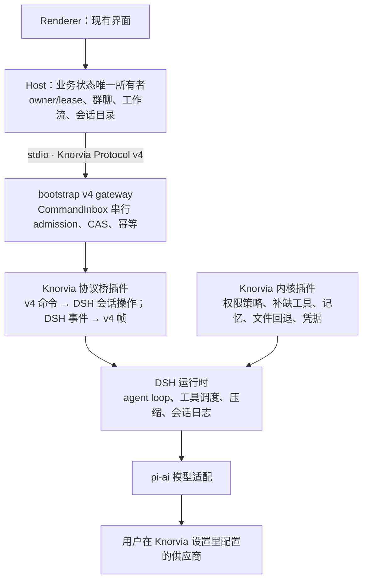

# Knorvia 内置内核：以 DeepSeek Harness 为底座

## 当前决定（2026-10-17）

用户确认产品定位：Knorvia Studio 是把各路 AI Agent 集中到一个工作台的集成产品，接入 Codex、Claude Code、Gemini、Grok 等外部 Agent，支持单聊、群聊协作与工作流；开箱自带 Knorvia 内置助手，不装任何 CLI 也能直接使用。

内置助手的 Agent 引擎改用 DeepSeek Harness（下称 DSH）：作为锁定版本的 npm 依赖在内核进程内加载，Knorvia 的工具、权限、协议桥与业务能力写成 Knorvia 自有插件。不 fork DSH，不跟随官方迭代以外改它的源码；确需改动时只把出问题的单个包 vendor 进仓库，并保留其许可与署名。

本规格替代 `specs/knorvia-independent-implementation.md` 第 2 阶段中“内置内核契约与工具执行按合同逐包重写”的做法，以及 `docs/knorvia-independent-replacement-plan.md` 中 M2 运行时相关包的重写安排。保留现有功能、数据、界面与 Host 业务边界的要求不变。插件化结构见 `specs/knorvia-internal-plugins.md`。

## 背景与依据

- 原型（2026-10-11，scratchpad，不入库）在本地假模型上验证：自有供应商路由、真实 bash、自定义工具、工具执行前策略拒绝、自动压缩、会话跨进程续接、ACP 中途取消均可用，且不需修改 DSH 源码。
- 用户 2026-10-17 用预置的外部 DSH 内核接真实模型试用，认为好用。
- 许可：DSH 自有包为 MIT，少量 BSD-3-Clause，可选 MPL-2.0（文档预览，不挂载则不安装）；`@earendil-works/pi-ai` 为 MIT。作为第三方依赖登记，不计入 Knorvia 原创。
- 版本：当前 `@deepseek-ai/dsh@0.2.0-rc.2`，预发布，SDK 协议不承诺兼容。锁定确切版本，升级单独验收。

## 进程与所有者

桌面与 Web 仍按 `packages/shared/src/agent-runtime.ts` 的描述启动 `knorvia app-server --stdio`，协议与调用方不变。变化只发生在内核进程内部：

- Host 仍是任务、会话目录、群聊与工作流的唯一业务所有者；Main 与 relay 不承载业务状态（AGENTS.md）。
- 新引擎下由协议桥（`apps/cli/packages/bootstrap/src/kernel-bridge/`）的 `CommandInbox` 做串行 admission，DSH 的会话收件箱只接收已被 admission 的输入，不另开一条写入路径。旧引擎仍用 `protocol-v4/` 的实现；两者按引擎互斥，`kernel-switch` 时删除旧实现，任何时刻同一进程只有一个 admission 所有者（2026-10-20 审查确认）。
- **对话正文的唯一所有者是 DSH 会话日志**（模型上下文、消息、工具调用与结果、压缩检查点）。协议桥从 DSH 事件派生 v4 projection 与帧，不在 Knorvia SQLite 里再存一份正文。Knorvia 仍保存对话级元数据（标题、workspace identity、内核、目标外的产品字段）及旧会话库。
- `desktop-continuous` 与 `web-remote-replayable` 两条链路语义不变：协议桥为每条 v4 帧保留现有序号与快照语义，重连与回放从 DSH 事件序号重建。

## 与本机 DSH 隔离

自带内核不得读写用户自己安装的 DSH，也不得被它影响。内核进程启动 DSH 前必须全部满足：

| 来源           | 要求                                                                                                                                                                               |
| -------------- | ---------------------------------------------------------------------------------------------------------------------------------------------------------------------------------- |
| 主目录         | 设置 `DSH_HOME=<Knorvia 数据根>/dsh`（数据根遵守 `KNORVIA_DATA_BASE_DIR` 与便携目录）。用户的 `~/.dsh` 不读不写                                                                    |
| 启动方式       | 用 `dsh-app-boot` 的直接配置入口加载 Knorvia 自己的固定插件组合；不使用 DSH 自带 profile，不叠加 `$DSH_HOME/cordis.patch.yml` 或任何用户 patch 层                                  |
| `.env` 层      | 不加载工作区目录与 DSH 主目录下的 `.env`（DSH 默认会读启动目录的 `.env`，而启动目录可能是用户项目）                                                                                |
| 环境变量       | 清除继承的 `DSH_*` 与各供应商 key 变量（如 `DEEPSEEK_API_KEY`），只注入 Knorvia 凭据服务提供的值                                                                                   |
| 工具子进程环境 | 启动时先保存用户环境快照；bash 等工具子进程使用该快照（只去掉 `DSH_*`），与旧内核“命令继承用户环境”的行为一致。凭据清理只约束 DSH 与模型适配，不得让用户项目脚本失去自己的环境变量 |
| 技能           | 不加载项目内 `.dsh/skills`；Knorvia 已有的 `.agents/skills` 与插件技能照旧，由 Knorvia 插件提供给 DSH                                                                              |
| 指令文件       | 项目 `AGENTS.md` 照旧注入；用户全局指令只读 `DSH_HOME` 下的位置（默认为空）                                                                                                        |
| Hook 兼容层    | 不挂载 `dsh-hooks-claude-code`、`dsh-hooks-codex`；Hook 由 Knorvia 插件按现有 7 种事件实现                                                                                         |
| 遥测           | 组合中不挂载任何遥测行（含默认发往 DeepSeek 采集端的 OTel 导出），并设置 `DSH_TELEMETRY_DISABLED=1`                                                                                |
| 程序版本       | 只用安装包内锁定版本，进程内加载；不在 PATH 中查找 `dsh`                                                                                                                           |

预置的外部内核 `deepseek-harness`（`acpCatalog.ts`）保持不变：它有意使用用户自己安装的 DSH 与 `~/.dsh`，与自带内核互不干扰。

## 身份与对外口径

- 关闭 `dsh-system-prompt` 的 `includeHarnessIdentity`，用 `personaPrefix` 写入 Knorvia 开场：Agent 自称 Knorvia，Knorvia Studio 的内置助手。
- 用户可见的报错、命令与状态文字由协议桥映射成 Knorvia 中英文文案，不透出 DSH 包名或 DSH 账号提示。
- 诚实边界：被直接问到底层时如实说明基于开源的 DeepSeek Harness；被问到模型时如实说明是用户配置的模型，不冒充其他模型。许可、NOTICE 与 README 写明基于 DeepSeek Harness。

## 能力映射

现有能力全部保留。默认使用 DSH 已有插件；DSH 没有或语义不符的，写成 Knorvia 内核插件。具体接口在各接入包合同中确定。

| 现有能力                                              | 现位置                                                            | 新做法                                                                                                                                                                                                                |
| ----------------------------------------------------- | ----------------------------------------------------------------- | --------------------------------------------------------------------------------------------------------------------------------------------------------------------------------------------------------------------- |
| v4 命令 34 种、RPC 31 个、通知 4 个；旧协议 74 个方法 | `packages/shared/src/protocol-v4/`、`protocol/index.ts`           | 协议不变；协议桥实现到 DSH 会话操作的映射                                                                                                                                                                             |
| 模型路由（Vercel AI SDK，3 种格式）                   | `adapters/src/model/`、`bootstrap/src/model-factory.ts`           | `dsh-llm-pi-ai`；供应商表由 Knorvia 供应商配置生成；凭据经 Host（现 `interaction/requestProviderRuntimeHeaders`）按请求获取的 Knorvia 凭据插件                                                                        |
| 权限模式 plan/build/edit/yolo/auto                    | `core/src/permission/`                                            | `dsh-plan-mode`、`dsh-sandbox-policy`、`dsh-user-approval` 加 Knorvia 策略插件（`tools/pre-execute`），五种模式行为与现规则一致                                                                                       |
| Hook 7 种事件                                         | `contracts/src/hooks/`、`core/src/hooks/`                         | Knorvia Hook 插件：SessionStart、UserPromptSubmit、PreToolUse（`tools/pre-execute`）、PermissionRequest（审批应答者）、PostToolUse / PostToolUseFailure（`tools/result`）、Stop（回合结束）；工作区 Hook 信任规则保留 |
| 压缩（自动、microcompact、手动）                      | `core/src/compact/`                                               | `dsh-compaction-basic`、工具结果裁剪、`/compact`；按模型配置 `modelPolicies`，小窗口模型必须单独配置                                                                                                                  |
| fork、编辑重发（会话回退）                            | `core/src/runtime/methods/session-fork*`、`editUserQuery`         | DSH 进程内 `session.fork(atSeq)`；编辑重发 = 在该用户消息前一序号 fork 后发送新输入                                                                                                                                   |
| 文件回退、工作区检查点                                | `core/src/runtime/methods/file-rewind*`、`workspace-checkpoints*` | Knorvia 文件回退插件（DSH 无对应能力时）；现有检查点数据继续可读                                                                                                                                                      |
| 目标模式                                              | `core/src/runtime/methods/target*`                                | `dsh-goal`；轮次上限与阻塞语义按现有规格配置                                                                                                                                                                          |
| 记忆（文件记忆与抽取）                                | `core/src/memory/`                                                | Knorvia 记忆插件；记忆目录与数据格式不变                                                                                                                                                                              |
| 子 Agent                                              | `core/src/subagent/`                                              | `dsh-subagent` 进程内 spawn / fork                                                                                                                                                                                    |
| 动态工作流运行                                        | `packages/dynamic-workflow*`、`core/src/workflow/`                | 作为 Knorvia 工具插件接入 DSH；分析器与引擎是产品能力，按原计划重写，不用 `dsh-tool-workflow` 替代                                                                                                                    |
| MCP                                                   | `core/src/mcp/`、`bootstrap/src/mcp-config`                       | DSH MCP 客户端，配置来自 Knorvia MCP 服务                                                                                                                                                                             |
| 技能与插件内容包                                      | `bootstrap` skills/plugins、`*-plugin` 包                         | `dsh-skill` 加 Knorvia 技能来源插件；文档、表格、浏览器、CUA 等插件包照旧                                                                                                                                             |
| 工具 39 个                                            | `core/src/tool/`                                                  | 逐个对照：DSH 已有的直接用，缺的写成 Knorvia 工具插件；名称与参数以现有模型可见契约为准                                                                                                                               |
| 终端交互模式                                          | `apps/cli/packages/tui`                                           | 保留；改为通过协议桥同一套接口驱动新运行时，界面按原计划重写                                                                                                                                                          |

## 现有包的去向

| 包（继承文件数）                                                                     | 去向                                                                                                                                                                                                                                                                                                                                                                                                                                                                          |
| ------------------------------------------------------------------------------------ | ----------------------------------------------------------------------------------------------------------------------------------------------------------------------------------------------------------------------------------------------------------------------------------------------------------------------------------------------------------------------------------------------------------------------------------------------------------------------------- |
| `core`（417）                                                                        | 运行时、工具调度、权限、压缩、上下文等由 DSH 与 Knorvia 插件取代；切换完成后整包删除。已合并的重写代码在切换前继续服役。例外（2026-10-22 补充）：`core` 中仍被保留包使用的独立能力（如 `browser-use-plugin` 依赖的 `browser-client`），在 `kernel-switch` 前移出为独立包（按内部插件化规格），不随 `core` 删除；移出不算重写，相似度仍与其在执行基线 `beff12b5` 上的来源文件比对。`kernel-switch` 前须用 `pnpm dep:refs` 全面清点 `core` 被包外保留代码引用的导出，逐项定去向 |
| `bootstrap`（125）                                                                   | 保留 app-server 入口；新引擎的 v4 gateway、`CommandInbox`、projection 与旧协议方法由协议桥重新实现，旧 `protocol/`、`protocol-v4/` 实现随 `kernel-switch` 删除；`createKnorviaApp` 组合根改为组装 DSH 与 Knorvia 插件                                                                                                                                                                                                                                                         |
| `contracts`（60，已重写）                                                            | 保留协议与产品类型；只服务于旧运行时的端口随 `core` 删除                                                                                                                                                                                                                                                                                                                                                                                                                      |
| `adapters`（53，已重写）                                                             | 模型适配由 pi-ai 取代后删除；存储保留旧会话库读取；其余按需保留                                                                                                                                                                                                                                                                                                                                                                                                               |
| `cli`（93）、`tui`（93）                                                             | 入口与终端交互模式保留，按原计划重写，改接新运行时                                                                                                                                                                                                                                                                                                                                                                                                                            |
| `dynamic-workflow`（96）、`dynamic-workflow-runtime`（8）                            | 保留，按原计划重写                                                                                                                                                                                                                                                                                                                                                                                                                                                            |
| `telemetry`（12）                                                                    | 无上游遥测去向时删除；本地诊断指标如需保留，改由 Knorvia 插件提供                                                                                                                                                                                                                                                                                                                                                                                                             |
| `i18n`、`shared-types`、`node-repl-host`、`browser-use-plugin`、`superpowers-plugin` | 按原计划处理                                                                                                                                                                                                                                                                                                                                                                                                                                                                  |

## 旧数据

- 旧会话库 `<数据根>/cli/db/db.sqlite` 不删除、不改格式。
- “保留旧会话库读取”的范围（2026-10-19 补充）：凡是打开任一历史版本的旧库（含按顺序执行已有迁移）、读取会话列表、消息、工具结果、压缩摘要、目标记录与工作区检查点，以供展示和一次性导入所需的存储代码，都属于保留范围；只服务旧运行时写入新会话或在旧库内 fork、提交共享上下文的代码，随 `kernel-switch` 删除。工作区 Hook 信任存储随 Knorvia Hook 插件保留；动态工作流日志（dwf-journal）归动态工作流包。逐文件归属由 `kernel-legacy-sessions` 合同按导入与展示路径的实际引用（`pnpm dep:refs`）确定。
- 旧会话在列表与时间线中照常显示（只读读取旧库）。在旧会话里继续发消息时，把其历史一次性导入为新的 DSH 会话并继续；导入保留消息、工具结果与压缩摘要，原库保持不动。
- 记忆目录、工作区检查点、目标状态、设置与凭据位置不变。
- 升级验收用脱敏的旧版数据实机升级：旧会话能打开、能继续、能 fork。

## 打包

- DSH 依赖经 pnpm 锁定确切版本进入 `apps/cli` 工作区，随 CLI 包打包；Electron 下仍以 `ELECTRON_RUN_AS_NODE=1` 运行。
- 原生模块：Linux / macOS 的会话锁用 `@deepseek-ai/node-addon-system` 平台包；Windows 走 Koffi。打包时这些原生文件必须解包可加载，安装版与便携版都要实测。
- 可选的 libreoffice-kit（MPL-2.0）不挂载、不打包。

## 验收

- `pnpm typecheck`、`pnpm lint`、`pnpm fmt:check`、全量架构检查、`pnpm build:cli-packages`、`pnpm test:studio` 全过；Linux 与 Windows CI 全绿。
- 协议级回归：现有 v4 与旧协议的契约测试中走公开协议入口的部分，对新运行时全部通过；只测旧内部端口的测试随旧包删除，并在验收文档列明。
- 隔离：在 `~/.dsh` 放入 key、插件 patch、技能、会话，在工作区放 `.env` 与 `.dsh/skills`，确认自带内核全部看不到；抓取网络确认无遥测外发。
- 身份：问“你是谁”回答 Knorvia；问底层如实答 DeepSeek Harness；问模型如实答所配置的模型。
- 真实模型冒烟：用户提供 key 时，桌面与 Web 各跑通单聊、工具、审批、取消、压缩、fork、目标、群聊成员、工作流；未执行时如实标注。
- 两条链路：`desktop-continuous` 实时链路与手机 `web-remote-replayable` 恢复链路的流、快照、队列、重连均验证。
- 升级：旧数据实机升级通过；安装版与便携版启动、会话、打包产物来源核对通过。
- 性能：`pnpm perf:baseline` 不比替换前慢 10% 以上。

## 不做

- 不 fork DSH，不改其源码；不使用其 Web 前端、账号、遥测与 DeepSeek 官方账号登录。
- 不改 v4 协议字段、数据目录、环境变量前缀与用户数据格式。
- 不把外部 DSH 内核与自带内核合并为一个入口。
